# PinglyMotion-Handbuch

Für PinglyMotion 0.3.0, eine frühe Vorabversion. Geschrieben für Menschen, die neu in Animation und Scripting sind.

Dieses Handbuch sagt, was jeder Teil des Programms tut. Es sagt, was fertig ist und was nicht. Wo etwas ein Test ist oder nicht in Second Life getestet wurde, steht das dabei.

*Maschinell aus dem englischen Handbuch übersetzt. Keine Person mit Deutsch als Muttersprache hat es geprüft. Im Zweifel gilt das [englische Handbuch](manual.html).*

Alle Bilder sind echte Screenshots des Programms (Linux-Version, dunkles Design). Das eine Bild, das als „Diagramm“ gekennzeichnet ist, wurde für dieses Handbuch gezeichnet.

**Inhalt**

- [Hier anfangen](#hier-anfangen): was es ist, das große Bild, für wen es gedacht ist, wo man beginnt
- [Schnellstart: die ersten fünf Minuten](#schnellstart-die-ersten-fünf-minuten)
- [Was fertig ist und was nicht](#was-fertig-ist-und-was-nicht)
- [Kapitel 1: Installieren und starten](#kapitel-1-installieren-und-starten)
- [Kapitel 2: Das Fenster in einem Bild](#kapitel-2-das-fenster-in-einem-bild)
- [Kapitel 3: Deine erste Animation](#kapitel-3-deine-erste-animation)
- [Kapitel 4: Posieren im Detail](#kapitel-4-posieren-im-detail)
- [Kapitel 5: Die Zeitleiste, Keys und Wiedergabe](#kapitel-5-die-zeitleiste-keys-und-wiedergabe)
- [Kapitel 6: Die 3D-Ansicht und die Kamera](#kapitel-6-die-3d-ansicht-und-die-kamera)
- [Kapitel 7: Requisiten](#kapitel-7-requisiten)
- [Kapitel 8: Die Bibliothek](#kapitel-8-die-bibliothek)
- [Kapitel 9: Dateien und Formate](#kapitel-9-dateien-und-formate)
- [Kapitel 10: Script Lab für Einsteiger](#kapitel-10-script-lab-für-einsteiger)
- [Kapitel 11: KI-Assistenten](#kapitel-11-ki-assistenten)
- [Kapitel 12: Die Live-Verbindung zu Aurora](#kapitel-12-die-live-verbindung-zu-aurora)
- [Kapitel 13: Einrichtung, Designs und Hilfe](#kapitel-13-einrichtung-designs-und-hilfe)
- [Kapitel 14: Tastenkürzel und Maus](#kapitel-14-tastenkürzel-und-maus)
- [Kapitel 15: Jeder Menüpunkt](#kapitel-15-jeder-menüpunkt)
- [Kapitel 16: Fehlersuche und Rückmeldung](#kapitel-16-fehlersuche-und-rückmeldung)
- [Kapitel 17: Danksagung und Quellen](#kapitel-17-danksagung-und-quellen)
- [Glossar](#glossar)

---

## Hier anfangen

### Wofür PinglyMotion gedacht ist

Second Life ist eine virtuelle Welt. Dort benutzen Menschen Animationen, damit ihre Avatare stehen, sitzen, tanzen und winken. Eine **Animation** ist eine Bewegung, die in einer Datei gespeichert ist.

PinglyMotion hilft dir, solche Bewegungen zu machen. Es ist kostenlos. Es ist Open Source, das heißt, jeder kann das Programm lesen und verbessern.

PinglyMotion macht drei Dinge:

1. **Eine Figur animieren.** Du beugst die Gelenke einer 3D-Figur. Du speicherst Posen zu bestimmten Zeitpunkten. Das Programm füllt die Bewegung dazwischen aus. Das Ergebnis exportierst du für Second Life.
2. **Scripts sicher testen.** Objekte in Second Life benutzen Scripts. PinglyMotion hat eine sichere Sandbox, das **Script Lab**, in dem du RLV- und LSL-Scripts auf deinem eigenen Computer ausführen kannst. Nichts davon erreicht Second Life. Benutze Scripts, denen du vertraust. Script Lab ist neu, und ein sehr ungewöhnliches Script kann das Programm zum Absturz bringen, also speichere zuerst deine Animation.
3. **Mit einem KI-Helfer arbeiten, wenn du willst.** Ein KI-Assistent auf deinem eigenen Computer kann die Figur für dich posieren. Er ist aus, bis du ihn einschaltest. Alles funktioniert auch ohne ihn.

PinglyMotion ist eine **frühe Vorabversion**. Sie ist zum Ausprobieren und für Rückmeldungen gemacht. Rechne mit Ecken und Kanten. Siehe [Was fertig ist und was nicht](#was-fertig-ist-und-was-nicht).

### Das große Bild

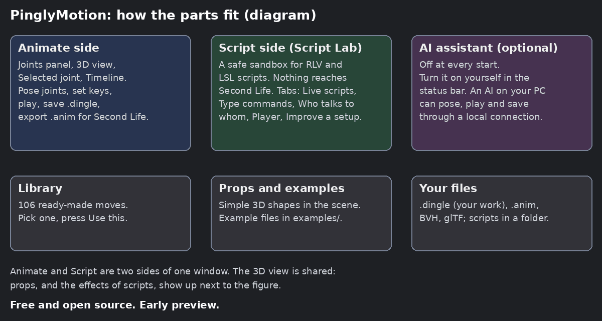

*Für dieses Handbuch gezeichnetes Diagramm.*

Das Programm ist ein Fenster mit zwei Seiten. Du wechselst mit den Schaltflächen **Animate** und **Script** oben links.

- **Animate** zeigt die Bereiche zum Erstellen einer Animation: die Joints-Liste, die 3D-Ansicht, den Bereich Selected joint und die Timeline.
- **Script** gibt den größten Teil des Fensters dem Script Lab. Die 3D-Ansicht bleibt links.

Jede Seite merkt sich ihr eigenes Layout. Die 3D-Ansicht ist gemeinsam. Eine Requisite (eine einfache 3D-Form) oder die Wirkung eines Scripts erscheint neben der Figur.

Weitere Teile:

- Die **Library** enthält 106 fertige Bewegungen. Du kannst mit einer davon beginnen.
- **Requisiten** sind einfache Formen, die du in der Szene platzieren kannst.
- Der Ordner **examples** neben dem Programm enthält Dateien, die du öffnen und mit diesem Handbuch nachvollziehen kannst.
- Der **AI Assistant** ist ein Schalter unten rechts. Er ist bei jedem Start aus.

### Für wen es gedacht ist

- **Einsteiger.** Du hast noch nie eine Animation gemacht oder ein Script geschrieben. Das Programm startet im Beginner-Modus. Es zeigt eine Willkommenskarte, Hinweiskarten und einen Helper-Bereich. Dieses Handbuch erklärt jedes Wort.
- **Erfahrene Nutzer.** Du kennst Animationswerkzeuge wie Maya oder Blender. Schalte den Expert-Modus ein (Shift+E). Dann bekommst du mehr Bedienelemente, zum Beispiel Kurvenbearbeitung und eine zweite Figur. Du kannst einen Maus- und Tastenstil von Maya, Blender oder Second Life wählen.

### Wo fange ich an?

- **Ich möchte eine Animation machen.** Lies den [Schnellstart](#schnellstart-die-ersten-fünf-minuten). Folge dann [Kapitel 3: Deine erste Animation](#kapitel-3-deine-erste-animation).
- **Ich möchte Scripts testen.** Gehe zu [Kapitel 10: Script Lab für Einsteiger](#kapitel-10-script-lab-für-einsteiger). Du brauchst vorher keine Animation.
- **Ich möchte, dass eine KI hilft.** Lies [Kapitel 11](#kapitel-11-ki-assistenten).
- **Ich möchte wissen, was funktioniert.** Lies [Was fertig ist und was nicht](#was-fertig-ist-und-was-nicht).

---

## Schnellstart: die ersten fünf Minuten

1. **Herunterladen.** Hole die Windows-Zip-Datei oder das Linux-AppImage von der Release-Seite (siehe [Kapitel 1](#kapitel-1-installieren-und-starten)).
2. **Starten.** Entpacke unter Windows die Zip-Datei. Starte `PinglyMotion.exe`. Mache unter Linux das AppImage ausführbar und starte es.
3. **Willkommenskarte.** Beim ersten Start erscheint „Make your first animation“. Wähle **New to animation**. Drücke **Standing**.

   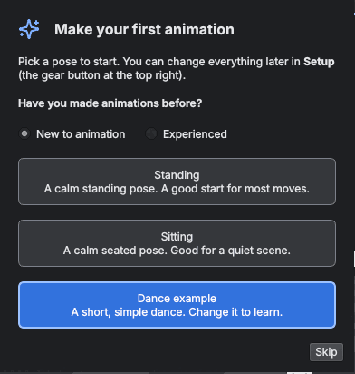

4. **Öffne die Joints-Liste.** Wähle **View > Joints**. Klicke in der Liste auf **Left Arm: Whole Arm**. Die Figur zeigt Ringe an diesem Gelenk.
5. **Speichere einen ersten Key.** Drücke unten auf dem Bildschirm **Set the first key**. Ein Key ist eine gespeicherte Pose zu einem Zeitpunkt.
6. **Posiere.** Ziehe den Zeitmarker (den Regler über der Start-Schaltfläche) nach rechts. Gib im Bereich **Selected joint** im Feld **Lean to the side** `-60` ein. Drücke Enter. Der Arm senkt sich. Das Programm speichert einen Key für dich.
7. **Abspielen.** Drücke **Start**. Drücke **Stop**, um anzuhalten.
8. **Speichern.** Drücke oben **Save** und wähle einen Namen. Die Datei endet auf `.dingle`.

Das ist eine ganze Animation. [Kapitel 3](#kapitel-3-deine-erste-animation) erklärt jeden Schritt. Um eine Datei für Second Life zu machen, drücke **Export** (siehe [Kapitel 9](#kapitel-9-dateien-und-formate)).

Was nicht fertig ist, steht in [Was fertig ist und was nicht](#was-fertig-ist-und-was-nicht).

---

## Was fertig ist und was nicht

Jeder Punkt trägt eines dieser Wörter:

- **Built.** Es funktioniert im Programm und hat automatische Tests.
- **Partly built.** Ein Teil funktioniert. Der Text sagt, was fehlt.
- **Trial.** Es existiert, ist aber ein Test. Es kann sich ändern oder kaputtgehen.
- **Not built.** Es ist geplant oder nur eine Idee.
- **Not tested in Second Life.** Das Programm tut auf deinem Computer, was es soll. Niemand hat bisher geprüft, ob Second Life das Ergebnis akzeptiert oder ausführt.

Die Daten stammen aus den Projektdokumenten vom 25. November 2026.

| Teil | Status | Hinweise |
|---|---|---|
| Gelenke posieren, Keys, Zeitleiste, Wiedergabe, Rückgängig | Built | Kapitel 3 bis 5. |
| Speichern als `.dingle`, `.dingle`, `.bvh`, `.avm` öffnen | Built | Alte `.avm`-Dateien lassen sich öffnen und werden als `.dingle` gespeichert. |
| Export für Second Life (`.anim`) | Built | Export, Upload und Wiedergabe einer Testanimation wurden in Second Life ausprobiert. |
| `.anim` importieren, BVH von einem anderen Skelett, glTF | Built | Fußsperre (verhindert, dass die Füße rutschen) ist **not built**. |
| Bibliothek mit 106 Bewegungen | Built | Die Bewegungen stammen aus offenen Quellen. Ihre Lizenzen werden im Bereich angezeigt. |
| Requisiten (Quader, Kugel, Kegel, Torus) | Built | Es sind einfache Formen. Eine Requisite lässt sich noch nicht umbenennen. |
| Zwei Figuren in einer Szene (Expert-Modus) | Built | Nur im Expert-Modus. |
| Gesichtsgelenke | Partly built | Die Gesichtsgelenke sind zurückgestellt. Der Reiter Face existiert, aber das Gesicht ist kein Schwerpunkt. |
| Script Lab: RLV-Befehle | Built | Eine Sandbox mit mehr als 200 RLV-Verhaltensweisen. **Not tested in Second Life.** Der letzte Test findet immer in Second Life statt. |
| Script Lab: LSL-Scripts laufen in einer Sandbox | Partly built | Mehr als 280 eingebaute Funktionen, eine simulierte Uhr. Manche Funktionen halten nur fest, worum sie gebeten wurden. Viele tun noch nichts. **Not tested in Second Life.** |
| Script Lab: Live scripts, Baum, Requisiten aus Prims | Built | Ein Ordner ist ein Objekt. Eine Requisite mit demselben Namen wie ein Prim gehört dazu. |
| Script Lab: Player, Who talks to whom, Record what I do | Built | **Not tested in Second Life.** Manche Teile der 3D-Ansicht folgen dem Player nicht (siehe Kapitel 10). |
| Script Lab: Improve a setup | Partly built | Die Speicherwerte schließen den Speicher aus, den der Code selbst belegt. Dafür ist eine Messung in Second Life nötig. |
| Script Lab: OpenCollar-Beispiel | Built | Ein echtes Halsband mit 23 Scripts läuft in der Sandbox. **Not tested in Second Life.** |
| Script Lab: Lua (SLua) | **Trial** | Hinter einem Schalter, der beim Start aus ist. Der Editor bekommt eine Sprachauswahl und eine Schaltfläche **Convert to SLua**. Noch führt nichts Lua aus. Keine Lua-Prüfungen oder Vorschläge. **Not tested in Second Life.** |
| Webversion (im Browser) | **Trial** | Es gibt nur einen Testbuild. Er läuft noch nicht gut. Plane nicht, ihn zu benutzen. |
| KI-Assistent (lokale Steuerung) | Built | Bei jedem Start aus. Claude: Eine Erweiterung wird mitgeliefert. ChatGPT und andere Werkzeuge: Die Einrichtung ist beschrieben, aber **von uns nicht getestet**. |
| Aurora-Live-Verbindung | Partly built | Funktioniert unter Windows mit einem speziellen Build (einem Fork) des Aurora-Viewers. Mit dem normalen Aurora funktioniert sie noch nicht. |
| Übersetzungen | Not built | Das Programm gibt es nur auf Englisch. Die Technik dafür ist vorhanden. |
| Code-Signierung für Windows | Not built | Windows warnt möglicherweise vor einem unbekannten Herausgeber. |
| Installer | Not built | Der Windows-Download ist eine Zip-Datei. |

Einige Unterschiede zwischen dem Programm und dem klickbaren Mockup auf der Website werden noch behoben. Wenn ein Bildschirm im Mockup anders aussieht, vertraue diesem Handbuch und dem Programm.

---

## Kapitel 1: Installieren und starten

### Windows

1. Öffne die Release-Seite des Projekts: <https://github.com/pingledingle-tech/PinglyMotion/releases>.
2. Lade die Windows-Zip-Datei herunter. Lade auch `SHA256SUMS` herunter, wenn du den Download prüfen willst.
3. Entpacke die Zip-Datei in einen Ordner deiner Wahl. Lass den Ordner `data` neben dem Programm liegen.
4. Starte `PinglyMotion.exe`.

Die Zip-Datei enthält außerdem den Ordner `examples` (Dateien, die in diesem Handbuch verwendet werden), den Ordner `library` und den Ordner `mcp` (für KI-Assistenten).

Es gibt keinen Installer. Um das Programm zu entfernen, lösche den Ordner.

### Linux

1. Lade das AppImage von der Release-Seite herunter.
2. Mache es ausführbar: `chmod +x PinglyMotion*.AppImage`.
3. Starte es.

### Was du brauchst

Eine Grafikkarte und einen Treiber mit OpenGL 3.3 oder neuer. Bleibt die 3D-Ansicht schwarz, aktualisiere deinen Grafiktreiber.

### Was das Programm auf deinem Computer schreibt

- Einstellungen: eine einfache Datei (`%APPDATA%\PinglyMotion` unter Windows, `~/.config/PinglyMotion` unter Linux).
- Ein Fehlerprotokoll und die Verbindungsdatei für den KI-Assistenten: in `%LOCALAPPDATA%\PinglyMotion` unter Windows oder `~/.local/share/PinglyMotion` unter Linux.
- Script-Lab-Beispiele, die du erstellst: in `Documents/PinglyMotion/Scripts`.

PinglyMotion sammelt keine personenbezogenen Daten und sendet keine Telemetrie. Das Programm prüft ungefähr einmal pro Woche, beim Start, ob es eine neuere Version gibt (die „Update check“).

### Erster Start

Beim ersten Start erscheint die Willkommenskarte (siehe Schnellstart). Wähle **Skip**, wenn du eine leere Figur willst. Du kannst die Karte mit **Help > Show the welcome card again** wieder anzeigen.

**Beispiel.** Starte das Programm. Drücke auf der Willkommenskarte **Skip**. Du siehst eine Figur in T-Pose (Arme gerade zur Seite gestreckt) auf einem karierten Boden.

---

## Kapitel 2: Das Fenster in einem Bild

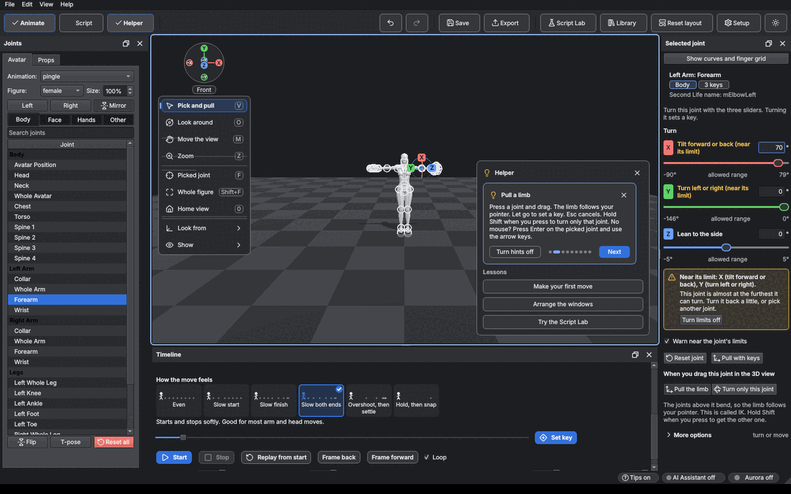

Von oben nach unten:

- **Menüleiste:** File, Edit, View, Help. Jeder Menüpunkt ist in [Kapitel 15](#kapitel-15-jeder-menüpunkt) aufgelistet.
- **Obere Leiste.** Von links nach rechts:
  - **Animate** und **Script** wechseln zwischen den beiden Seiten (F7 und F8).
  - **Helper** schaltet den Helper-Bereich ein und aus.
  - Die Pfeile Undo und Redo.
  - **Save** und **Export**.
  - **Script Lab** und **Library** öffnen diese Bereiche.
  - **Reset layout** setzt jeden Bereich an seinen Startplatz zurück.
  - **Setup** öffnet die Einstellungen.
  - Die Sonnen-Schaltfläche wechselt zwischen dunklem und hellem Design.
- **Joints-Bereich** (links): die Liste der Gelenke, mit den Reitern Avatar und Props.
- **3D-Ansicht** (Mitte): die Figur und der Boden. Oben links ist das **view-direction widget** (klicke auf ein Achsenende, um von dort zu schauen). Darunter ist die **view toolbar** mit den Werkzeugen Pick and pull, Look around, Move the view und Zoom.
- **Selected-joint-Bereich** (rechts): dreht das gewählte Gelenk.
- **Timeline** (unten): Keys über der Zeit, die Easing-Kacheln, der Zeitmarker und die Wiedergabeschaltflächen.
- **Statusleiste** (ganz unten): links eine Hilfezeile. Rechts: die Schalter **Tips**, **AI Assistant** und **Aurora**.

### Bereiche, die du verschieben und in der Größe ändern kannst

Jeder Bereich kann:

- an seinem Titel an eine neue Stelle gezogen werden,
- in ein eigenes Fenster **herausgelöst** werden (das kleine Quadrat-Symbol im Titel),
- in der Größe geändert werden, indem du die Trennlinien zwischen den Bereichen ziehst,
- mit dem X im Titel ausgeblendet werden.

Drücke **Tab**, um alle Bereiche aus- oder einzublenden. **View > Reset layout** (oder die Schaltfläche **Reset layout**) setzt alles zurück. Reset layout setzt beide Seiten zurück.

**Beispiel.** Ziehe die Timeline an ihrem Titel auf die rechte Seite. Drücke **Reset layout**. Sie springt wieder nach unten.

### Animate und Script

Drücke **Script** (oder F8). Das Script Lab füllt die rechte Seite des Fensters.

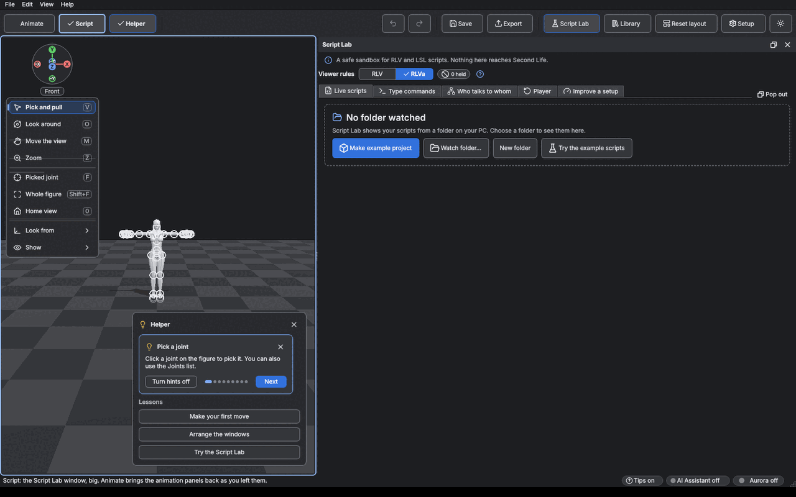

Drücke **Animate** (oder F7). Deine Animationsbereiche sind wieder so, wie du sie verlassen hast.

### Der Helper

Die Schaltfläche **Helper** zeigt einen kleinen Bereich unten rechts in der 3D-Ansicht. Er zeigt die nächste Hinweiskarte und drei kurze Lektionen:

- **Make your first move:** ein Gelenk wählen, es drehen, einen Key speichern und ansehen.
- **Arrange the windows:** die Library öffnen und dann jedes Fenster zurücksetzen.
- **Try the Script Lab:** zu Script wechseln und zurück.

Ein Ring markiert das echte Bedienelement, von dem ein Schritt spricht. Ein Schritt geht weiter, wenn du ihn ausführst. Drücke **Turn hints off**, um die Hinweiskarten zu beenden. Schalte den Helper aus, und das Programm ist aufgeräumt.

Die Helper-Schaltfläche und **Help > Show hints** (Shift+H) sind dieselbe Einstellung.

### Beginner und Expert

**View > Expert mode** (Shift+E) zeigt mehr Bedienelemente. Der Expert-Modus fügt hinzu:

- **Paste mirrored**,
- **Edit curve** in der Zeitleiste,
- ein Raster aller Fingergelenke in Grad auf dem Reiter Hands,
- einen Schalter, der jedes Gelenk in der Zeitleiste anzeigt,
- die zweite Figur (File > Add a second figure, im Library-Bereich: Add as a second figure).

Derselbe Schalter ist in **Setup**.

---

## Kapitel 3: Deine erste Animation

Du machst in etwa zehn Minuten eine kurze Armbewegung.

Zuerst drei Wörter.

- Ein **Key** ist eine gespeicherte Pose zu einem Zeitpunkt. Das Programm füllt die Bewegung zwischen zwei Keys aus.
- Ein **Frame** ist ein Zeitschritt.
- Der **Zeitmarker** ist der Regler, der den Moment wählt, den du siehst.

### Schritt 1: Start

1. Wähle **File > New animation** (Ctrl+N). Eine Figur erscheint.
2. Oder wähle **File > Open** und nimm `wave.dingle` aus dem Ordner `examples` neben dem Programm. Das ist eine fertige Animation zum Anschauen.

Die Figur steht in T-Pose.

### Schritt 2: Die Joints-Liste öffnen und ein Gelenk wählen

1. Wähle **View > Joints**. Der Joints-Bereich öffnet sich links.
2. Klicke in der Liste unter **Left Arm** auf **Whole Arm**. Oder klicke auf den Arm an der Figur.

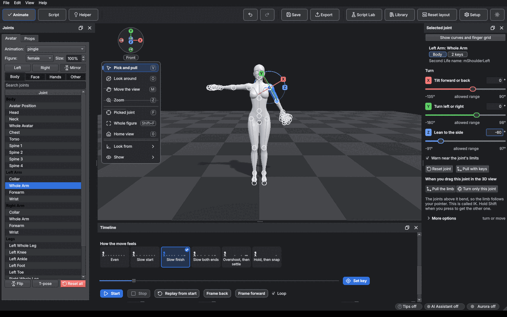

Der Bereich **Selected joint** zeigt den Namen des Gelenks und drei Regler: **Tilt forward or back**, **Turn left or right** und **Lean to the side**. Jeder zeigt seinen erlaubten Bereich.

### Schritt 3: Den ersten Key setzen

Drücke unten auf dem Bildschirm **Set the first key** (oder drücke **K**). Das Programm speichert die Pose, die du gerade siehst, als Key. Die Zeitleiste zeigt jetzt eine Zeile für dieses Gelenk.

Eine neue Animation hat 30 Frames. Der erste Frame ist gesperrt, um die erste Pose zu schützen. Dein erster Key kommt also auf Frame 2. Um den ersten Frame zu entsperren, schalte **Edit > Lock the first frame** aus.

### Schritt 4: Einen späteren Moment wählen

Ziehe den Zeitmarker (den Regler über der Schaltfläche **Start**) nach rechts. Der Text **Frame ... of ...** unten in der Zeitleiste zeigt, wo du bist. Die Figur behält die Pose des Keys davor.

Der Bereich Timeline ist nicht hoch. Wenn du den Regler und die Wiedergabeschaltflächen nicht siehst, scrolle innerhalb der Timeline oder ziehe die Trennlinie darüber nach oben.

### Schritt 5: Posieren

Mache eines davon:

- Gib in einem Feld des Bereichs Selected joint eine Zahl ein, zum Beispiel `-60` bei **Lean to the side**, und drücke Enter.
- Ziehe einen Regler.
- Ziehe einen farbigen Ring an der Figur. Rot dreht um X, grün um Y und blau um Z.
- Ziehe das Gelenk selbst. Das Glied folgt dem Zeiger. Halte **Shift**, um nur dieses Gelenk zu drehen.

Wenn du ein Gelenk drehst, wird sofort ein Key für dieses Gelenk gespeichert. Die Zeitleiste zeigt ihn. Die Statuszeile sagt „Key set at frame ... for ...“.

### Schritt 6: Wählen, wie sich die Bewegung anfühlt

Ist ein Key gewählt, zeigt die Zeitleiste sechs Kacheln unter **How the move feels**:

| Kachel | Bedeutung |
|---|---|
| Even | Die ganze Zeit gleiche Geschwindigkeit. |
| Slow start | Beginnt sanft und wird dann schneller. |
| Slow finish | Bewegt sich zügig und kommt dann zur Ruhe. Gut, um eine Hand abzulegen. |
| Slow both ends | Beginnt und endet sanft. Das ist die Voreinstellung für einen neuen Key. |
| Overshoot, then settle | Geht etwas zu weit und kommt dann zurück. |
| Hold, then snap | Bleibt still und springt dann. |

### Schritt 7: Abspielen

1. Drücke **Start**. Die Animation wird abgespielt.
2. Drücke **Stop**, um anzuhalten.
3. **Replay from start** spielt ab dem ersten Frame.
4. **Loop** (standardmäßig angehakt) spielt immer wieder ab.
5. **Frame back** und **Frame forward** gehen einen Frame zurück oder vor.

### Schritt 8: Speichern

1. Wähle **File > Save as...** (Ctrl+A) oder drücke oben **Save**.
2. Wähle einen Namen. Die Datei endet auf `.dingle`. Das ist das Arbeitsformat. Es bewahrt deine gesamte Arbeit.

### Schritt 9: Für Second Life exportieren

1. Drücke oben **Export** oder wähle **File > Export for Second Life (.anim)...** (Ctrl+Shift+E).
2. Ein kleines Fenster öffnet sich.

   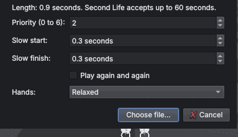

   - **Length** wird als Text angezeigt. Second Life akzeptiert bis zu 60 Sekunden.
   - **Priority (0 to 6):** Wenn zwei Animationen dasselbe Gelenk bewegen, gewinnt die höhere Zahl.
   - **Slow start** und **Slow finish:** wie lange die Animation zum Ein- und Ausblenden braucht.
   - **Play again and again:** die Schleifenpunkte verwenden.
   - **Hands:** wie die Finger beim Abspielen aussehen.
3. Drücke **Choose file...** und wähle einen Namen. Die Datei endet auf `.anim`.

Das Programm prüft die Animation beim Export gegen die Regeln von Second Life.

### Schritt 10: Zu Second Life hochladen

Das Hochladen geschieht im Second-Life-Viewer, nicht in PinglyMotion.

1. Wähle im Viewer **Build > Upload > Animation**. (Der genaue Menüname hängt von deinem Viewer ab.)
2. Wähle deine `.anim`-Datei.
3. Stelle dieselbe Priorität und Schleife ein wie im Exportfenster. Der Viewer verlangt eine kleine Gebühr.
4. Trage oder spiele die Animation ab, um sie zu sehen.

Ein ehrlicher Hinweis: Export, Upload und Wiedergabe einer Testanimation wurden in Second Life ausprobiert. Das Hochladen kostet in Second Life eine kleine Gebühr.

### Wenn etwas schiefgeht

- **Die Figur bewegt sich nicht.** Möglicherweise bist du auf dem gesperrten ersten Frame. Ziehe den Zeitmarker auf einen späteren Frame.
- **Ein Gelenk lässt sich nicht weiter drehen.** Es ist am äußersten Punkt. Drehe es zurück oder drücke in der Warnung **Turn limits off**.
- **Ein Key gefällt dir nicht.** Drücke Ctrl+Z zum Rückgängigmachen.
- **Die Ansicht ist verloren.** Drücke **0** für die Startansicht oder drücke **Whole figure** (Shift+F).
- **Beim Abspielen bewegt sich nichts.** Ein Gelenk braucht zwei Keys auf verschiedenen Frames.

---

## Kapitel 4: Posieren im Detail

### Der Joints-Bereich

Der Bereich hat zwei Reiter: **Avatar** und **Props** (Kapitel 7).

Auf dem Reiter Avatar, von oben nach unten:

- **Animation:** der Name der geöffneten Animation. Eine neue Animation heißt `pingle`.
- **Figure:** `female` oder `male`. Das ändert nur, was du siehst.
- **Size:** die Größe der Figur in der Ansicht (zu Beginn 100 %).
- **Left**, **Right** und **Mirror**: welche Seite die Liste zeigt und welche Seite eine Änderung betrifft. Der Tipp bei **Mirror** sagt: „turning one side turns the other side too“. Bewegt sich der andere Arm, obwohl du nur einen wolltest, drücke **Mirror**, um es auszuschalten.
- Vier Reiter: **Body**, **Face**, **Hands** und **Other**.
- **Search joints:** gib einen Teil eines Namens ein.
- Die Liste der Gelenke, in Gruppen: Body, Left Arm, Right Arm, Legs und mehr.
- **Flip:** spiegelt die ganze Pose von links nach rechts.
- **T-pose:** Arme gerade zur Seite gestreckt.
- **Reset all:** setzt jedes Gelenk zurück.

### Der Bereich Selected joint

Ist ein Gelenk gewählt, zeigt der Bereich:

- seinen Namen und wie viele Keys es hat,
- seinen Namen in Second Life (zum Beispiel `mShoulderLeft`),
- drei Regler mit Zahlenfeldern (in Grad) und dem **erlaubten Bereich**,
- eine Warnung, wenn du nahe an der Grenze bist. **Turn limits off** entfernt die Grenze. **Warn near the joint's limits** schaltet die Warnung aus,
- **Reset joint** und **Pull with keys**,
- **Pull the limb** und **Turn only this joint**: was das Ziehen am Gelenk bewirkt,
- **More options** mit **turn or move**: das Gelenk drehen oder bewegen,
- **Show curves and finger grid**, eine Schaltfläche oben im Bereich. Sie zeigt die zusätzlichen Bedienelemente des Expert-Modus. Eine zweite Schaltfläche, **Show all joints**, erscheint, wenn nichts gewählt ist.

Wenn du nichts gewählt hast, zeigt der Bereich drei kurze Schritte und eine Schaltfläche, die ein Gelenk für dich wählt.

### Ein Glied ziehen

Drücke auf ein Gelenk an der Figur und ziehe. Die Gelenke darüber beugen sich, sodass das Glied dem Zeiger folgt. Das heißt IK (inverse Kinematik). Lass los, um einen Key zu setzen. Esc bricht ab. Halte **Shift**, wenn du auf das Gelenk drückst, um nur dieses Gelenk zu drehen.

Keine Maus? Drücke **Enter** auf dem gewählten Gelenk. Benutze die Pfeiltasten. Drücke Enter, um einen Key zu setzen. Esc bricht ab.

### Hände

Auf dem Reiter **Hands** bekommst du:

- neun fertige Fingerposen,
- einen **Bend**-Regler für jeden Finger,
- **Reset hand**,
- im Expert-Modus ein Raster aller Fingergelenke in Grad.

**Mirror** kopiert eine Änderung auf die andere Hand. Die Zeile oben sagt, mit welcher Hand du arbeitest, zum Beispiel „Right hand. The other hand copies it.“

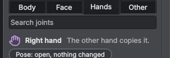

**Beispiel.** Öffne den Reiter **Hands**. Wähle eine der fertigen Posen. Drücke **Set key**.

### Face und Other

Der Reiter **Face** listet die Bento-Gesichtsgelenke: Kopf, Brauen, Augen, Ohren und mehr. Der Reiter **Other** listet die zusätzlichen Bento-Gelenke: Schwanz, Hinterbeine und Flügel. Mit **View > Joint groups** zeigst oder verbirgst du diese Gruppen. **Hide in lists** lässt verborgene Gelenke aus den Listen weg.

Die Gesichtsgelenke sind zurückgestellt: Sie sind da, bekommen aber noch keine besondere Aufmerksamkeit.

### Gelenkgrenzen

Jedes Gelenk hat den Bereich, den Second Life erlaubt. Nahe der Grenze warnt dich der Bereich. Die Grenzen sind standardmäßig an.

---

## Kapitel 5: Die Zeitleiste, Keys und Wiedergabe

### Zeilen

Die Zeitleiste zeigt eine Zeile für jedes Gelenk mit Änderungen und für das gewählte Gelenk. Die Zeilen sind nach Körperbereich eingefärbt und benannt. Das Feld **Show rows for** filtert nach Körperbereich. Der Expert-Modus fügt einen Schalter hinzu, der jedes Gelenk anzeigt.

Ohne Keys sagt die Zeitleiste **No keys yet** und bietet **Set the first key** an.

### Keys

- **Set key** (K) speichert die Pose, die du gerade siehst.
- Das Drehen eines Gelenks setzt von selbst einen Key.
- Eine Markierung in der Zeitleiste zeigt jeden Key.
- Wähle einen Key, um sein Easing zu ändern (Kapitel 3, Schritt 6).
- Im Expert-Modus zeichnet **Edit curve...** deine eigene Geschwindigkeitskurve für eine Bewegung. Das Fenster merkt sich Platz und Größe.

### Auswählen, kopieren und einfügen

1. Halte **Shift** und ziehe in der Zeitleiste, oder benutze Shift und die Pfeiltasten, um einen Abschnitt auszuwählen.
2. **Edit > Copy** (Ctrl+C), **Cut** (Ctrl+X) oder **Paste** (Ctrl+V).
3. **Paste mirrored** (Ctrl+Shift+V, Expert-Modus) fügt mit vertauschtem Links und Rechts ein. Ein linker Schritt wird ein rechter Schritt.

### Rückgängig und Wiederholen

Ctrl+Z macht rückgängig. Ctrl+Shift+Z oder Ctrl+Y wiederholt. Jede Änderung oder jedes Ziehen ist ein Schritt. Der Verlauf fasst bis zu 100 Schritte und übersteht Save.

### Schleifenpunkte

Unten in der Zeitleiste findest du:

- **Loop starts at** und **Loop ends at**: die zwei Frames, zwischen denen die Animation schleift, mit ihrer Position in Prozent,
- **Frame ... of ...**: wo du bist und wie viele Frames es gibt,
- **Frames per second** (zu Beginn 30).

Das Exportfenster benutzt die Schleifen-Frames, wenn **Play again and again** angehakt ist.

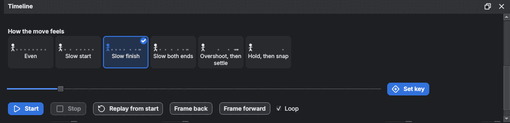

### Notizzeile

Manche Animationen tragen Lehrnotizen. Laut den Projektdokumenten zeigt dann eine Zeile unter der Zeitleiste die Notiz des aktuellen Frames, mit **Hide notes**. (Eine Prüfung von `wave.dingle` in der Linux-Version zeigte keine Notizzeile, behandle das also als unbestätigt.)

**Beispiel.** Öffne `wave.dingle` aus dem Ordner `examples`. Drücke **Start**. Sieh der Figur beim Winken zu. Drücke **Stop**.

### Langsames Beispiel

`jump_slow.dingle` ist `jump.dingle`, bei dem jeder Key 2,5-mal später liegt. Es läuft mit 40 Prozent der Geschwindigkeit, sodass du den Sprung in Zeitlupe sehen kannst.

---

## Kapitel 6: Die 3D-Ansicht und die Kamera

### Maus und Tasten

Der Standardstil, PinglyMotion genannt, funktioniert so:

| Was | Wie |
|---|---|
| Umschauen (Orbit) | Leeren Raum ziehen |
| Ansicht verschieben (Pan) | Mit rechts ziehen |
| Zoomen | Mausrad |
| Ein Gelenk wählen | Darauf klicken oder auf seine Zeile |
| Auf das gewählte Gelenk fokussieren | F oder Doppelklick darauf |

In **Setup** oder unter **Help > Camera and keys...** kannst du stattdessen den Stil von Maya, Blender oder Second Life wählen. Kapitel 14 hat die Tabellen.

### Die Ansichtsleiste

Oben links in der 3D-Ansicht:

- Das **view-direction widget:** klicke auf ein Achsenende, um von dort zu schauen.
- **Pick and pull** (V), **Look around** (O), **Move the view** (M), **Zoom** (Z).
- **Picked joint** (F), **Whole figure** (Shift+F), **Home view** (0).
- **Look from** (Front, Side, Top).
- **Show:** das Bodenraster, Drehringe, Gelenkpunkte und Werkzeugnamen.

Jede Einstellung gibt es auch im Menü **View**.

### Das Menü View

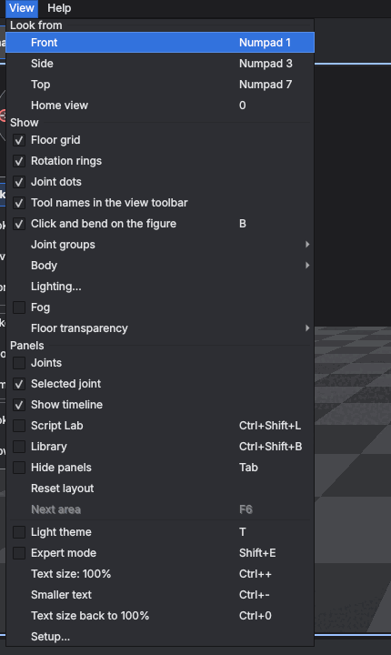

- **Look from:** Front (Numpad 1), Side (Numpad 3), Top (Numpad 7), Home view (0).
- **Show:** Floor grid, Rotation rings, Joint dots, Tool names in the view toolbar, **Click and bend on the figure** (B), Joint groups, Body, Lighting..., Fog, Floor transparency.
- **Joint groups** zeigt oder verbirgt Gruppen zusätzlicher Gelenke: Wings, Tail, Hind limbs, Face und Fingers and toes. Das Verbergen ändert nur, was du siehst. **Hide in lists** lässt verborgene Gelenke aus der Zeitleiste und der Gelenkliste weg. Ist es aus, werden sie abgedunkelt angezeigt.
- **Body** wählt das Körpernetz: **Ruth2** oder **Max**. Es ändert nur, wie die Figur aussieht.
- **Lighting...** öffnet ein kleines Fenster mit den Reglern **Brightness** (Dark bis Bright), **Shine** (Matt bis Shiny) und **Warmth** (Cool bis Warm), einem Häkchen **Shadow on the floor** und den Schaltflächen **Reset** und **Close**.
- **Fog** blendet das ferne Ende des Bodens aus. Zu Beginn ist es aus.
- **Floor transparency:** 0, 25, 33, 50 oder 75 Prozent.
- **Panels:** Joints, Selected joint, Show timeline, Script Lab, Library, Hide panels (Tab), Reset layout, Next area (F6).
- **Light theme** (T), **Expert mode** (Shift+E), Textgröße und **Setup...**.

**Beispiel.** Bewege den Zeiger über die 3D-Ansicht. Drücke **O** (look around) und ziehe. Drücke **M** und ziehe, um die Ansicht zu verschieben. Drücke **V**, um zum Wählen von Gelenken zurückzukehren. Drücke **0**, um nach Hause zu kommen.

### Textgröße

**Ctrl++** macht den Text größer, **Ctrl+-** kleiner und **Ctrl+0** zurück auf 100 Prozent. Setup bietet 100, 125, 150, 175 und 200 Prozent.

### Click and bend

Ist **Click and bend** an (B), wählt ein Klick auf die Figur ein Gelenk, und Ziehen beugt es. Ist es aus, tun Klicks auf die Figur nichts. Benutze die Joints-Liste und die Regler.

---

## Kapitel 7: Requisiten

Eine **Requisite** (Prop) ist eine einfache 3D-Form in der Szene. Sie steht für ein Objekt. Eine Requisite kann an ein Gelenk gehängt werden, sodass sie sich mit diesem Gelenk bewegt.

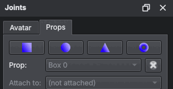

1. Wähle **View > Joints**. Öffne den Reiter **Props**.
2. Drücke eine Formschaltfläche: Quader, Kugel, Kegel oder Torus (ein Ring).
3. Das Programm benennt sie, zum Beispiel **Box 0**. Der nächste Quader ist **Box 1**. Eine Requisite lässt sich noch nicht umbenennen.
4. Platziere sie mit **Place**, **Turn** und **Size** im Bereich rechts, der jetzt **Selected prop** heißt. Dort kannst du auch die **Shape** ändern: Box, Ring, Cone oder Ball. Ein kleines Fenster über der 3D-Ansicht, **Edit prop**, hat die Werkzeuge **Move**, **Turn** und **Size** zum Ziehen.
5. Wähle ein Gelenk bei **Attach to**. Die Requisite bewegt sich mit diesem Gelenk.
6. Die Schaltfläche mit dem X löscht die Requisite.

**File > Save** bewahrt die Requisiten in der Animationsdatei. **File > Open** holt sie zurück. **File > Open props...** und **Save props...** benutzen die älteren `.prp`-Dateien. Beim Öffnen einer `.prp` werden zuerst die aktuellen Requisiten entfernt.

**Beispiel.** Öffne `throne.dingle` aus dem Ordner `examples`. Die Figur sitzt. Wähle **File > Open props...** und nimm `throne.prp`. Quader erscheinen um die Figur. Der gewählte ist blau. Wähle in der Liste **Prop:** einen anderen Namen, um ihn auszuwählen.

---

## Kapitel 8: Die Bibliothek

Die Bibliothek enthält 106 fertige Bewegungen. Benutze eine als Anfang.

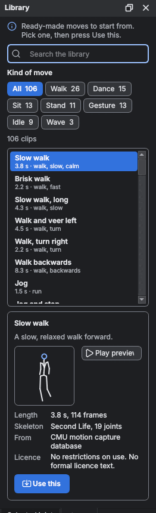

1. Drücke oben **Library** (oder Ctrl+Shift+B, oder **View > Library**).
2. Suche oder wähle eine Art von Bewegung: Walk, Dance, Sit, Stand, Gesture, Idle, Wave.
3. Wähle einen Clip. Der Bereich zeigt eine Vorschau an einer kleinen Figur und **Play preview**.
4. Er zeigt auch Länge, Skelett, Herkunft und Lizenz.
5. Drücke **Use this**. Der Clip öffnet sich als deine Animation. Das Programm fragt zuerst nach, wenn du ungespeicherte Änderungen hast. Die Statuszeile sagt „Opened Slow walk from the library. Save it under your own name.“ Der eigene Name des Clips ist der Name der Animation, bis du speicherst.

Die Library teilt sich die rechte Seite mit Selected joint. Wechsle mit den Reitern unten. Im Expert-Modus stellt **Add as a second figure** einen Clip stattdessen neben deine Figur.

**Beispiel.** Drücke **Library**. Wähle **Slow walk**. Drücke **Use this**. Drücke **Start**. Die Timeline zeigt dann 114 Frames.

Die Bibliothek stammt aus der CMU-Motion-Capture-Datenbank und von Mesh2Motion. Siehe [Kapitel 17](#kapitel-17-danksagung-und-quellen).

Sagt der Bereich **No library found**, fehlt der Ordner `library` neben dem Programm. Installiere das Programm neu.

---

## Kapitel 9: Dateien und Formate

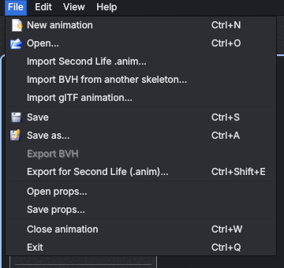

### Die Formate

| Endung | Was | Hinweise |
|---|---|---|
| `.dingle` | Das eigene Arbeitsformat von PinglyMotion | Bewahrt alles. Als Text (JSON) geschrieben. |
| `.anim` | Second-Life-Animation | Export und Import. |
| `.bvh` | Eine verbreitete Bewegungsdatei | Export und Öffnen. Eine geöffnete `.bvh` bleibt unberührt, bis du speicherst. |
| `.avm` | Das alte Format | Lässt sich öffnen. Wird als `.dingle` gespeichert. |
| `.prp` | Alte Requisitendatei | Open props und Save props. |
| `.glb`, `.gltf` | 3D-Animation aus anderen Werkzeugen | Nur Import. |

### Das Menü File

- **New animation** (Ctrl+N), **Open...** (Ctrl+O), **Save** (Ctrl+S), **Save as...** (Ctrl+A).
- **Import Second Life .anim...** öffnet eine `.anim` als neue, ungespeicherte Animation. Eine Liste **What could not be imported** sagt, was weggelassen wurde.
- **Import BVH from another skeleton...** zeigt, welche Gelenke zugeordnet und welche weggelassen wurden. Hake **My file starts in a T-pose or A-pose** an, wenn der erste Frame eine Standpose ist. Drücke **Open the animation**. Eine Zuordnung, die du machst, kann in einer kleinen `.jointmap`-Datei aufbewahrt werden.
- **Import glTF animation...** öffnet `.glb` oder `.gltf`. Hat die Datei mehr als eine Animation, wähle die gewünschten.
- **Export BVH** erzeugt eine `.bvh`-Datei.
- **Export for Second Life (.anim)...** (Ctrl+Shift+E).
- **Open props...** und **Save props...**.
- **Close animation** (Ctrl+W) und **Exit** (Ctrl+Q).

Jeder Import öffnet sich als unbenannte Animation. Deine Originaldatei wird nicht verändert. Speichere sie, um sie zu behalten.

**Beispiel.** Wähle **File > Open** und nimm `jump.dingle` in `examples`. Wähle **File > Save as...** und speichere sie unter einem neuen Namen. Wähle **File > Export for Second Life (.anim)...** und erzeuge `jump.anim`. Wähle **File > Import Second Life .anim...** und öffne sie wieder. Eine Meldung sagt „Opened jump.anim.“ und listet auf, was nicht importiert werden konnte. Für diese Datei sagt sie, dass Priorität, sanfter Start und Ausklang sowie Hände nicht erhalten bleiben. Die Bewegung selbst kommt zurück.

### Der Ordner für KI-Assistenten

Ein KI-Assistent kann nur in einem Ordner Dateien öffnen und speichern: `PinglyMotion` in deinem Ordner Dokumente. Siehe [Kapitel 11](#kapitel-11-ki-assistenten).

---

## Kapitel 10: Script Lab für Einsteiger

Das Script Lab ist eine sichere Sandbox. Du kannst RLV- und LSL-Scripts auf deinem Computer ausführen. Nichts erreicht Second Life. Benutze Scripts, denen du vertraust. Script Lab ist neu, und ein sehr ungewöhnliches Script kann das Programm zum Absturz bringen, also speichere zuerst deine Animation.

Zuerst einige Wörter.

- **LSL** ist die Scriptsprache von Second Life.
- Ein **Script** ist ein kleines Programm in einem Objekt.
- Ein **Objekt** besteht aus **Prims**. Ein Prim ist ein Teil, zum Beispiel ein Quader.
- **RLV** (Restrained Love Viewer) ist eine Reihe von Befehlen, die ein Script an einen Viewer senden kann. Sie schränken ein, was ein Avatar darf, zum Beispiel bedeutet `@detach=n` „das kann nicht abgelegt werden“.
- **RLVa** ist ein Viewer, der RLV und mehr versteht.
- Ein **Kanal** (Channel) ist eine Zahl, über die Scripts miteinander sprechen, wie ein Funkkanal.

**Ehrlicher Stand.** Das Script Lab ist in vielen Teilen gebaut. Nichts darin wurde in Second Life getestet. Die Sandbox ist nie identisch mit Second Life. Siehe [Was fertig ist und was nicht](#was-fertig-ist-und-was-nicht).

Öffne das Script Lab mit der Schaltfläche **Script** (F8) oder der Schaltfläche **Script Lab** (Ctrl+Shift+L).

### Der obere Teil des Fensters

- **Viewer rules:** **RLV** oder **RLVa**. Zu Beginn ist es RLVa. Das Umschalten entfernt jede Einschränkung, wie nach einer neuen Anmeldung.
- Ein Chip zeigt, wie viele Einschränkungen gehalten werden („0 held“).
- Fünf Reiter: **Live scripts**, **Type commands**, **Who talks to whom**, **Player**, **Improve a setup**.
- **Pop out** verschiebt das Script Lab in ein eigenes Fenster.

### Das Beispielprojekt erstellen

1. Drücke **Script**.
2. Drücke **Make example project**.

Das Programm kopiert das Beispiel **First colour** in deinen eigenen Ordner (`Documents/PinglyMotion/Scripts/First_colour`). Es fügt der Szene einen Quader hinzu. Es beobachtet den Ordner. Eine Karte **Steps** listet fünf Schritte auf und hakt sie ab.

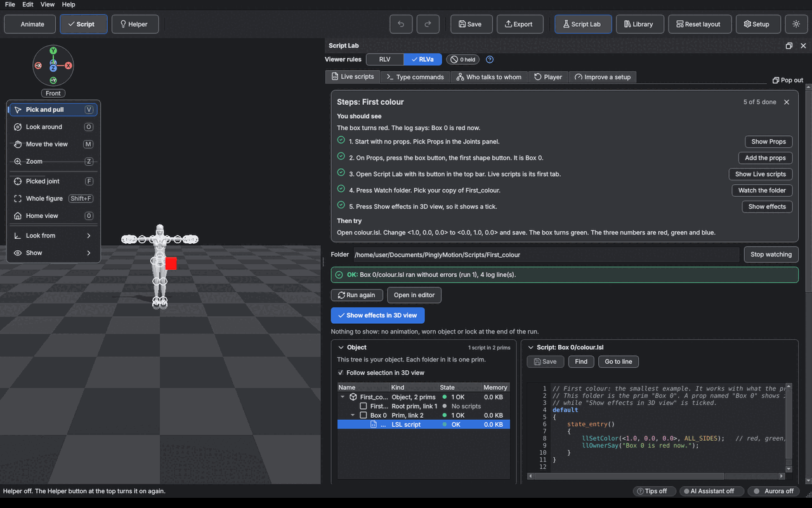

Du solltest sehen:

- einen roten Quader neben der Figur,
- die Meldung **OK: Box 0/colour.lsl ran without errors**,
- die Protokollzeile „Box 0 is red now.“

### Der Baum

Das Feld **Object** zeigt dein Objekt als Baum. Jeder Ordner ist ein Prim. Der Ordner **Box 0** ist ein Prim. Das Script darin ist die Zeile **LSL script**. Die Spalten sind **Name**, **Kind**, **State** und **Memory**.

Klicke auf eine Zeile. Ist **Follow selection in 3D view** angehakt, leuchtet die Requisite mit demselben Namen in der 3D-Ansicht auf.

### Das Script ändern

1. Das Script ist rechts im Editor geöffnet. (**Open in editor** öffnet es erneut.)
2. Ändere `<1.0, 0.0, 0.0>` in `<0.0, 1.0, 0.0>`.
3. Drücke **Save**.

Der Quader wird grün. Die drei Zahlen sind Rot, Grün und Blau. Jedes Speichern führt den Ordner erneut aus. Drücke **Run again**, um ihn ohne Änderung auszuführen.

Der Editor hat **Save**, **Find** und **Go to line**. Er zeigt beim Tippen Vorschläge und Hilfetexte zu LSL-Funktionen. Er schlägt auch RLV-Befehle innerhalb von `llOwnerSay("@...")` vor, mit klaren Warnungen. Wechsle in Setup zu **Show suggestions only when I press Ctrl+Space**, wenn du das bevorzugst.

### Effekte in der 3D-Ansicht zeigen

Die Schaltfläche **Show effects in 3D view** lässt Requisiten zeigen, was die Scripts tun: Farbe und Durchsichtigkeit. Eine Requisite, die wie ein Prim heißt, zeigt die Wirkung der Scripts dieses Prims. Ein Klick auf eine Requisite zählt als Berührung. Ein Menü, das ein Script zeigt (`llDialog`), erscheint als Feld über der 3D-Ansicht. Drücke darin eine Schaltfläche oder **Ignore** (Esc).

### Weitere Beispiele

Der Ordner `examples/objects` hat sechs weitere Objekte: Button HUD, Gear set, Timed lock, RLV relay und Work system. `examples/scriptlab` hat einzelne Scripts. Drücke **Try the example scripts** (wenn kein Ordner beobachtet wird), um `rlv_lock.lsl` auszuführen.

**Watch folder...** beobachtet jeden Ordner deiner Wahl. Ein Ordner ist ein Objekt. **New folder** erstellt einen neuen.

### Type commands

Der Reiter **Type commands** ist für RLV-Zeilen.

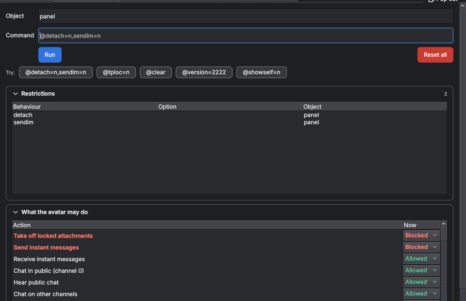

1. Öffne den Reiter **Type commands**.
2. Klicke in das Feld **Command**, tippe `@detach=n,sendim=n` und drücke Enter.
3. Der Reiter zeigt **Restrictions** (detach und sendim), gehalten vom Objekt `panel`. Unter **What the avatar may do** sagen **Take off locked attachments** und **Send instant messages** jetzt **Blocked**.

Die Chips unter **Try** füllen ein fertiges Beispiel ein. **Reset all** entfernt jede Einschränkung. Jede Zeile in der Aktionsliste ist eine Auswahl **Allowed / Blocked**, die du setzen kannst. Das Protokoll **Replies and messages** zeigt die Antworten, die ein Script hören würde.

Der Reiter hat außerdem Schalter für Kamerabegrenzungen, Umgebung und Ansichtsmodi in der 3D-Ansicht sowie einen Teil namens **Vision sphere**.

### Who talks to whom

Der Reiter **Who talks to whom** zeichnet eine Karte, während ein Ordner beobachtet wird. Öffne den Teil **Who talks to whom** mit einem Klick auf seine Überschrift. Beim Beispiel First colour siehst du ein Feld **Box 0** mit einem Pfeil zum gestrichelten Feld **You**, beschriftet mit `owner say: "Box 0 is red now."`.

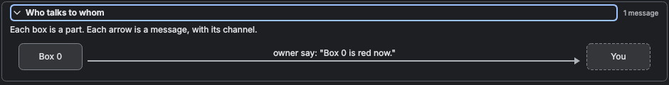

In größeren Aufbauten sind die Felder die Prims und außerdem **You**, **Your viewer (RLV)** und **Web server**. Pfeile zeigen Chat, Link-Nachrichten, Menüs und RLV-Zeilen mit ihrem Kanal. Ein Pfeil, den niemand hört, ist gestrichelt, rot und sagt, warum. Ein Prim, das lauscht und Befehle weitergibt, ist mit **(hub)** markiert. Ein Klick auf einen Pfeil zeigt die Script-Zeile, die ihn gesendet hat.

### Player

Drücke auf dem Reiter **Player** **Record what I do**. Klicke auf Requisiten oder drücke Menüschaltflächen. Jede Aktion ist ein Schritt. Drücke **Stop recording**.

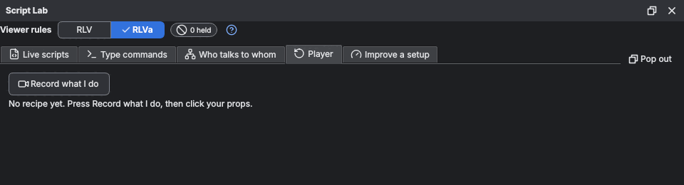

Das Programm speichert die Schritte als `recipe.rlvtest` im Objektordner. Es spielt sie erneut ab und sagt, was sich seit dem letzten Mal geändert hat. Der Player hat dieselben Schaltflächen Start, Stop, Step back und Step forward wie die Zeitleiste. Er listet die Momente und was in jedem galt. **Go to first difference** springt zur ersten Änderung.

Not built: Der Player bewegt weder die Animation noch die Kamera, die Umgebung oder das Menüfeld. Diese zeigen den Live-Lauf.

### Improve a setup

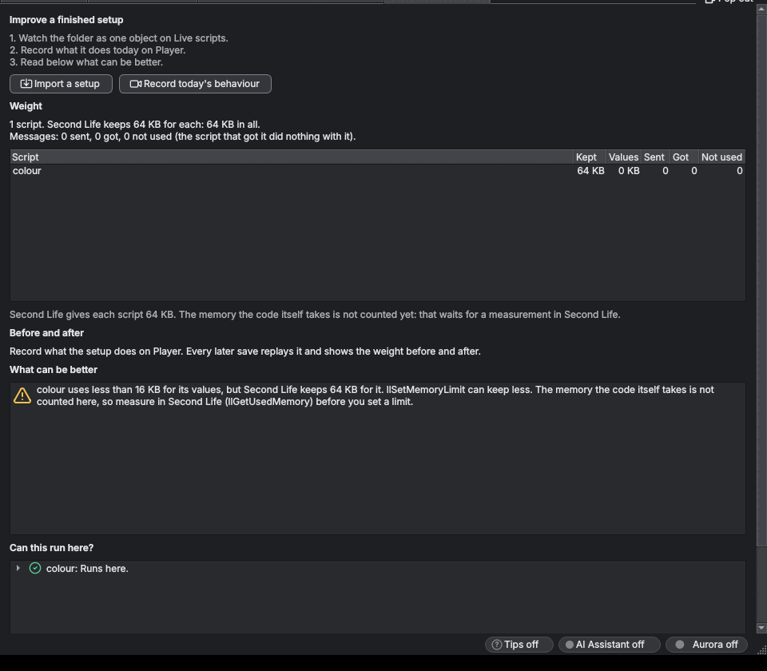

Für einen fertigen Aufbau, zum Beispiel ein Halsband:

1. Beobachte den Ordner als ein Objekt (Live scripts).
2. Nimm auf, was er tut (Player).
3. Lies den Reiter **Improve a setup**.

Er zeigt, wie schwer jedes Script ist (**Kept**, **Values**, **Sent**, **Got**, **Not used**), was besser sein kann und pro Script, ob es hier laufen kann. **Import a setup** und **Record today's behaviour** sind auf dem Reiter.

Der Speicher des Codes selbst wird noch nicht gezählt. Dafür ist eine Messung in Second Life nötig.

### Das OpenCollar-Beispiel

`examples/improve/OpenCollar` enthält die 23 Scripts des öffentlichen OpenCollar-Halsbands. Sie sind unverändert kopiert, mit ihrer Lizenz (GPL 2). Beobachte den Ordner. Das Halsband startet und zeigt sein Menü, wenn du darauf klickst. **Not tested in Second Life.**

### Lua (ein Test)

Lua ist eine neuere Scriptsprache in Second Life. Sie heißt SLua.

1. Öffne **Setup**. Hake **Lua (trial): show the language choice in the editor** an.
2. Der Editor zeigt ein Feld **Language** mit **LSL** und **SLua (Lua, trial)**.
3. Wähle SLua. Scrolle im Reiter Live scripts nach unten. Drücke am rechten Ende der Zeile unter dem Text **Convert to SLua**.

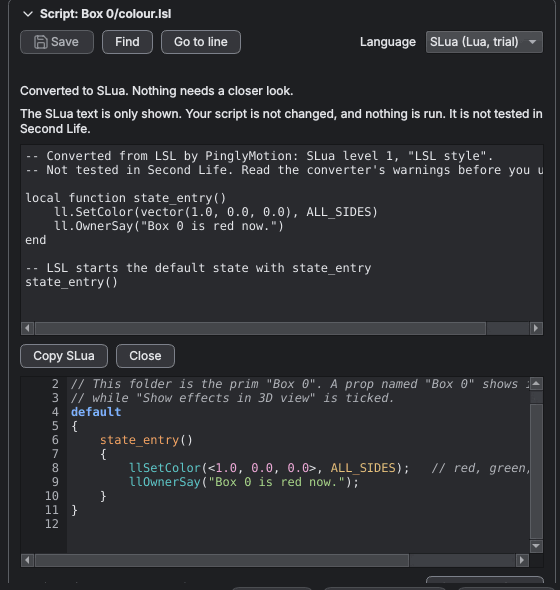

Der Bereich zeigt den umgewandelten Text und Hinweise. Dein Script wird nicht verändert. Nichts wird ausgeführt. **Copy SLua** kopiert den Text. **Close** schließt den Bereich.

Lua ist ein Test. Der Konverter wird durch Tests geprüft, die exakten Text vergleichen. Er ist **not tested in Second Life**. Es gibt keine Lua-Prüfungen oder Vorschläge, und Lua läuft nicht.

### Schritte und die Anleitung

**Help > Script Lab steps** zeigt die Schrittekarte wieder an.

---

## Kapitel 11: KI-Assistenten

Ein KI-Assistent auf deinem eigenen Computer kann die Figur posieren, abspielen, ansehen und speichern. Das ist optional. Er ist **bei jedem Start aus** und schaltet sich nie von selbst ein.

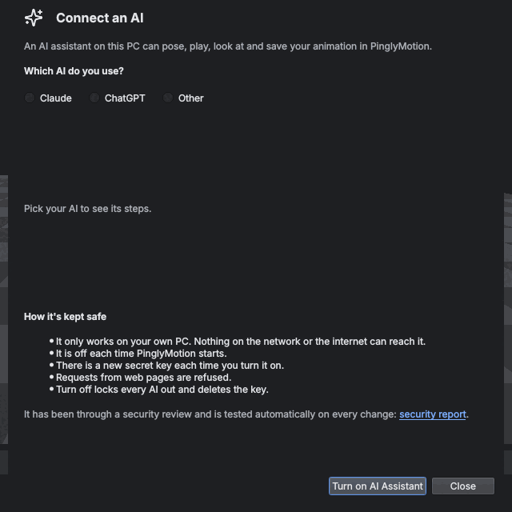

### Einschalten

1. Klicke in der Statusleiste (unten rechts) auf die Schaltfläche **AI Assistant**.
2. Der Dialog **Connect an AI** fragt „Which AI do you use?“ Wähle **Claude**, **ChatGPT** oder **Other**. Jede zeigt nur ihre eigenen Schritte.
3. Drücke **Turn on AI Assistant**.

Die Schaltfläche zeigt einen Punkt und ihren Zustand:

| Punkt | Text | Bedeutung |
|---|---|---|
| Grau | AI Assistant off | Aus. |
| Gelb | AI Assistant on, waiting for an AI | An, keine KI verbunden. |
| Grün | AI Assistant: Claude | Eine KI ist verbunden. |
| Rot | A wrong key was refused | Etwas hat einen falschen Schlüssel versucht. |

Der Fenstertitel sagt „AI Assistant on“, solange er an ist. Klicke die Schaltfläche erneut, um ihn auszuschalten. Das Ausschalten sperrt jede KI aus.

### Wie er sicher gehalten wird

- Er arbeitet nur auf deinem eigenen PC. Nichts im Netzwerk kann ihn erreichen.
- Er ist bei jedem Start von PinglyMotion aus.
- Bei jedem Einschalten gibt es einen neuen geheimen Schlüssel.
- Webseiten können ihm keine Befehle geben: Jeder Befehl braucht den geheimen Schlüssel.

### Was ein Assistent tun kann

Ein Assistent benutzt die Befehle der Steuerungsschnittstelle: den Zustand ansehen, Gelenke posieren, Frames setzen, abspielen, einen Screenshot machen, die Pose und die Bewegung in Worten beschreiben, eine ganze Animation als kleine Texttabelle lesen und schreiben, eine Animation gegen die Regeln von Second Life prüfen, `.anim` exportieren, die Bibliothek durchsuchen und das Script Lab benutzen (RLV-Befehle und LSL-Scripts). Die vollständige Liste steht in `docs/CONTROL.md` und `tools/mcp/commands.json`.

Der Assistent kann nur im Ordner `Documents/PinglyMotion` Dateien öffnen und speichern. Ein KI-Assistent, den du verbindest, kann das Programm auch bitten, Script-Dateien aus einem Ordner zu lesen. Das tut es nur, solange der AI Assistant eingeschaltet ist.

### Stand

- **Claude:** Die Windows-Zip-Datei enthält `mcp/PinglyMotion.mcpb`, eine Erweiterung für die Claude-App.
- **ChatGPT:** Die Einrichtung ist beschrieben. Die Schaltfläche schreibt die Konfiguration der Desktop-App. **Von uns nicht getestet.**
- **Andere Werkzeuge:** Die Datei `pinglymotion_mcp.js` bedient andere Werkzeuge, die MCP sprechen. **Von uns nicht getestet.**

Manuelle Arbeit funktioniert immer ohne jede KI. Die vollständige Statusliste steht in [Was fertig ist und was nicht](#was-fertig-ist-und-was-nicht).

---

**Beispiel.** Drücke die Schaltfläche **AI Assistant**. Wähle **Claude** und lies die Schritte. Drücke **Turn on AI Assistant** nur, wenn du eine KI verbinden willst. Drücke **Close**. Die Schaltfläche sagt weiterhin „AI Assistant off“.

### Die Steuerbefehle

Die Befehle, die ein Assistent benutzen kann, sind dieselben für jedes Programm auf deinem PC, das einfaches HTTP spricht. Sie werden von `GET /api/commands` und in `docs/CONTROL.md` aufgelistet. Kurz gesagt:

| Gruppe | Befehle |
|---|---|
| Ansehen | `state`, `joints`, `get_pose`, `keys`, `screenshot`, `describe_pose`, `describe_motion`, `describe_body` |
| Pose und Zeit | `set_pose`, `set_position`, `delete_key`, `set_frame`, `set_frame_count`, `set_fps`, `set_loop`, `play`, `stop` |
| Dateien | `new_animation`, `open_file`, `save_file`, `export_anim` |
| Die Ansicht | `set_figure`, `set_camera` |
| Ganze Animationen als Text | `motion_script`, `load_motion_script`, `check_animation` |
| Bibliothek | `find_reference`, `load_reference` |
| Script Lab | `rlv_command`, `rlv_state`, `rlv_reset`, `lsl_check`, `lsl_lint`, `lsl_run`, `lsl_event`, `lab_watch`, `lab_unwatch`, `lab_result`, `lab_replay` |

Du musst diese nicht kennen, um PinglyMotion zu benutzen. Sie sind für KI-Werkzeuge und für Leute, die Scripts rund um das Programm schreiben.

---

## Kapitel 12: Die Live-Verbindung zu Aurora

Aurora ist ein Second-Life-Viewer. PinglyMotion kann deine Pose auf deinem eigenen Avatar in Aurora zeigen, während du arbeitest. Nur du siehst sie. Nichts wird hochgeladen.

**Stand.** Es funktioniert unter Windows. Es braucht Aurora, gebaut aus dem Fork, der in `docs/AURORA_LINK.md` genannt wird. Mit dem normalen Aurora funktioniert es noch nicht.

**Beispiel.** Mit laufendem Aurora-Fork:

1. Wähle in Aurora **Build > LiveMesh > Enable preview**.
2. Hake in PinglyMotion in **Setup** **Live link to Aurora** an oder klicke auf den Punkt in der Statusleiste.
3. Die Statusleiste sagt „Waiting for Aurora“, dann „Aurora live“.
4. Drehe ein Gelenk. Dein Avatar nimmt die Pose an.

Die Verbindung ist bei jedem Start aus.

---

## Kapitel 13: Einrichtung, Designs und Hilfe

Drücke **Setup** (das Zahnrad oben rechts).

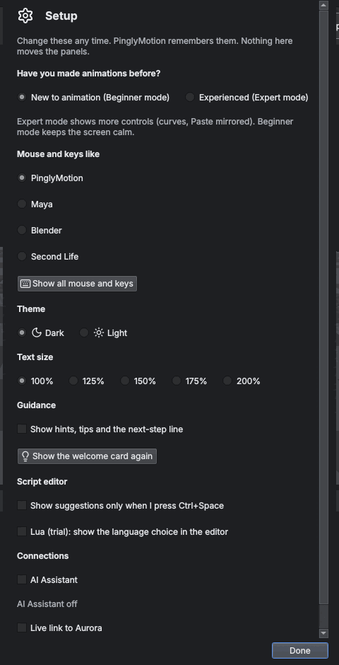

- **Have you made animations before?** New to animation (Beginner-Modus) oder Experienced (Expert-Modus).
- **Mouse and keys like:** PinglyMotion, Maya, Blender oder Second Life. **Show all mouse and keys** öffnet die Tabelle.
- **Theme:** Dark oder Light.
- **Text size:** 100, 125, 150, 175 oder 200 Prozent.
- **Guidance:** **Show hints, tips and the next-step line** und **Show the welcome card again**.
- **Script editor:** **Show suggestions only when I press Ctrl+Space** und der Schalter **Lua (trial)**.
- **Connections:** **AI Assistant** und **Live link to Aurora**.

PinglyMotion merkt sich diese Auswahl.

### Das Menü Help

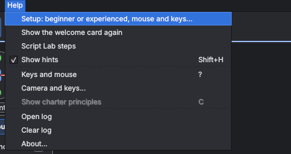

- **Setup: beginner or experienced, mouse and keys...**
- **Show the welcome card again**
- **Script Lab steps**
- **Show hints** (Shift+H)
- **Keys and mouse** (?)
- **Camera and keys...**
- **Show charter principles** (C), wenn verfügbar
- **Open log** und **Clear log**
- **About...**: wer die Avatarkörper gemacht hat und unter welcher Lizenz.

**Beispiel.** Drücke **Setup**. Wähle unter **Theme** **Light**. Wähle unter **Text size** **150%**. Drücke **Done**. Beide Änderungen bleiben beim nächsten Start erhalten.

### Hinweise und Tipps

Neun Hinweiskarten führen durch die ersten Schritte. **Next** geht weiter. **Turn hints off** beendet sie. Der Statusleistenschalter **Tips on/off** zeigt oder verbirgt kurze Hilfen, wenn der Zeiger auf einem Bedienelement ruht.

---

## Kapitel 14: Tastenkürzel und Maus

### Überall

| Tasten | Was |
|---|---|
| Ctrl+N | New animation |
| Ctrl+O | Open |
| Ctrl+S | Save |
| Ctrl+A | Save as |
| Ctrl+Shift+E | Export for Second Life |
| Ctrl+W | Close animation |
| Ctrl+Q | Exit |
| Ctrl+Z | Rückgängig |
| Ctrl+Shift+Z oder Ctrl+Y | Wiederholen |
| K | Set key |
| Ctrl+X, Ctrl+C, Ctrl+V | Ausschneiden, kopieren, einfügen |
| Ctrl+Shift+V | Paste mirrored (Expert-Modus) |
| F7, F8 | Animate-Seite, Script-Seite |
| Ctrl+Shift+L | Script Lab |
| Ctrl+Shift+B | Library |
| Tab | Alle Bereiche aus- oder einblenden |
| F6 | Next area |
| T | Helles oder dunkles Design |
| Shift+E | Expert-Modus |
| Shift+H | Hinweise an oder aus |
| ? | Keys and mouse |
| Ctrl++, Ctrl+-, Ctrl+0 | Text größer, kleiner, zurück auf 100 % |
| Alt+1, Alt+2 | Die erste oder zweite Figur wählen (Expert-Modus) |

### In der 3D-Ansicht

| Tasten | Was |
|---|---|
| V, O, M, Z | Werkzeuge: pick and pull, look around, move the view, zoom |
| F | Auf das gewählte Gelenk fokussieren |
| Shift+F | Whole figure |
| 0 | Home view |
| Numpad 1, 3, 7 (oder 1, 3, 7) | Front, side, top |
| Alt + Pfeiltasten | Mit Tasten umschauen |
| Page Up, Page Down | Mit Tasten zoomen |
| B | Click and bend an oder aus |
| Esc | Ein Ziehen abbrechen |
| Enter auf einem gewählten Gelenk | Mit den Pfeiltasten ziehen; Enter setzt einen Key |

### Die Kamerastile

| Aktion | PinglyMotion | Maya | Blender | Second Life |
|---|---|---|---|---|
| Umschauen | Leeren Raum ziehen | Alt + mit links ziehen | Mit Mitte ziehen | Alt + ziehen (seitwärts), Ctrl + Alt + ziehen |
| Ansicht verschieben | Mit rechts ziehen | Alt + mit Mitte ziehen | Shift + mit Mitte ziehen | Ctrl + Alt + Shift + ziehen |
| Zoomen | Mausrad | Alt + mit rechts ziehen, oder Rad | Ctrl + mit Mitte ziehen, oder Rad | Alt + nach oben oder unten ziehen, oder Rad |
| Ein Gelenk wählen | Darauf klicken oder auf seine Zeile | Klick | Klick | Klick |
| Auf das Gelenk fokussieren | F oder Doppelklick | F | Numpad . | Alt + Klick |

### Gelenke

| Was | Wie |
|---|---|
| Ein Glied ziehen | Auf ein Gelenk drücken und ziehen. Loslassen setzt einen Key. Esc bricht ab. |
| Nur dieses Gelenk drehen | Shift halten, wenn du auf das Gelenk drückst |
| Auf einer Achse drehen | Den roten X-, grünen Y- oder blauen Z-Ring ziehen |

Dieselbe Tabelle gibt es im Programm: **Help > Keys and mouse**.

**Beispiel.** Drücke **?**, um die Tabelle zu öffnen. Schließe sie. Drücke **Shift+E**, um den Expert-Modus einzuschalten, und noch einmal, um ihn auszuschalten.

---

## Kapitel 15: Jeder Menüpunkt

### File

Siehe [Kapitel 9](#kapitel-9-dateien-und-formate).

### Edit

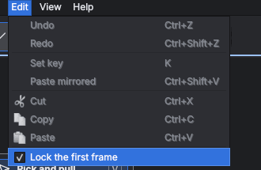

| Punkt | Tasten | Was |
|---|---|---|
| Undo, Redo | Ctrl+Z, Ctrl+Shift+Z | Eine Änderung zurücknehmen und wiederholen. |
| Set key | K | Die Pose jetzt als Key speichern. |
| Paste mirrored | Ctrl+Shift+V | Mit vertauschtem Links und Rechts einfügen. |
| Cut, Copy, Paste | Ctrl+X, C, V | Auf den gewählten Abschnitt der Zeitleiste. |
| Lock the first frame | | Standardmäßig an. Hält die erste Pose sicher. |

### View

Siehe [Kapitel 6](#kapitel-6-die-3d-ansicht-und-die-kamera).

### Help

Siehe [Kapitel 13](#kapitel-13-einrichtung-designs-und-hilfe).

**Beispiel.** Öffne das Menü **Help** und wähle **About...**. Schließe es. Öffne **View** und wähle **Floor transparency**, dann 50 %.

### Schaltflächen der oberen Leiste

| Schaltfläche | Was |
|---|---|
| Animate, Script | Seiten wechseln (F7, F8) |
| Helper | Helper-Bereich an oder aus |
| Undo, Redo | Wie Edit |
| Save | Die Animation speichern |
| Export | Für Second Life exportieren |
| Script Lab | Script Lab öffnen |
| Library | Die Library öffnen |
| Reset layout | Jeden Bereich zurücksetzen |
| Setup | Setup öffnen |
| Sonnen-Schaltfläche | Dunkles oder helles Design |

---

## Kapitel 16: Fehlersuche und Rückmeldung

- **Die 3D-Ansicht ist schwarz.** Aktualisiere den Grafiktreiber. PinglyMotion braucht OpenGL 3.3.
- **Windows warnt vor einem unbekannten Herausgeber.** Das Programm ist noch nicht signiert. Das ist in der frühen Vorabversion zu erwarten.
- **Ein Bereich ist verschwunden.** Drücke **Reset layout**.
- **Der Text ist zu klein.** Drücke Ctrl++ oder wähle in Setup eine Textgröße.
- **Die Bibliothek sagt „No library found“.** Der Ordner `library` muss neben dem Programm liegen.
- **Eine importierte Datei bewegt sich nicht richtig.** Öffne die Liste im Importfenster. Mit **Left out** markierte Gelenke wurden nicht übernommen.
- **Ein Script tut im Script Lab nichts.** Lies den Teil **Errors and warnings**. Die Sandbox führt das meiste von LSL aus, aber nicht alles.
- **Etwas ist kaputtgegangen.** Wähle **Help > Open log**. Das Protokoll ist eine einfache Textdatei darüber, was das Programm getan hat.

### Einen Fehler melden oder Rückmeldung geben

Gehe zu <https://github.com/pingledingle-tech/PinglyMotion/issues> und eröffne ein Issue. Sage, was du getan hast, was du erwartet hast und was passiert ist. Schreibe keine persönlichen Daten in das Issue. Die Website hat auch Seiten für Fehlerberichte und Vorschläge.

---

## Kapitel 17: Danksagung und Quellen

PinglyMotion ist kostenlos und Open Source. Es basiert auf QAvimator. Die Avatarkörper, die Bibliotheksclips, das Beispielhalsband und das andere fremde Material sind in der Datei [CREDITS.md](../CREDITS.md) und unter **Help > About...** genannt.

Die fertigen Bewegungen stammen aus der CMU-Motion-Capture-Datenbank und von Mesh2Motion (CC0). Das Beispielhalsband ist das öffentliche OpenCollar-Projekt (GPL 2).

PinglyMotion ist freie Software. Du darfst es unter der GNU General Public License, Version 2 oder später, nutzen, untersuchen, weitergeben und ändern. Es enthält die Arbeit anderer unter deren eigenen Lizenzen, zum Beispiel das Qt-Toolkit, Avatarkörper, Bewegungsclips und Beispielscripts. Die vollständige Liste mit jeder Lizenz steht in [CREDITS.md](../CREDITS.md).

PinglyMotion ist ein unabhängiges Projekt. Es wird nicht von Linden Research, Inc. (Linden Lab) hergestellt, empfohlen oder unterstützt. Second Life und Linden Lab sind Marken von Linden Research, Inc. Firestorm, Aurora, OpenCollar und andere Namen gehören ihren Inhabern.

---

## Glossar

| Wort | Bedeutung |
|---|---|
| Animation | Die gesamte Bewegung in einer Datei. |
| Key | Eine gespeicherte Pose zu einem Zeitpunkt. |
| Frame | Ein Zeitschritt. |
| Zeitmarker | Der Marker, den du zum Wählen eines Moments ziehst. |
| Zeitleiste | Der Streifen, der deine Keys über der Zeit zeigt. |
| Gelenk | Ein Teil, das sich dreht, zum Beispiel ein Ellbogen. |
| Pose | Wie die Figur zu einem Zeitpunkt steht. |
| Easing | Wie eine Bewegung zwischen zwei Keys schneller oder langsamer wird. |
| Schleife | Die Animation wird immer wieder abgespielt. |
| T-Pose | Stehen mit den Armen gerade zur Seite gestreckt. |
| Requisite | Eine einfache 3D-Form in der Szene. |
| Prim | Ein Teil eines Objekts in Second Life. |
| LSL | Die Scriptsprache von Second Life. |
| RLV | Befehle, die ein Script senden kann, um einen Avatar einzuschränken. |
| Kanal | Eine Zahl, über die Scripts miteinander sprechen. |
| Sandbox | Ein sicherer Ort zum Ausprobieren. Nichts verlässt ihn. |
| IK | Wird eine Hand bewegt, bewegen sich die Gelenke darüber mit. |
