# PinglyMotion User Manual

For PinglyMotion 0.3.0, an early preview. Written for people who are new to animation and to scripting.

This manual says what each part of the program does. It says what is finished and what is not. Where something is a trial, or not tested in Second Life, it says so.

All pictures are real screenshots of the program (Linux build, dark theme). The one picture marked "diagram" was drawn for this manual.

**Contents**

- [Start here](#start-here): what it is, the big picture, who it is for, where to start
- [Quick start: the first five minutes](#quick-start-the-first-five-minutes)
- [What is finished and what is not](#what-is-finished-and-what-is-not)
- [Chapter 1: Install and start](#chapter-1-install-and-start)
- [Chapter 2: The window in one picture](#chapter-2-the-window-in-one-picture)
- [Chapter 3: Your first animation](#chapter-3-your-first-animation)
- [Chapter 4: Posing in detail](#chapter-4-posing-in-detail)
- [Chapter 5: The timeline, keys and playback](#chapter-5-the-timeline-keys-and-playback)
- [Chapter 6: The 3D view and the camera](#chapter-6-the-3d-view-and-the-camera)
- [Chapter 7: Props](#chapter-7-props)
- [Chapter 8: The library](#chapter-8-the-library)
- [Chapter 9: Files and formats](#chapter-9-files-and-formats)
- [Chapter 10: Script Lab for beginners](#chapter-10-script-lab-for-beginners)
- [Chapter 11: AI assistants](#chapter-11-ai-assistants)
- [Chapter 12: The live link to Aurora](#chapter-12-the-live-link-to-aurora)
- [Chapter 13: Setup, themes and help](#chapter-13-setup-themes-and-help)
- [Chapter 14: Keyboard shortcuts and mouse](#chapter-14-keyboard-shortcuts-and-mouse)
- [Chapter 15: Every menu item](#chapter-15-every-menu-item)
- [Chapter 16: Troubleshooting and feedback](#chapter-16-troubleshooting-and-feedback)
- [Chapter 17: Credits](#chapter-17-credits)
- [Glossary](#glossary)

---

## Start here

### What PinglyMotion is for

Second Life is a virtual world. People there use animations to make their avatars stand, sit, dance and wave. An **animation** is a movement saved in a file.

PinglyMotion helps you make those movements. It is for free. It is open source, which means anyone can read and improve the program.

PinglyMotion does three things:

1. **Animate a figure.** You bend the joints of a 3D figure. You save poses at moments in time. The program fills in the movement between them. You export the result for Second Life.
2. **Test scripts safely.** Objects in Second Life use scripts. PinglyMotion has a safe sandbox, the **Script Lab**, where you can run RLV and LSL scripts on your own computer. Nothing you do there reaches Second Life.
3. **Work with an AI helper, if you want.** An AI assistant on your own computer can pose the figure for you. It is off until you turn it on. Everything works without it.

PinglyMotion is an **early preview**. It is made for trying out and for feedback. Expect rough edges. See [What is finished and what is not](#what-is-finished-and-what-is-not).

### The big picture

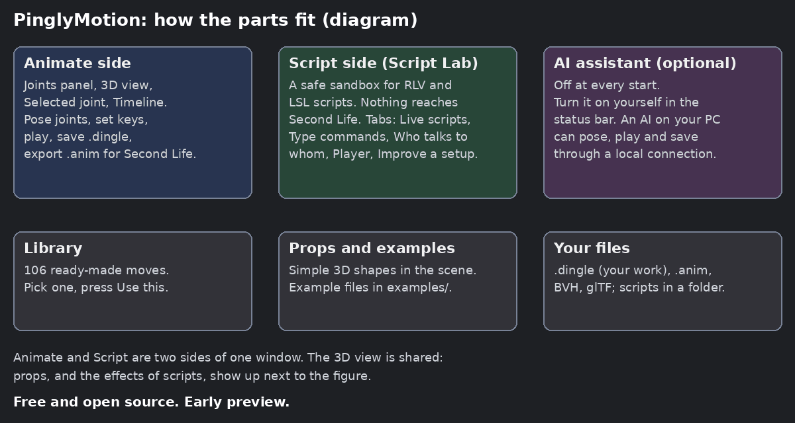

*Diagram drawn for this manual.*

The program is one window with two sides. You switch with the buttons **Animate** and **Script** at the top left.

- **Animate** shows the panels for making an animation: the Joints list, the 3D view, the Selected joint panel and the Timeline.
- **Script** gives most of the window to the Script Lab. The 3D view stays on the left.

Each side remembers its own layout. The 3D view is shared. A prop (a simple 3D shape) or the effect of a script shows up next to the figure.

Other parts:

- The **Library** holds 106 ready-made moves. You can start from one.
- **Props** are simple shapes you can place in the scene.
- The folder **examples** next to the program holds files you can open and follow along with this manual.
- The **AI assistant** is a switch at the bottom right. It is off at every start.

### Who it is for

- **Beginners.** You have never made an animation or written a script. The program starts in Beginner mode. It shows a welcome card, hint cards and a Helper panel. This manual explains each word.
- **Experienced users.** You know animation tools such as Maya or Blender. Switch on Expert mode (Shift+E). You get more controls, such as curve editing and a second figure. You can choose a mouse and key style from Maya, Blender or Second Life.

### Where do I start?

- **I want to make an animation.** Read the [Quick start](#quick-start-the-first-five-minutes). Then follow [Chapter 3: Your first animation](#chapter-3-your-first-animation).
- **I want to test scripts.** Go to [Chapter 10: Script Lab for beginners](#chapter-10-script-lab-for-beginners). You need no animation first.
- **I want an AI to help.** Read [Chapter 11](#chapter-11-ai-assistants).
- **I want to know what works.** Read [What is finished and what is not](#what-is-finished-and-what-is-not).

---

## Quick start: the first five minutes

1. **Download.** Get the Windows zip or the Linux AppImage from the release page (see [Chapter 1](#chapter-1-install-and-start)).
2. **Start.** On Windows, extract the zip. Start `PinglyMotion.exe`. On Linux, make the AppImage executable and start it.
3. **Welcome card.** The first start shows "Make your first animation". Choose **New to animation**. Press **Standing**.

   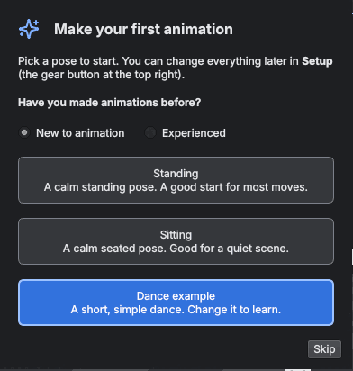

4. **Open the Joints list.** Choose **View > Joints**. Click **Left Arm: Whole Arm** in the list. The figure shows rings on that joint.
5. **Save a first key.** Press **Set the first key** at the bottom of the screen. A key is a saved pose at one moment.
6. **Pose.** Drag the time marker (the slider above the Start button) to the right. In the panel **Selected joint**, type `-60` in the box **Lean to the side**. Press Enter. The arm lowers. The program saves a key for you.
7. **Play.** Press **Start**. Press **Stop** to stop.
8. **Save.** Press **Save** at the top and choose a name. The file ends in `.dingle`.

That is a whole animation. [Chapter 3](#chapter-3-your-first-animation) explains each step. To make a file for Second Life, press **Export** (see [Chapter 9](#chapter-9-files-and-formats)).

What is not finished is listed in [What is finished and what is not](#what-is-finished-and-what-is-not).

---

## What is finished and what is not

Each item has one of these words:

- **Built.** It works in the program and has automatic tests.
- **Partly built.** Some of it works. The text says what is missing.
- **Trial.** It exists, but it is a test. It may change or break.
- **Not built.** It is planned or only an idea.
- **Not tested in Second Life.** The program does what it should on your computer. Nobody has checked yet that Second Life accepts or runs the result.

Dates are from the project documents of 25 November 2026.

| Part | Status | Notes |
|---|---|---|
| Posing joints, keys, timeline, playback, undo | Built | Chapters 3 to 5. |
| Save as `.dingle`, open `.dingle`, `.bvh`, `.avm` | Built | Old `.avm` files open and are saved as `.dingle`. |
| Export for Second Life (`.anim`) | Built | Export, upload and playback were validated in Firestorm on 21 November 2026: timing, loop, slow start and finish, hands, easing. Other viewers were not checked. |
| Import `.anim`, BVH from another skeleton, glTF | Built | Foot lock (keeping feet from sliding) is **not built**. |
| Library of 106 moves | Built | The moves come from open sources. Their licences are shown in the panel. |
| Props (box, sphere, cone, torus) | Built | They are simple shapes. A prop cannot be renamed yet. |
| Two figures in one scene (Expert mode) | Built | Only in Expert mode. |
| Face joints | Partly built | Face joints are parked. The Face tab exists, but the face is not a focus. |
| Script Lab: RLV commands | Built | A sandbox with 206 RLV behaviours. **Not tested in Second Life.** The final test is always in Second Life. |
| Script Lab: LSL scripts run in a sandbox | Partly built | 282 built-in functions, a simulated clock. Some functions only record what they were asked. Many do nothing yet. **Not tested in Second Life.** |
| Script Lab: Live scripts, tree, props from prims | Built | One folder is one object. A prop with the same name as a prim belongs to it. |
| Script Lab: Player, Who talks to whom, Record what I do | Built | **Not tested in Second Life.** Some parts of the 3D view do not follow the player (see Chapter 10). |
| Script Lab: Improve a setup | Partly built | Memory counts exclude the memory the code itself takes. That needs a measurement in Second Life. |
| Script Lab: OpenCollar example | Built | A real collar with 23 scripts runs in the sandbox. **Not tested in Second Life.** |
| Script Lab: Lua (SLua) | **Trial** | Behind a switch that is off at start. The editor gets a language choice and a **Convert to SLua** button. Nothing runs Lua yet. No Lua checks or suggestions. **Not tested in Second Life.** |
| Web version (in a browser) | **Trial** | There is a trial build only. It does not run well yet. Do not plan to use it. |
| AI assistant (local control) | Built | Off at every start. Claude: an extension is provided. ChatGPT and other tools: setup is written but **not tested by us**. |
| Aurora live link | Partly built | Works on Windows with a special build (a fork) of the Aurora viewer. It does not work with the normal Aurora yet. |
| Translations | Not built | The program is English only. The plumbing exists. |
| Windows code signing | Not built | Windows may warn about an unknown publisher. |
| Installer | Not built | The Windows download is a zip file. |

Some differences between the program and the clickable mockup on the website are still being fixed. If a screen in the mockup looks different, trust this manual and the program.

---

## Chapter 1: Install and start

### Windows

1. Open the release page of the project: <https://github.com/pingledingle-tech/PinglyMotion/releases>.
2. Download the Windows zip. Also download `SHA256SUMS` if you want to check the download.
3. Extract the zip into a folder you choose. Keep the folder `data` next to the program.
4. Start `PinglyMotion.exe`.

The zip also holds the folder `examples` (files used in this manual), the folder `library` and the folder `mcp` (for AI assistants).

There is no installer. To remove the program, delete the folder.

### Linux

1. Download the AppImage from the release page.
2. Make it executable: `chmod +x PinglyMotion*.AppImage`.
3. Start it.

### What you need

A graphics card and driver with OpenGL 3.3 or newer. If the 3D view stays black, update your graphics driver.

### What the program writes on your computer

- Settings: a plain file (`%APPDATA%\PinglyMotion` on Windows, `~/.config/PinglyMotion` on Linux).
- An error log and the connection file for the AI assistant: in `%LOCALAPPDATA%\PinglyMotion` on Windows or `~/.local/share/PinglyMotion` on Linux.
- Script Lab examples you create: in `Documents/PinglyMotion/Scripts`.

PinglyMotion collects no personal data and sends no telemetry. The program does look once at start for a newer version (the "Update check").

### First start

The first start shows the welcome card (see the Quick start). Choose **Skip** if you want an empty figure. You can show the card again with **Help > Show the welcome card again**.

**Example.** Start the program. Press **Skip** on the welcome card. You see a figure in a T-pose (arms straight out to the sides) on a checkered floor.

---

## Chapter 2: The window in one picture

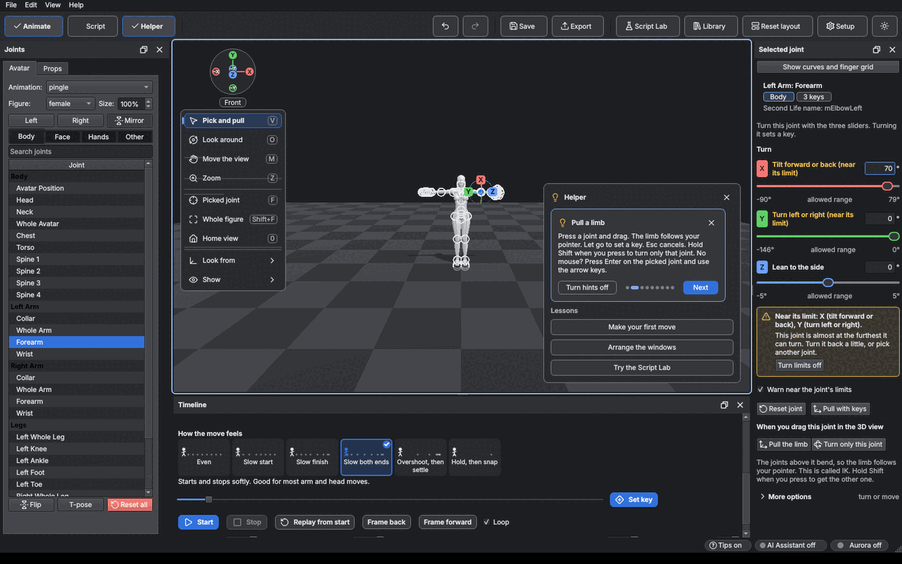

From top to bottom:

- **Menu bar:** File, Edit, View, Help. Every menu item is listed in [Chapter 15](#chapter-15-every-menu-item).
- **Top bar.** From left to right:
  - **Animate** and **Script** switch the two sides (F7 and F8).
  - **Helper** turns the Helper panel on and off.
  - Undo and Redo arrows.
  - **Save** and **Export**.
  - **Script Lab** and **Library** open those panels.
  - **Reset layout** puts every panel back where it started.
  - **Setup** opens the settings.
  - The sun button switches between the dark and the light theme.
- **Joints panel** (left): the list of joints, with the tabs Avatar and Props.
- **3D view** (middle): the figure and the floor. Top left is the **view-direction widget** (click an axis end to look from there). Below it is the **view toolbar** with the tools Pick and pull, Look around, Move the view and Zoom.
- **Selected joint panel** (right): turns the joint you picked.
- **Timeline** (bottom): keys over time, the easing tiles, the time marker and the play buttons.
- **Status bar** (very bottom): a line of help on the left. On the right: **Tips**, **AI Assistant** and **Aurora** switches.

### Panels you can move and resize

Every panel can be:

- dragged by its title to a new place,
- **popped out** into its own window (the small square icon in its title),
- resized by dragging the dividers between panels,
- hidden with the X in its title.

Press **Tab** to hide or show all panels. **View > Reset layout** (or the **Reset layout** button) puts everything back. Reset layout resets both sides.

**Example.** Drag the Timeline by its title to the right side. Press **Reset layout**. It jumps back to the bottom.

### Animate and Script

Press **Script** (or F8). The Script Lab fills the right side of the window.

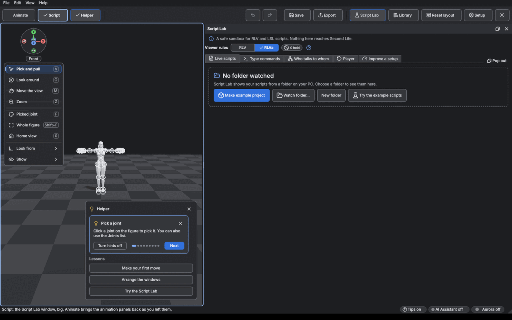

Press **Animate** (or F7). Your animation panels are back as you left them.

### The Helper

The **Helper** button shows a small panel at the bottom right of the 3D view. It shows the next hint card, and three short lessons:

- **Make your first move:** pick a joint, turn it, save a key and watch it.
- **Arrange the windows:** open the Library, then put every window back.
- **Try the Script Lab:** switch to Script and back.

A ring marks the real control that a step talks about. A step goes on when you do it. Press **Turn hints off** to stop the hint cards. Switch the Helper off and the program is clean.

The Helper button and **Help > Show hints** (Shift+H) are the same setting.

### Beginner and Expert

**View > Expert mode** (Shift+E) shows more controls. Expert mode adds:

- **Paste mirrored**,
- **Edit curve** in the timeline,
- a grid of every finger joint in degrees on the Hands tab,
- a switch to show every joint in the timeline,
- the second figure (File > Add a second figure, in the Library panel: Add as a second figure).

The same switch is in **Setup**.

---

## Chapter 3: Your first animation

You will make a short arm movement in about ten minutes.

First, three words.

- A **key** is a saved pose at one moment. The program fills in the movement between two keys.
- A **frame** is one step in time.
- The **time marker** is the slider that picks the moment you see.

### Step 1: Start

1. Choose **File > New animation** (Ctrl+N). A figure appears.
2. Or choose **File > Open** and pick `wave.dingle` in the folder `examples` next to the program. It is a finished animation to look at.

The figure stands in a T-pose.

### Step 2: Open the Joints list and pick a joint

1. Choose **View > Joints**. The Joints panel opens on the left.
2. In the list, click **Whole Arm** under **Left Arm**. Or click the arm on the figure.

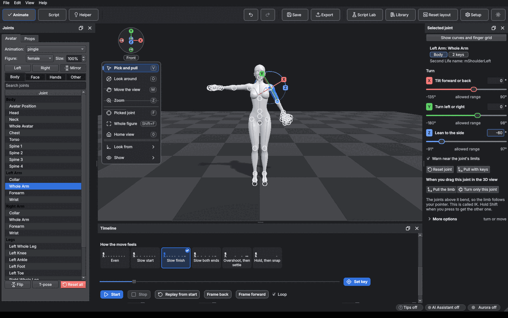

The panel **Selected joint** shows the joint's name and three sliders: **Tilt forward or back**, **Turn left or right** and **Lean to the side**. Each shows its allowed range.

### Step 3: Set the first key

Press **Set the first key** at the bottom of the screen (or press **K**). The program saves the pose you see now as a key. The timeline now shows a row for this joint.

A new animation has 30 frames. The first frame is locked, to protect the first pose. So your first key goes at frame 2. To unlock the first frame, turn off **Edit > Lock the first frame**.

### Step 4: Pick a later moment

Drag the time marker (the slider above the **Start** button) to the right. The text **Frame ... of ...** at the bottom of the timeline shows where you are. The figure keeps the pose of the key before it.

The Timeline panel is not tall. If you cannot see the slider and the play buttons, scroll inside the Timeline, or drag the divider above it upward.

### Step 5: Pose

Do one of these:

- Type a number in a box of the Selected joint panel, for example `-60` in **Lean to the side**, and press Enter.
- Drag a slider.
- Drag a coloured ring on the figure. Red turns around X, green around Y and blue around Z.
- Drag the joint itself. The limb follows the pointer. Hold **Shift** to turn only that joint.

Turning a joint saves a key for that joint at once. The timeline shows it. The status line says "Key set at frame ... for ...".

### Step 6: Choose how the move feels

When a key is picked, the timeline shows six tiles under **How the move feels**:

| Tile | Meaning |
|---|---|
| Even | Same speed all the way. |
| Slow start | Starts gently, then speeds up. |
| Slow finish | Moves at speed, then settles. Good for putting a hand down. |
| Slow both ends | Starts and stops softly. This is the default for a new key. |
| Overshoot, then settle | Goes a little too far, then comes back. |
| Hold, then snap | Stays still, then jumps. |

### Step 7: Play

1. Press **Start**. The animation plays.
2. Press **Stop** to stop.
3. **Replay from start** plays from the first frame.
4. **Loop** (ticked by default) plays again and again.
5. **Frame back** and **Frame forward** move one frame.

### Step 8: Save

1. Choose **File > Save as...** (Ctrl+A) or press **Save** at the top.
2. Pick a name. The file ends in `.dingle`. This is the working format. It keeps all your work.

### Step 9: Export for Second Life

1. Press **Export** at the top, or choose **File > Export for Second Life (.anim)...** (Ctrl+Shift+E).
2. A small box opens.

   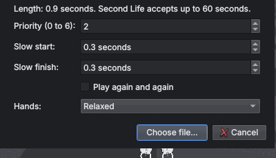

   - **Length** is shown as text. Second Life accepts up to 60 seconds.
   - **Priority (0 to 6):** when two animations move the same joint, the higher number wins.
   - **Slow start** and **Slow finish:** how long the animation takes to fade in and out.
   - **Play again and again:** use the loop points.
   - **Hands:** how the fingers look while it plays.
3. Press **Choose file...** and pick a name. The file ends in `.anim`.

The program checks the animation against Second Life's rules while you export.

### Step 10: Upload to Second Life

Uploading is done in the Second Life viewer, not in PinglyMotion.

1. In the viewer, choose **Build > Upload > Animation**. (The exact menu name depends on your viewer.)
2. Pick your `.anim` file.
3. Set the same priority and loop as in the export box. The viewer asks for a small fee.
4. Wear or play the animation to see it.

An honest note: export, upload and playback were validated in Firestorm on 21 November 2026. Other viewers were not tested. Uploading costs a small fee in Second Life.

### If something goes wrong

- **The figure does not move.** You may be on the locked first frame. Drag the time marker to a later frame.
- **A joint will not turn further.** It is at the furthest it can turn. Turn it back, or press **Turn limits off** in the warning.
- **You do not like a key.** Press Ctrl+Z to undo.
- **The view is lost.** Press **0** for the home view, or press **Whole figure** (Shift+F).
- **Nothing moves when you play.** A joint needs two keys at different frames.

---

## Chapter 4: Posing in detail

### The Joints panel

The panel has two tabs: **Avatar** and **Props** (Chapter 7).

On the Avatar tab, from top to bottom:

- **Animation:** the name of the open animation. A new animation is called `pingle`.
- **Figure:** `female` or `male`. This only changes what you see.
- **Size:** the size of the figure in the view (100% at start).
- **Left**, **Right** and **Mirror**: which side the list shows and which side an edit changes. The tip of **Mirror** says: "turning one side turns the other side too". If the other arm moves when you only wanted one, press **Mirror** to turn it off.
- Four tabs: **Body**, **Face**, **Hands** and **Other**.
- **Search joints:** type a part of a name.
- The list of joints, in groups: Body, Left Arm, Right Arm, Legs, and more.
- **Flip:** flips the whole pose left to right.
- **T-pose:** arms straight out to the sides.
- **Reset all:** reset every joint.

### The Selected joint panel

When a joint is picked, the panel shows:

- its name and how many keys it has,
- its Second Life name (for example `mShoulderLeft`),
- three sliders with number boxes (in degrees) and the **allowed range**,
- a warning when you are near the limit. **Turn limits off** removes the limit. **Warn near the joint's limits** turns the warning off,
- **Reset joint** and **Pull with keys**,
- **Pull the limb** and **Turn only this joint**: what dragging the joint does,
- **More options** with **turn or move**: turn or move the joint,
- **Show curves and finger grid**, a button at the top of the panel. It shows the extra controls of Expert mode. A second button, **Show all joints**, shows when nothing is picked.

When you pick nothing, the panel shows three short steps and a button that picks a joint for you.

### Pulling a limb

Press a joint on the figure and drag. The joints above it bend so the limb follows the pointer. This is called IK (inverse kinematics). Let go to set a key. Esc cancels. Hold **Shift** when you press the joint to turn only that joint.

No mouse? Press **Enter** on the picked joint. Use the arrow keys. Press Enter to set a key. Esc cancels.

### Hands

On the **Hands** tab you get:

- nine ready-made finger poses,
- one **Bend** slider for each finger,
- **Reset hand**,
- in Expert mode, a grid of every finger joint in degrees.

**Mirror** copies a change to the other hand. The line at the top says which hand you work on, for example "Right hand. The other hand copies it."

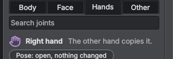

**Example.** Open the **Hands** tab. Pick one of the ready-made poses. Press **Set key**.

### Face and Other

The **Face** tab lists the Bento face joints: head, brows, eyes, ears and more. The **Other** tab lists the extra Bento joints: tail, hind limbs and wings. Use **View > Joint groups** to show or hide these groups. **Hide in lists** leaves hidden joints out of the lists.

Face joints are parked: they are there, but they get no special attention yet.

### Joint limits

Each joint has the range Second Life allows. Near the limit the panel warns you. The limits are on by default.

---

## Chapter 5: The timeline, keys and playback

### Rows

The timeline shows a row for each joint with changes, and for the picked joint. Rows are coloured and named by body area. The box **Show rows for** filters by body area. Expert mode adds a switch to show every joint.

With no keys, the timeline says **No keys yet** and offers **Set the first key**.

### Keys

- **Set key** (K) saves the pose you see now.
- Turning a joint sets a key by itself.
- A mark in the timeline shows each key.
- Pick a key to change its easing (Chapter 3, step 6).
- In Expert mode, **Edit curve...** draws your own speed curve for a movement. The window remembers its place and size.

### Select, copy and paste

1. Hold **Shift** and drag in the timeline, or use Shift and the arrow keys, to select a stretch.
2. **Edit > Copy** (Ctrl+C), **Cut** (Ctrl+X) or **Paste** (Ctrl+V).
3. **Paste mirrored** (Ctrl+Shift+V, Expert mode) pastes with left and right swapped. A left step becomes a right step.

### Undo and Redo

Ctrl+Z undoes. Ctrl+Shift+Z or Ctrl+Y redoes. Each edit or drag is one step. The history holds up to 100 steps and survives Save.

### Loop points

At the bottom of the timeline you find:

- **Loop starts at** and **Loop ends at**: the two frames the animation loops between, with their place in percent,
- **Frame ... of ...**: where you are and how many frames there are,
- **Frames per second** (30 at the start).

The export box uses the loop frames when **Play again and again** is ticked.

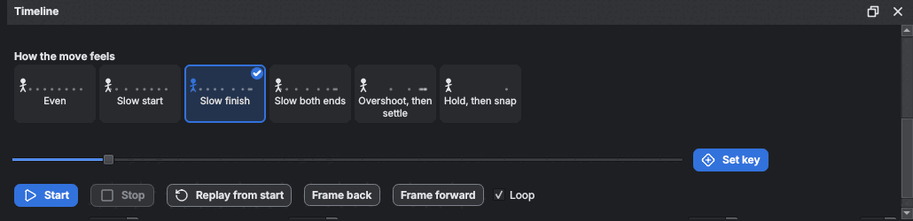

### Notes line

Some animations carry teaching notes. According to the project documents, a line under the timeline then shows the note of the current frame, with **Hide notes**. (A check of `wave.dingle` in the Linux build did not show a notes line, so treat this as unverified.)

**Example.** Open `wave.dingle` from the `examples` folder. Press **Start**. Watch the figure wave. Press **Stop**.

### Slow example

`jump_slow.dingle` is `jump.dingle` with every key 2.5 times later. It runs at 40 percent of the speed, so you can watch the jump slowly.

---

## Chapter 6: The 3D view and the camera

### Mouse and keys

The default style, called PinglyMotion, works like this:

| What | How |
|---|---|
| Look around (orbit) | Drag empty space |
| Move the view (pan) | Right-drag |
| Zoom | Mouse wheel |
| Pick a joint | Click it, or its row |
| Focus on the picked joint | F, or double-click it |

In **Setup** or **Help > Camera and keys...** you can choose the style of Maya, Blender or Second Life instead. Chapter 14 has the tables.

### The view toolbar

At the top left of the 3D view:

- The **view-direction widget:** click an axis end to look from there.
- **Pick and pull** (V), **Look around** (O), **Move the view** (M), **Zoom** (Z).
- **Picked joint** (F), **Whole figure** (Shift+F), **Home view** (0).
- **Look from** (Front, Side, Top).
- **Show:** the floor grid, rotation rings, joint dots, and tool names.

Every setting is also in the **View** menu.

### The View menu

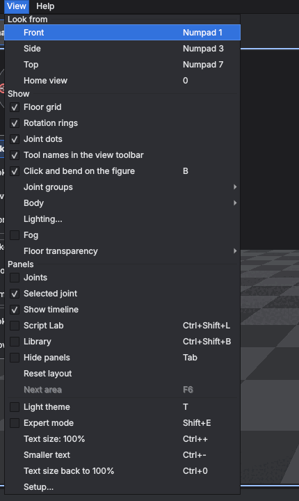

- **Look from:** Front (Numpad 1), Side (Numpad 3), Top (Numpad 7), Home view (0).
- **Show:** Floor grid, Rotation rings, Joint dots, Tool names in the view toolbar, **Click and bend on the figure** (B), Joint groups, Body, Lighting..., Fog, Floor transparency.
- **Joint groups** shows or hides groups of extra joints: Wings, Tail, Hind limbs, Face, and Fingers and toes. Hiding changes only what you see. **Hide in lists** leaves hidden joints out of the timeline and the joint list. If it is off, they show dimmed.
- **Body** picks the body mesh: **Ruth2** or **Max**. It changes only how the figure looks.
- **Lighting...** opens a small box with the sliders **Brightness** (Dark to Bright), **Shine** (Matt to Shiny) and **Warmth** (Cool to Warm), a tick **Shadow on the floor**, and the buttons **Reset** and **Close**.
- **Fog** fades the far end of the floor. It is off at the start.
- **Floor transparency:** 0, 25, 33, 50 or 75 percent.
- **Panels:** Joints, Selected joint, Show timeline, Script Lab, Library, Hide panels (Tab), Reset layout, Next area (F6).
- **Light theme** (T), **Expert mode** (Shift+E), text size, and **Setup...**.

**Example.** Hover over the 3D view. Press **O** (look around) and drag. Press **M** and drag to move the view. Press **V** to go back to picking joints. Press **0** to come home.

### Text size

**Ctrl++** makes the text bigger, **Ctrl+-** smaller and **Ctrl+0** back to 100 percent. Setup offers 100, 125, 150, 175 and 200 percent.

### Click and bend

With **Click and bend** on (B), a click on the figure picks a joint and a drag bends it. With it off, clicks on the figure do nothing. Use the Joints list and the sliders.

---

## Chapter 7: Props

A **prop** is a simple 3D shape in the scene. It stands in for an object. A prop can be attached to a joint, so it moves with that joint.

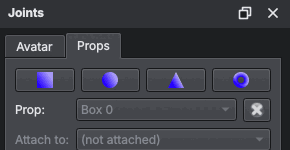

1. Choose **View > Joints**. Open the **Props** tab.
2. Press a shape button: box, sphere, cone or torus (a ring).
3. The program names it, for example **Box 0**. The next box is **Box 1**. A prop cannot be renamed yet.
4. Place it with **Place**, **Turn** and **Size** in the panel on the right, which now says **Selected prop**. There you can also change the **Shape**: Box, Ring, Cone or Ball. A small box over the 3D view, **Edit prop**, has the tools **Move**, **Turn** and **Size** for dragging it.
5. Pick a joint in **Attach to**. The prop moves with that joint.
6. The button with the X deletes the prop.

**File > Save** keeps the props inside the animation file. **File > Open** brings them back. **File > Open props...** and **Save props...** use the older `.prp` files. Opening a `.prp` removes the current props first.

**Example.** Open `throne.dingle` from the `examples` folder. The figure sits. Choose **File > Open props...** and pick `throne.prp`. Box shapes appear around the figure. The picked one is blue. Pick another name in the **Prop:** list to select it.

---

## Chapter 8: The library

The library holds 106 ready-made moves. Use one as a start.

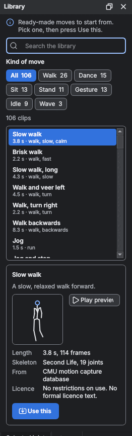

1. Press **Library** at the top (or Ctrl+Shift+B, or **View > Library**).
2. Search, or pick a kind of move: Walk, Dance, Sit, Stand, Gesture, Idle, Wave.
3. Pick a clip. The panel shows a preview on a small figure and **Play preview**.
4. It also shows length, skeleton, where it came from and its licence.
5. Press **Use this**. The clip opens as your animation. The program asks first if you have unsaved changes. The status line says "Opened Slow walk from the library. Save it under your own name." The clip's own name is the name of the animation until you save it.

The Library shares the right side with Selected joint. Switch with the tabs at the bottom. In Expert mode, **Add as a second figure** puts a clip next to your figure instead.

**Example.** Press **Library**. Pick **Slow walk**. Press **Use this**. Press **Start**. The Timeline then shows 114 frames.

The library comes from the CMU motion capture database and from Mesh2Motion. See [Chapter 17](#chapter-17-credits).

If the panel says **No library found**, the folder `library` is missing next to the program. Install the program again.

---

## Chapter 9: Files and formats

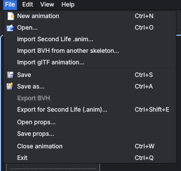

### The formats

| Ending | What | Notes |
|---|---|---|
| `.dingle` | PinglyMotion's own working format | Keeps everything. Written as text (JSON). |
| `.anim` | Second Life animation | Export and import. |
| `.bvh` | A common motion file | Export, and open. An opened `.bvh` is left alone until you save. |
| `.avm` | The old format | Opens. Saved as `.dingle`. |
| `.prp` | Old props file | Open props and Save props. |
| `.glb`, `.gltf` | 3D animation from other tools | Import only. |

### File menu

- **New animation** (Ctrl+N), **Open...** (Ctrl+O), **Save** (Ctrl+S), **Save as...** (Ctrl+A).
- **Import Second Life .anim...** opens an `.anim` as a new, unsaved animation. A list **What could not be imported** says what was left out.
- **Import BVH from another skeleton...** shows which joints were matched and which were left out. Tick **My file starts in a T-pose or A-pose** if the first frame is a standing pose. Press **Open the animation**. A mapping you make can be kept in a small `.jointmap` file.
- **Import glTF animation...** opens `.glb` or `.gltf`. If the file has more than one animation, pick the ones you want.
- **Export BVH** makes a `.bvh` file.
- **Export for Second Life (.anim)...** (Ctrl+Shift+E).
- **Open props...** and **Save props...**.
- **Close animation** (Ctrl+W) and **Exit** (Ctrl+Q).

Every import opens as an untitled animation. Your original file is not changed. Save it to keep it.

**Example.** Choose **File > Open** and pick `jump.dingle` in `examples`. Choose **File > Save as...** and save it under a new name. Choose **File > Export for Second Life (.anim)...** and make `jump.anim`. Choose **File > Import Second Life .anim...** and open it again. A message says "Opened jump.anim." and lists what could not be imported. For this file it says that priority, slow start and finish, and hands are not kept. The movement itself comes back.

### The folder for AI assistants

An AI assistant can only open and save files in one folder: `PinglyMotion` in your Documents folder. See [Chapter 11](#chapter-11-ai-assistants).

---

## Chapter 10: Script Lab for beginners

Script Lab is a safe sandbox. You can run RLV and LSL scripts on your computer. Nothing reaches Second Life.

Some words first.

- **LSL** is the scripting language of Second Life.
- A **script** is a small program inside an object.
- An **object** is made of **prims**. A prim is one part, such as a box.
- **RLV** (Restrained Love Viewer) is a set of commands that a script can send to a viewer. They restrict what an avatar may do, for example `@detach=n` means "this cannot be taken off".
- **RLVa** is a viewer that understands RLV and more.
- A **channel** is a number that scripts use to talk, like a radio channel.

**Honest status.** Script Lab is built in many parts. Nothing in it has been tested in Second Life. The sandbox is never identical to Second Life. See [What is finished and what is not](#what-is-finished-and-what-is-not).

Open Script Lab with the **Script** button (F8) or the **Script Lab** button (Ctrl+Shift+L).

### The top of the window

- **Viewer rules:** **RLV** or **RLVa**. The start is RLVa. Switching removes every restriction, as after a new login.
- A chip shows how many restrictions are held ("0 held").
- Five tabs: **Live scripts**, **Type commands**, **Who talks to whom**, **Player**, **Improve a setup**.
- **Pop out** moves Script Lab into its own window.

### Make the example project

1. Press **Script**.
2. Press **Make example project**.

The program copies the example **First colour** into your own folder (`Documents/PinglyMotion/Scripts/First_colour`). It adds a box to the scene. It watches the folder. A **Steps** card lists five steps and ticks them.

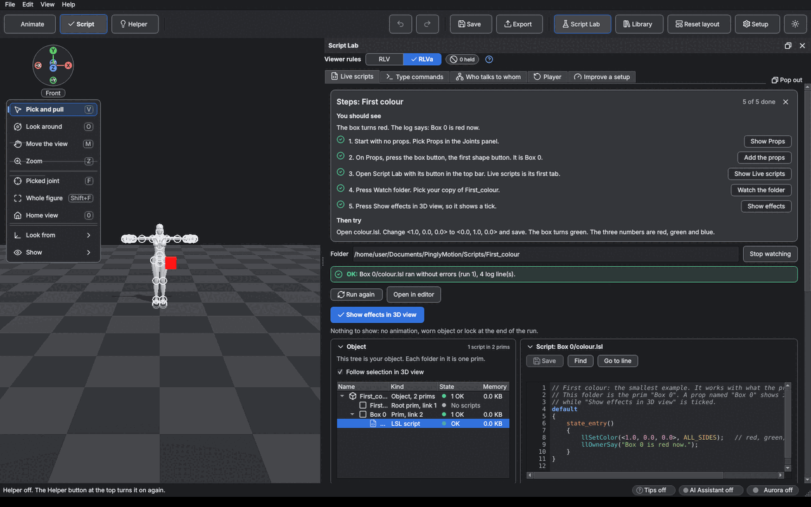

You should see:

- a red box next to the figure,
- the message **OK: Box 0/colour.lsl ran without errors**,
- the log line "Box 0 is red now."

### The tree

The box **Object** shows your object as a tree. Each folder is one prim. The folder **Box 0** is a prim. The script inside it is the row **LSL script**. The columns are **Name**, **Kind**, **State** and **Memory**.

Click a row. With **Follow selection in 3D view** ticked, the prop with the same name lights up in the 3D view.

### Change the script

1. The script is open in the editor on the right. (**Open in editor** opens it again.)
2. Change `<1.0, 0.0, 0.0>` to `<0.0, 1.0, 0.0>`.
3. Press **Save**.

The box turns green. The three numbers are red, green and blue. Each save runs the folder again. Press **Run again** to run it without a change.

The editor has **Save**, **Find** and **Go to line**. It shows suggestions and help text for LSL functions as you type. It also suggests RLV commands inside `llOwnerSay("@...")`, with plain warnings. Switch to **Show suggestions only when I press Ctrl+Space** in Setup if you prefer.

### Show effects in 3D view

The button **Show effects in 3D view** makes props show what the scripts do: colour and how clear. A prop named like a prim shows the effect of that prim's scripts. Clicking a prop counts as a touch. A menu a script shows (`llDialog`) appears as a box over the 3D view. Press a button in it, or **Ignore** (Esc).

### Other examples

The folder `examples/objects` has six more objects: Button HUD, Gear set, Timed lock, RLV relay and Work system. `examples/scriptlab` has loose scripts. Press **Try the example scripts** (when no folder is watched) to run `rlv_lock.lsl`.

**Watch folder...** watches any folder of your own. A folder is an object. **New folder** makes a new one.

### Type commands

The tab **Type commands** is for RLV lines.

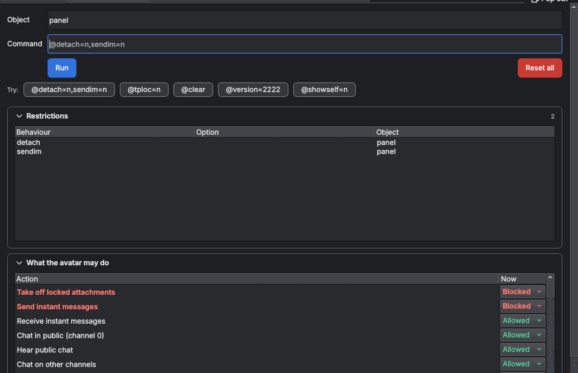

1. Open the tab **Type commands**.
2. Click the box **Command**, type `@detach=n,sendim=n` and press Enter.
3. The tab shows **Restrictions** (detach and sendim), held by the object `panel`. In **What the avatar may do**, **Take off locked attachments** and **Send instant messages** now say **Blocked**.

The chips under **Try** fill a ready example. **Reset all** removes every restriction. Each row in the actions list is an **Allowed / Blocked** choice you can set. The log **Replies and messages** shows the answers a script would hear.

The tab also has switches for camera limits, environment and view modes in the 3D view, and a part named **Vision sphere**.

### Who talks to whom

The tab **Who talks to whom** draws a map while a folder is watched. Open the part **Who talks to whom** by clicking its header. For the First colour example you see a box **Box 0** with an arrow to the dashed box **You**, labelled `owner say: "Box 0 is red now."`.

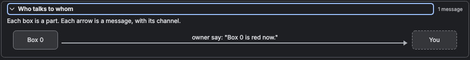

In bigger setups the boxes are the prims, and also **You**, **Your viewer (RLV)** and **Web server**. Arrows show chat, link messages, menus and RLV lines, with their channel. An arrow that nobody hears is dashed, red and says why. A prim that listens and passes on commands is marked **(hub)**. A click on an arrow shows the script line that sent it.

### Player

Press **Record what I do** on the tab **Player**. Click props or press menu buttons. Each action is a step. Press **Stop recording**.

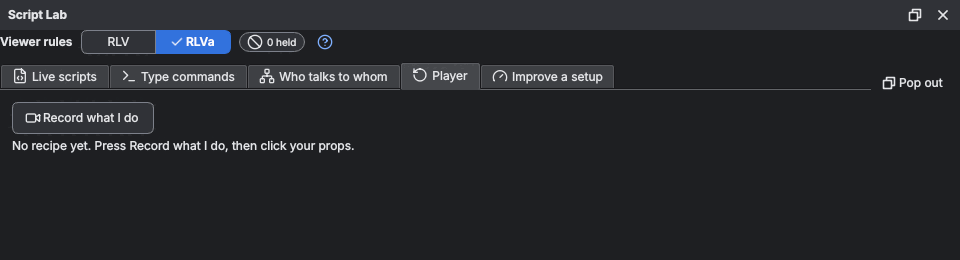

The program saves the steps as `recipe.rlvtest` in the object folder. It replays them and says what changed since last time. The player has the same Start, Stop, Step back and Step forward buttons as the timeline. It lists the moments and what was true at each. **Go to first difference** jumps to the first change.

Not built: the player does not move the animation, the camera, the environment or the menu box. Those show the live run.

### Improve a setup

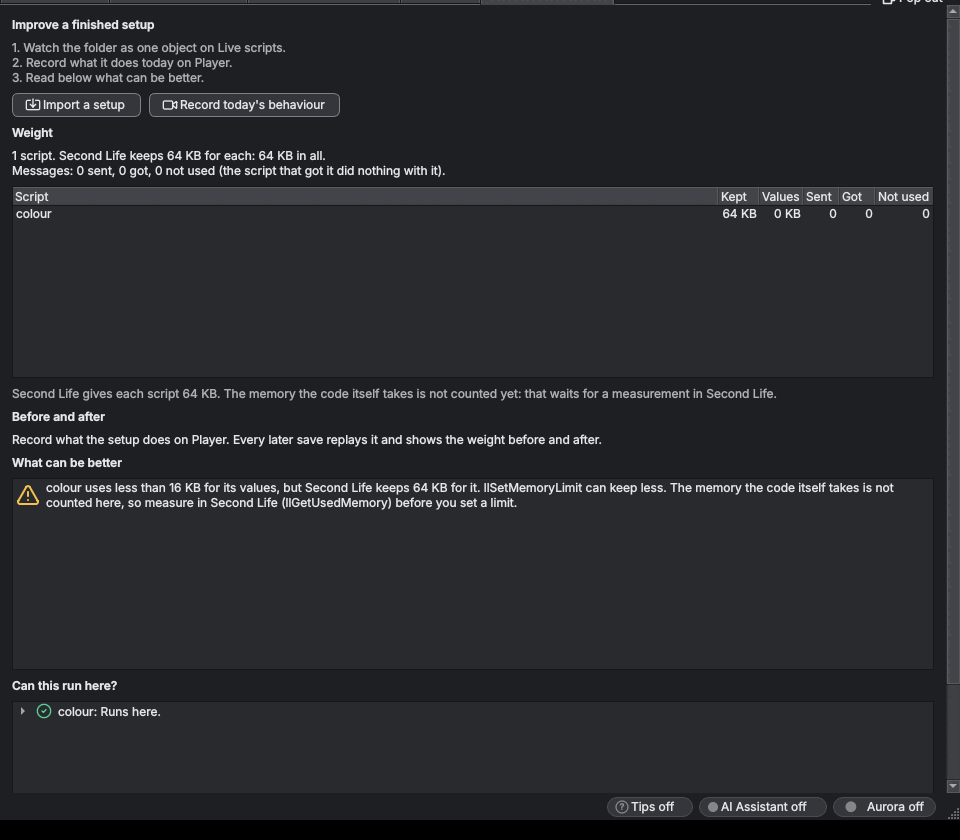

For a finished setup, such as a collar:

1. Watch the folder as one object (Live scripts).
2. Record what it does (Player).
3. Read the tab **Improve a setup**.

It shows how heavy each script is (**Kept**, **Values**, **Sent**, **Got**, **Not used**), what can be better, and per script whether it can run here. **Import a setup** and **Record today's behaviour** are on the tab.

The memory of the code itself is not counted yet. That needs a measurement in Second Life.

### The OpenCollar example

`examples/improve/OpenCollar` holds the 23 scripts of the public OpenCollar collar. They are copied unchanged, with their licence (GPL 2). Watch the folder. The collar starts and shows its menu when you click it. **Not tested in Second Life.**

### Lua (a trial)

Lua is a newer scripting language in Second Life. It is called SLua.

1. Open **Setup**. Tick **Lua (trial): show the language choice in the editor**.
2. The editor shows a **Language** box with **LSL** and **SLua (Lua, trial)**.
3. Choose SLua. Scroll down in the Live scripts tab. At the right end of the line under the text, press **Convert to SLua**.

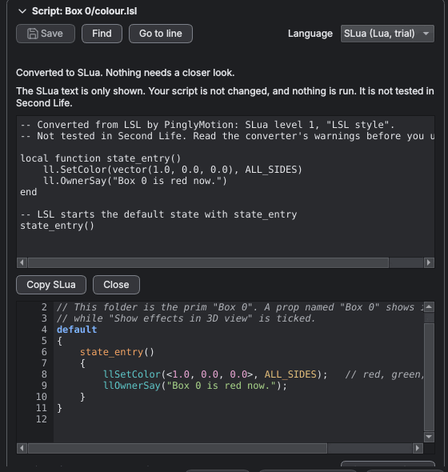

The pane shows the converted text and notes. Your script is not changed. Nothing is run. **Copy SLua** copies the text. **Close** closes the pane.

Lua is a trial. The converter is checked by tests that compare exact text. It is **not tested in Second Life**. There are no Lua checks or suggestions, and Lua does not run.

### Steps and the guide

**Help > Script Lab steps** shows the steps card again.

---

## Chapter 11: AI assistants

An AI assistant on your own computer can pose the figure, play it, look at it and save it. This is optional. It is **off at every start** and never turns on by itself.

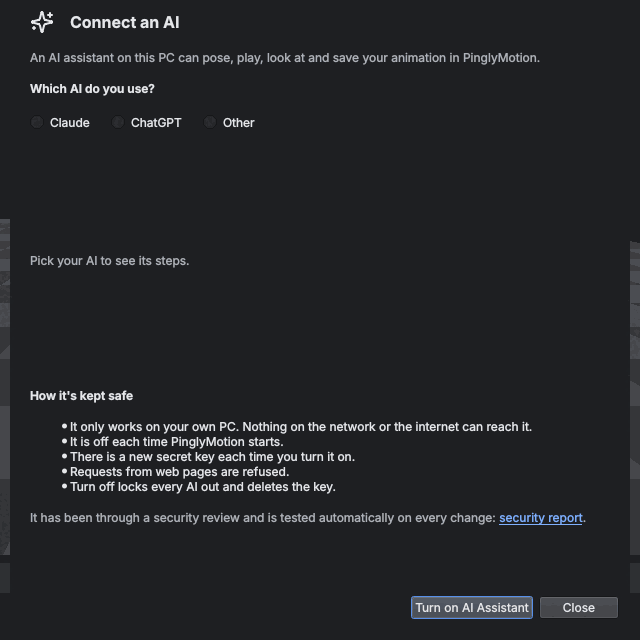

### Turn it on

1. Click the **AI Assistant** button in the status bar (bottom right).
2. The dialog **Connect an AI** asks "Which AI do you use?" Choose **Claude**, **ChatGPT** or **Other**. Each shows only its own steps.
3. Press **Turn on AI Assistant**.

The button shows a dot and its state:

| Dot | Text | Meaning |
|---|---|---|
| Grey | AI Assistant off | Off. |
| Yellow | AI Assistant on, waiting for an AI | On, no AI connected. |
| Green | AI Assistant: Claude | An AI is connected. |
| Red | A wrong key was refused | Something tried a wrong key. |

The window title says "AI Assistant on" while it is on. Click the button again to turn it off. Turning it off locks every AI out.

### How it is kept safe

- It works only on your own PC. Nothing on the network can reach it.
- It is off each time PinglyMotion starts.
- There is a new secret key each time you turn it on.
- Requests from web pages are refused.

### What an assistant can do

An assistant uses the commands of the control interface: look at the state, pose joints, set frames, play, take a screenshot, describe the pose and the movement in words, read and write a whole animation as a small text table, check an animation against Second Life's rules, export `.anim`, search the library, and use the Script Lab (RLV commands and LSL scripts). The full list is in `docs/CONTROL.md` and `tools/mcp/commands.json`.

The assistant can only open and save files in the folder `Documents/PinglyMotion`.

### Status

- **Claude:** the Windows zip has `mcp/PinglyMotion.mcpb`, an extension for the Claude app.
- **ChatGPT:** setup is written. The button writes the desktop app's configuration. **Not tested by us.**
- **Other tools:** the file `pinglymotion_mcp.js` serves other tools that speak MCP. **Not tested by us.**

Manual work always works without any AI. The full status list is in [What is finished and what is not](#what-is-finished-and-what-is-not).

---

**Example.** Press the **AI Assistant** button. Choose **Claude** and read the steps. Do not press **Turn on AI Assistant** unless you want to connect an AI. Press **Close**. The button still says "AI Assistant off".

### The control commands

The commands an assistant can use are the same ones for any program on your PC that speaks plain HTTP. They are listed by `GET /api/commands` and in `docs/CONTROL.md`. In short:

| Group | Commands |
|---|---|
| Look | `state`, `joints`, `get_pose`, `keys`, `screenshot`, `describe_pose`, `describe_motion`, `describe_body` |
| Pose and time | `set_pose`, `set_position`, `delete_key`, `set_frame`, `set_frame_count`, `set_fps`, `set_loop`, `play`, `stop` |
| Files | `new_animation`, `open_file`, `save_file`, `export_anim` |
| The view | `set_figure`, `set_camera` |
| Whole animations as text | `motion_script`, `load_motion_script`, `check_animation` |
| Library | `find_reference`, `load_reference` |
| Script Lab | `rlv_command`, `rlv_state`, `rlv_reset`, `lsl_check`, `lsl_lint`, `lsl_run`, `lsl_event`, `lab_watch`, `lab_unwatch`, `lab_result`, `lab_replay` |

You do not need to know these to use PinglyMotion. They are for AI tools and for people who write scripts around the program.

---

## Chapter 12: The live link to Aurora

Aurora is a Second Life viewer. PinglyMotion can show your pose on your own avatar in Aurora while you work. Only you see it. Nothing is uploaded.

**Status.** It works on Windows. It needs Aurora built from the fork named in `docs/AURORA_LINK.md`. It does not work with the normal Aurora yet.

**Example.** With the Aurora fork running:

1. In Aurora, choose **Build > LiveMesh > Enable preview**.
2. In PinglyMotion, tick **Live link to Aurora** in **Setup**, or click the dot in the status bar.
3. The status bar says "Waiting for Aurora", then "Aurora live".
4. Turn a joint. Your avatar takes the pose.

The link is off at every start.

---

## Chapter 13: Setup, themes and help

Press **Setup** (the gear at the top right).

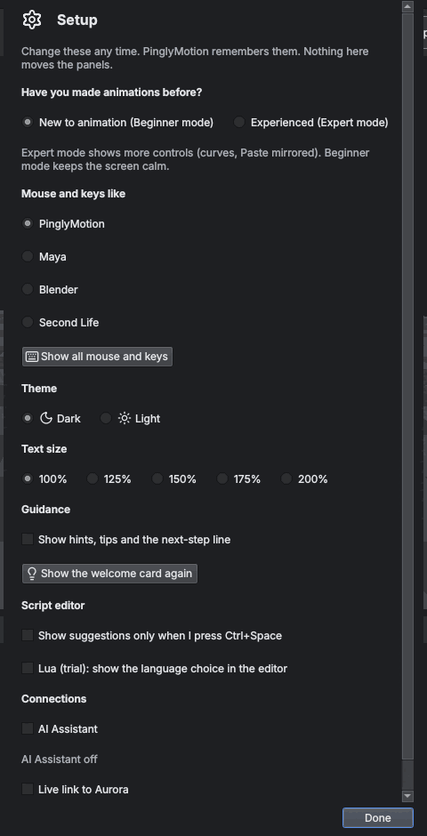

- **Have you made animations before?** New to animation (Beginner mode) or Experienced (Expert mode).
- **Mouse and keys like:** PinglyMotion, Maya, Blender or Second Life. **Show all mouse and keys** opens the table.
- **Theme:** Dark or Light.
- **Text size:** 100, 125, 150, 175 or 200 percent.
- **Guidance:** **Show hints, tips and the next-step line**, and **Show the welcome card again**.
- **Script editor:** **Show suggestions only when I press Ctrl+Space**, and the **Lua (trial)** switch.
- **Connections:** **AI Assistant** and **Live link to Aurora**.

PinglyMotion remembers these choices.

### Help menu

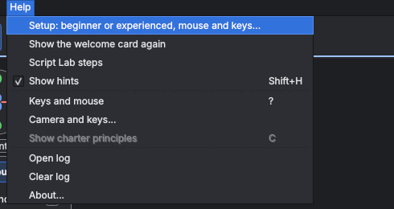

- **Setup: beginner or experienced, mouse and keys...**
- **Show the welcome card again**
- **Script Lab steps**
- **Show hints** (Shift+H)
- **Keys and mouse** (?)
- **Camera and keys...**
- **Show charter principles** (C), when available
- **Open log** and **Clear log**
- **About...**: who made the avatar bodies and under which licence.

**Example.** Press **Setup**. Under **Theme** choose **Light**. Under **Text size** choose **150%**. Press **Done**. Both changes are kept the next time you start.

### Hints and tips

Nine hint cards guide the first moves. **Next** goes on. **Turn hints off** stops them. The status bar switch **Tips on/off** shows or hides short help when the mouse rests on a control.

---

## Chapter 14: Keyboard shortcuts and mouse

### Everywhere

| Keys | What |
|---|---|
| Ctrl+N | New animation |
| Ctrl+O | Open |
| Ctrl+S | Save |
| Ctrl+A | Save as |
| Ctrl+Shift+E | Export for Second Life |
| Ctrl+W | Close animation |
| Ctrl+Q | Exit |
| Ctrl+Z | Undo |
| Ctrl+Shift+Z or Ctrl+Y | Redo |
| K | Set key |
| Ctrl+X, Ctrl+C, Ctrl+V | Cut, copy, paste |
| Ctrl+Shift+V | Paste mirrored (Expert mode) |
| F7, F8 | Animate side, Script side |
| Ctrl+Shift+L | Script Lab |
| Ctrl+Shift+B | Library |
| Tab | Hide or show all panels |
| F6 | Next area |
| T | Light or dark theme |
| Shift+E | Expert mode |
| Shift+H | Hints on or off |
| ? | Keys and mouse |
| Ctrl++, Ctrl+-, Ctrl+0 | Text bigger, smaller, back to 100% |
| Alt+1, Alt+2 | Pick the first or second figure (Expert mode) |

### In the 3D view

| Keys | What |
|---|---|
| V, O, M, Z | Tools: pick and pull, look around, move the view, zoom |
| F | Focus on the picked joint |
| Shift+F | Whole figure |
| 0 | Home view |
| Numpad 1, 3, 7 (or 1, 3, 7) | Front, side, top |
| Alt + arrow keys | Look around with keys |
| Page Up, Page Down | Zoom with keys |
| B | Click and bend on or off |
| Esc | Cancel a drag |
| Enter on a picked joint | Pull with the arrow keys; Enter sets a key |

### The camera styles

| Action | PinglyMotion | Maya | Blender | Second Life |
|---|---|---|---|---|
| Look around | Drag empty space | Alt + left-drag | Middle-drag | Alt + drag (sideways), Ctrl + Alt + drag |
| Move the view | Right-drag | Alt + middle-drag | Shift + middle-drag | Ctrl + Alt + Shift + drag |
| Zoom | Mouse wheel | Alt + right-drag, or wheel | Ctrl + middle-drag, or wheel | Alt + drag up or down, or wheel |
| Pick a joint | Click it, or its row | Click | Click | Click |
| Focus on the joint | F, or double-click | F | Numpad . | Alt + click |

### Joints

| What | How |
|---|---|
| Pull a limb | Press a joint and drag. Let go to set a key. Esc cancels. |
| Turn only that joint | Hold Shift when you press the joint |
| Turn on one axis | Drag the red X, green Y or blue Z ring |

The same table is in the program: **Help > Keys and mouse**.

**Example.** Press **?** to open the table. Close it. Press **Shift+E** to switch Expert mode on and press it again to switch it off.

---

## Chapter 15: Every menu item

### File

See [Chapter 9](#chapter-9-files-and-formats).

### Edit

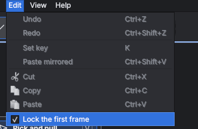

| Item | Keys | What |
|---|---|---|
| Undo, Redo | Ctrl+Z, Ctrl+Shift+Z | Take back and bring back an edit. |
| Set key | K | Save the pose now as a key. |
| Paste mirrored | Ctrl+Shift+V | Paste with left and right swapped. |
| Cut, Copy, Paste | Ctrl+X, C, V | On the selected stretch of the timeline. |
| Lock the first frame | | On by default. Keeps the first pose safe. |

### View

See [Chapter 6](#chapter-6-the-3d-view-and-the-camera).

### Help

See [Chapter 13](#chapter-13-setup-themes-and-help).

**Example.** Open the **Help** menu and choose **About...**. Close it. Open **View** and pick **Floor transparency**, then 50%.

### Top bar buttons

| Button | What |
|---|---|
| Animate, Script | Switch sides (F7, F8) |
| Helper | Helper panel on or off |
| Undo, Redo | Same as Edit |
| Save | Save the animation |
| Export | Export for Second Life |
| Script Lab | Open Script Lab |
| Library | Open the Library |
| Reset layout | Put every panel back |
| Setup | Open Setup |
| Sun button | Dark or light theme |

---

## Chapter 16: Troubleshooting and feedback

- **The 3D view is black.** Update the graphics driver. PinglyMotion needs OpenGL 3.3.
- **Windows warns about an unknown publisher.** The program is not signed yet. This is expected in the early preview.
- **A panel has vanished.** Press **Reset layout**.
- **The text is too small.** Press Ctrl++ or choose a text size in Setup.
- **The library says "No library found".** The folder `library` must be next to the program.
- **An imported file does not move right.** Open the list in the import box. Joints marked **Left out** were not brought in.
- **A script does nothing in Script Lab.** Read the **Errors and warnings** part. The sandbox runs most LSL, not all of it.
- **Something broke.** Choose **Help > Open log**. The log is a plain text file of what the program did.

### Report a bug or give feedback

Go to <https://github.com/pingledingle-tech/PinglyMotion/issues> and open an issue. Say what you did, what you expected and what happened. Do not put personal data in the issue. The web site also has pages for bug reports and suggestions.

---

## Chapter 17: Credits

PinglyMotion is free and open source. It is based on QAvimator. The avatar bodies, the library clips, the example collar and the other outside material are credited in the file [CREDITS.md](../CREDITS.md) and in **Help > About...**.

The ready-made moves come from the CMU motion capture database and from Mesh2Motion (CC0). The example collar is the public OpenCollar project (GPL 2).

---

## Glossary

| Word | Meaning |
|---|---|
| Animation | All the movement in one file. |
| Key | A saved pose at one moment. |
| Frame | One step in time. |
| Time marker | The marker you drag to pick a moment. |
| Timeline | The strip that shows your keys over time. |
| Joint | A part that turns, such as an elbow. |
| Pose | How the figure stands at one moment. |
| Easing | How a move speeds up or slows down between two keys. |
| Loop | The animation plays again and again. |
| T-pose | Standing with the arms straight out to the sides. |
| Prop | A simple 3D shape in the scene. |
| Prim | One part of an object in Second Life. |
| LSL | The scripting language of Second Life. |
| RLV | Commands a script can send to restrict an avatar. |
| Channel | A number scripts use to talk. |
| Sandbox | A safe place to try things. Nothing leaves it. |
| IK | Moving a hand moves the joints above it. |
