# PinglyMotion-handleiding

Voor PinglyMotion 0.3.0, een vroege previewversie. Geschreven voor mensen die nieuw zijn met animatie en scripten.

Deze handleiding zegt wat elk onderdeel van het programma doet. Ze zegt wat af is en wat niet. Waar iets een proef is, of niet in Second Life is getest, staat dat erbij.

*Machinaal vertaald uit de Engelse handleiding. Geen moedertaalspreker van het Nederlands heeft haar nagekeken. Bij twijfel geldt de [Engelse handleiding](manual.html).*

Alle afbeeldingen zijn echte schermafbeeldingen van het programma (Linux-versie, donker thema). De ene afbeelding die als „diagram” is aangeduid, is voor deze handleiding getekend.

**Inhoud**

- [Begin hier](#begin-hier): wat het is, het grote geheel, voor wie het is, waar je begint
- [Snelstart: de eerste vijf minuten](#snelstart-de-eerste-vijf-minuten)
- [Wat af is en wat niet](#wat-af-is-en-wat-niet)
- [Hoofdstuk 1: Installeren en starten](#hoofdstuk-1-installeren-en-starten)
- [Hoofdstuk 2: Het venster in één plaatje](#hoofdstuk-2-het-venster-in-één-plaatje)
- [Hoofdstuk 3: Je eerste animatie](#hoofdstuk-3-je-eerste-animatie)
- [Hoofdstuk 4: Poseren in detail](#hoofdstuk-4-poseren-in-detail)
- [Hoofdstuk 5: De tijdlijn, keys en afspelen](#hoofdstuk-5-de-tijdlijn-keys-en-afspelen)
- [Hoofdstuk 6: De 3D-weergave en de camera](#hoofdstuk-6-de-3d-weergave-en-de-camera)
- [Hoofdstuk 7: Props](#hoofdstuk-7-props)
- [Hoofdstuk 8: De bibliotheek](#hoofdstuk-8-de-bibliotheek)
- [Hoofdstuk 9: Bestanden en formaten](#hoofdstuk-9-bestanden-en-formaten)
- [Hoofdstuk 10: Script Lab voor beginners](#hoofdstuk-10-script-lab-voor-beginners)
- [Hoofdstuk 11: AI-assistenten](#hoofdstuk-11-ai-assistenten)
- [Hoofdstuk 12: De live koppeling met Aurora](#hoofdstuk-12-de-live-koppeling-met-aurora)
- [Hoofdstuk 13: Instellingen, thema's en hulp](#hoofdstuk-13-instellingen-themas-en-hulp)
- [Hoofdstuk 14: Sneltoetsen en muis](#hoofdstuk-14-sneltoetsen-en-muis)
- [Hoofdstuk 15: Elk menu-item](#hoofdstuk-15-elk-menu-item)
- [Hoofdstuk 16: Problemen oplossen en feedback](#hoofdstuk-16-problemen-oplossen-en-feedback)
- [Hoofdstuk 17: Dank en bronnen](#hoofdstuk-17-dank-en-bronnen)
- [Woordenlijst](#woordenlijst)

---

## Begin hier

### Waar PinglyMotion voor dient

Second Life is een virtuele wereld. Mensen gebruiken daar animaties om hun avatars te laten staan, zitten, dansen en zwaaien. Een **animatie** is een beweging die in een bestand is opgeslagen.

PinglyMotion helpt je zulke bewegingen te maken. Het is gratis. Het is open source, wat betekent dat iedereen het programma kan lezen en verbeteren.

PinglyMotion doet drie dingen:

1. **Een figuur animeren.** Je buigt de gewrichten van een 3D-figuur. Je slaat poses op op bepaalde momenten. Het programma vult de beweging ertussen in. Je exporteert het resultaat voor Second Life.
2. **Scripts veilig testen.** Objecten in Second Life gebruiken scripts. PinglyMotion heeft een veilige zandbak, het **Script Lab**, waar je RLV- en LSL-scripts op je eigen computer kunt draaien. Niets wat je daar doet, bereikt Second Life.
3. **Met een AI-hulp werken, als je wilt.** Een AI-assistent op je eigen computer kan de figuur voor je poseren. Hij staat uit tot je hem aanzet. Alles werkt ook zonder.

PinglyMotion is een **vroege preview**. Het is gemaakt om uit te proberen en voor feedback. Verwacht ruwe kantjes. Zie [Wat af is en wat niet](#wat-af-is-en-wat-niet).

### Het grote geheel

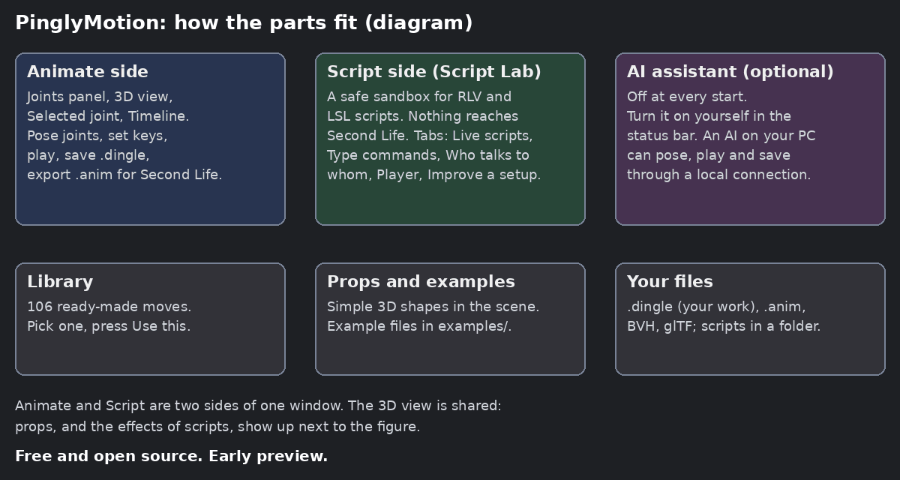

*Diagram getekend voor deze handleiding.*

Het programma is één venster met twee kanten. Je schakelt met de knoppen **Animate** en **Script** linksboven.

- **Animate** toont de panelen om een animatie te maken: de lijst Joints, de 3D-weergave, het paneel Selected joint en de Timeline.
- **Script** geeft het grootste deel van het venster aan het Script Lab. De 3D-weergave blijft links.

Elke kant onthoudt zijn eigen indeling. De 3D-weergave wordt gedeeld. Een prop (een eenvoudige 3D-vorm) of het effect van een script verschijnt naast de figuur.

Andere onderdelen:

- De **Library** bevat 106 kant-en-klare bewegingen. Je kunt met een ervan beginnen.
- **Props** zijn eenvoudige vormen die je in de scène kunt plaatsen.
- De map **examples** naast het programma bevat bestanden die je kunt openen en samen met deze handleiding kunt volgen.
- De **AI Assistant** is een schakelaar rechtsonder. Hij staat bij elke start uit.

### Voor wie het is

- **Beginners.** Je hebt nog nooit een animatie gemaakt of een script geschreven. Het programma start in Beginner-modus. Het toont een welkomstkaart, hintkaarten en een Helper-paneel. Deze handleiding legt elk woord uit.
- **Ervaren gebruikers.** Je kent animatiehulpmiddelen zoals Maya of Blender. Zet de Expert-modus aan (Shift+E). Je krijgt meer bedieningselementen, zoals curvebewerking en een tweede figuur. Je kunt een muis- en toetsenstijl kiezen van Maya, Blender of Second Life.

### Waar begin ik?

- **Ik wil een animatie maken.** Lees de [Snelstart](#snelstart-de-eerste-vijf-minuten). Volg daarna [Hoofdstuk 3: Je eerste animatie](#hoofdstuk-3-je-eerste-animatie).
- **Ik wil scripts testen.** Ga naar [Hoofdstuk 10: Script Lab voor beginners](#hoofdstuk-10-script-lab-voor-beginners). Je hebt eerst geen animatie nodig.
- **Ik wil dat een AI helpt.** Lees [Hoofdstuk 11](#hoofdstuk-11-ai-assistenten).
- **Ik wil weten wat werkt.** Lees [Wat af is en wat niet](#wat-af-is-en-wat-niet).

---

## Snelstart: de eerste vijf minuten

1. **Downloaden.** Haal het Windows-zipbestand of de Linux-AppImage op van de releasepagina (zie [Hoofdstuk 1](#hoofdstuk-1-installeren-en-starten)).
2. **Starten.** Pak op Windows het zipbestand uit. Start `PinglyMotion.exe`. Maak op Linux de AppImage uitvoerbaar en start hem.
3. **Welkomstkaart.** De eerste start toont "Make your first animation". Kies **New to animation**. Druk op **Standing**.

   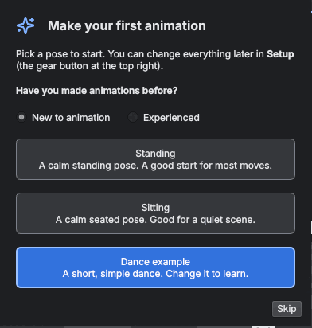

4. **Open de lijst Joints.** Kies **View > Joints**. Klik in de lijst op **Left Arm: Whole Arm**. De figuur toont ringen op dat gewricht.
5. **Sla een eerste key op.** Druk onderaan het scherm op **Set the first key**. Een key is een opgeslagen pose op één moment.
6. **Poseer.** Sleep de tijdmarkering (de schuifregelaar boven de knop Start) naar rechts. Typ in het paneel **Selected joint** `-60` in het vak **Lean to the side**. Druk op Enter. De arm zakt. Het programma slaat een key voor je op.
7. **Afspelen.** Druk op **Start**. Druk op **Stop** om te stoppen.
8. **Opslaan.** Druk bovenaan op **Save** en kies een naam. Het bestand eindigt op `.dingle`.

Dat is een hele animatie. [Hoofdstuk 3](#hoofdstuk-3-je-eerste-animatie) legt elke stap uit. Om een bestand voor Second Life te maken, druk je op **Export** (zie [Hoofdstuk 9](#hoofdstuk-9-bestanden-en-formaten)).

Wat niet af is, staat in [Wat af is en wat niet](#wat-af-is-en-wat-niet).

---

## Wat af is en wat niet

Elk onderdeel heeft een van deze woorden:

- **Built.** Het werkt in het programma en heeft automatische tests.
- **Partly built.** Een deel werkt. De tekst zegt wat er ontbreekt.
- **Trial.** Het bestaat, maar het is een proef. Het kan veranderen of kapotgaan.
- **Not built.** Het is gepland of alleen een idee.
- **Not tested in Second Life.** Het programma doet op je computer wat het moet. Niemand heeft nog gecontroleerd of Second Life het resultaat accepteert of uitvoert.

De data komen uit de projectdocumenten van 25 november 2026.

| Onderdeel | Status | Opmerkingen |
|---|---|---|
| Gewrichten poseren, keys, tijdlijn, afspelen, ongedaan maken | Built | Hoofdstuk 3 tot 5. |
| Opslaan als `.dingle`, `.dingle`, `.bvh`, `.avm` openen | Built | Oude `.avm`-bestanden gaan open en worden als `.dingle` opgeslagen. |
| Export voor Second Life (`.anim`) | Built | Export, upload en afspelen zijn op 21 november 2026 in Firestorm gevalideerd: timing, lus, zachte start en afloop, handen, easing. Andere viewers zijn niet gecontroleerd. |
| `.anim` importeren, BVH van een ander skelet, glTF | Built | Voetvergrendeling (voorkomen dat voeten glijden) is **not built**. |
| Bibliotheek met 106 bewegingen | Built | De bewegingen komen uit open bronnen. Hun licenties staan in het paneel. |
| Props (doos, bol, kegel, torus) | Built | Het zijn eenvoudige vormen. Een prop kan nog niet worden hernoemd. |
| Twee figuren in één scène (Expert-modus) | Built | Alleen in de Expert-modus. |
| Gezichtsgewrichten | Partly built | De gezichtsgewrichten zijn geparkeerd. Het tabblad Face bestaat, maar het gezicht is geen aandachtspunt. |
| Script Lab: RLV-opdrachten | Built | Een zandbak met 206 RLV-gedragingen. **Not tested in Second Life.** De laatste test is altijd in Second Life. |
| Script Lab: LSL-scripts draaien in een zandbak | Partly built | 282 ingebouwde functies, een gesimuleerde klok. Sommige functies noteren alleen wat er van hen gevraagd is. Veel doen nog niets. **Not tested in Second Life.** |
| Script Lab: Live scripts, boom, props uit prims | Built | Eén map is één object. Een prop met dezelfde naam als een prim hoort erbij. |
| Script Lab: Player, Who talks to whom, Record what I do | Built | **Not tested in Second Life.** Sommige delen van de 3D-weergave volgen de speler niet (zie Hoofdstuk 10). |
| Script Lab: Improve a setup | Partly built | De geheugenwaarden tellen het geheugen dat de code zelf inneemt niet mee. Daarvoor is een meting in Second Life nodig. |
| Script Lab: OpenCollar-voorbeeld | Built | Een echte halsband met 23 scripts draait in de zandbak. **Not tested in Second Life.** |
| Script Lab: Lua (SLua) | **Trial** | Achter een schakelaar die bij de start uit staat. De editor krijgt een taalkeuze en een knop **Convert to SLua**. Niets voert nog Lua uit. Geen Lua-controles of suggesties. **Not tested in Second Life.** |
| Webversie (in een browser) | **Trial** | Er is alleen een proefbuild. Hij werkt nog niet goed. Plan niet om hem te gebruiken. |
| AI-assistent (lokale besturing) | Built | Bij elke start uit. Claude: er wordt een extensie meegeleverd. ChatGPT en andere hulpmiddelen: de installatie is beschreven maar **door ons niet getest**. |
| Live koppeling met Aurora | Partly built | Werkt op Windows met een speciale build (een fork) van de Aurora-viewer. Met de gewone Aurora werkt het nog niet. |
| Vertalingen | Not built | Het programma is alleen in het Engels. De techniek ervoor bestaat. |
| Codeondertekening voor Windows | Not built | Windows kan waarschuwen voor een onbekende uitgever. |
| Installatieprogramma | Not built | De Windows-download is een zipbestand. |

Sommige verschillen tussen het programma en de klikbare mockup op de website worden nog verholpen. Als een scherm in de mockup er anders uitziet, vertrouw dan deze handleiding en het programma.

---

## Hoofdstuk 1: Installeren en starten

### Windows

1. Open de releasepagina van het project: <https://github.com/pingledingle-tech/PinglyMotion/releases>.
2. Download het Windows-zipbestand. Download ook `SHA256SUMS` als je de download wilt controleren.
3. Pak het zipbestand uit in een map naar keuze. Laat de map `data` naast het programma staan.
4. Start `PinglyMotion.exe`.

Het zipbestand bevat ook de map `examples` (bestanden die in deze handleiding worden gebruikt), de map `library` en de map `mcp` (voor AI-assistenten).

Er is geen installatieprogramma. Om het programma te verwijderen, verwijder je de map.

### Linux

1. Download de AppImage van de releasepagina.
2. Maak hem uitvoerbaar: `chmod +x PinglyMotion*.AppImage`.
3. Start hem.

### Wat je nodig hebt

Een videokaart en driver met OpenGL 3.3 of nieuwer. Blijft de 3D-weergave zwart, werk dan je videodriver bij.

### Wat het programma op je computer schrijft

- Instellingen: een gewoon bestand (`%APPDATA%\PinglyMotion` op Windows, `~/.config/PinglyMotion` op Linux).
- Een foutenlogboek en het verbindingsbestand voor de AI-assistent: in `%LOCALAPPDATA%\PinglyMotion` op Windows of `~/.local/share/PinglyMotion` op Linux.
- Script Lab-voorbeelden die je maakt: in `Documents/PinglyMotion/Scripts`.

PinglyMotion verzamelt geen persoonsgegevens en stuurt geen telemetrie. Het programma kijkt bij de start één keer of er een nieuwere versie is (de "Update check").

### Eerste start

De eerste start toont de welkomstkaart (zie de Snelstart). Kies **Skip** als je een lege figuur wilt. Je kunt de kaart opnieuw tonen met **Help > Show the welcome card again**.

**Voorbeeld.** Start het programma. Druk op de welkomstkaart op **Skip**. Je ziet een figuur in een T-pose (armen recht opzij) op een geblokte vloer.

---

## Hoofdstuk 2: Het venster in één plaatje

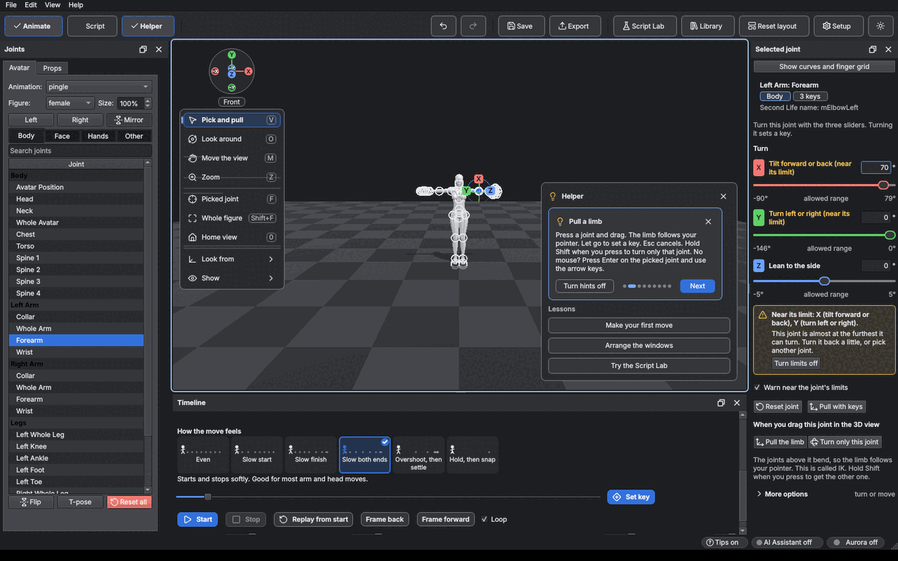

Van boven naar beneden:

- **Menubalk:** File, Edit, View, Help. Elk menu-item staat in [Hoofdstuk 15](#hoofdstuk-15-elk-menu-item).
- **Bovenbalk.** Van links naar rechts:
  - **Animate** en **Script** schakelen tussen de twee kanten (F7 en F8).
  - **Helper** zet het Helper-paneel aan en uit.
  - De pijlen Undo en Redo.
  - **Save** en **Export**.
  - **Script Lab** en **Library** openen die panelen.
  - **Reset layout** zet elk paneel terug op zijn beginplek.
  - **Setup** opent de instellingen.
  - De zonknop schakelt tussen het donkere en het lichte thema.
- **Paneel Joints** (links): de lijst met gewrichten, met de tabbladen Avatar en Props.
- **3D-weergave** (midden): de figuur en de vloer. Linksboven staat de **view-direction widget** (klik op het uiteinde van een as om vanaf daar te kijken). Daaronder staat de **view toolbar** met de gereedschappen Pick and pull, Look around, Move the view en Zoom.
- **Paneel Selected joint** (rechts): draait het gewricht dat je hebt gekozen.
- **Timeline** (onder): keys over tijd, de easing-tegels, de tijdmarkering en de afspeelknoppen.
- **Statusbalk** (helemaal onderaan): links een regel hulp. Rechts: de schakelaars **Tips**, **AI Assistant** en **Aurora**.

### Panelen die je kunt verplaatsen en vergroten of verkleinen

Elk paneel kan:

- aan zijn titel naar een nieuwe plek worden gesleept,
- in een eigen venster worden **losgemaakt** (het kleine vierkante pictogram in de titel),
- van grootte worden veranderd door de scheidingslijnen tussen panelen te slepen,
- worden verborgen met het kruisje in de titel.

Druk op **Tab** om alle panelen te verbergen of te tonen. **View > Reset layout** (of de knop **Reset layout**) zet alles terug. Reset layout zet beide kanten terug.

**Voorbeeld.** Sleep de Timeline aan zijn titel naar de rechterkant. Druk op **Reset layout**. Hij springt terug naar onderen.

### Animate en Script

Druk op **Script** (of F8). Het Script Lab vult de rechterkant van het venster.

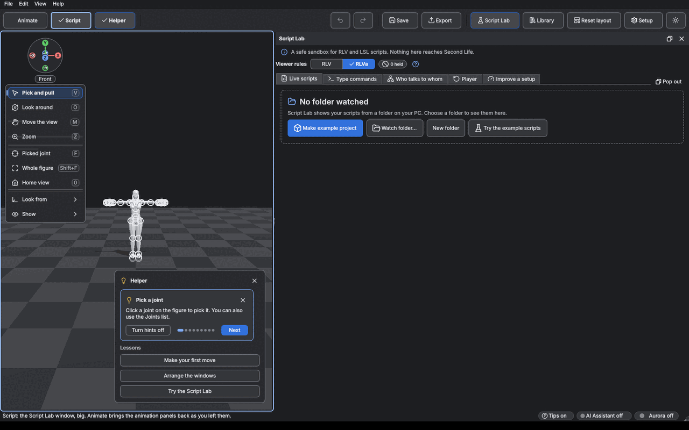

Druk op **Animate** (of F7). Je animatiepanelen zijn terug zoals je ze hebt achtergelaten.

### De Helper

De knop **Helper** toont een klein paneel rechtsonder in de 3D-weergave. Het toont de volgende hintkaart en drie korte lessen:

- **Make your first move:** kies een gewricht, draai het, sla een key op en bekijk het.
- **Arrange the windows:** open de Library en zet daarna elk venster terug.
- **Try the Script Lab:** schakel naar Script en terug.

Een ring markeert het echte bedieningselement waarover een stap gaat. Een stap gaat verder als je hem uitvoert. Druk op **Turn hints off** om de hintkaarten te stoppen. Zet de Helper uit en het programma is schoon.

De knop Helper en **Help > Show hints** (Shift+H) zijn dezelfde instelling.

### Beginner en Expert

**View > Expert mode** (Shift+E) toont meer bedieningselementen. De Expert-modus voegt toe:

- **Paste mirrored**,
- **Edit curve** in de tijdlijn,
- een raster van elk vingergewricht in graden op het tabblad Hands,
- een schakelaar om elk gewricht in de tijdlijn te tonen,
- de tweede figuur (File > Add a second figure, in het paneel Library: Add as a second figure).

Dezelfde schakelaar staat in **Setup**.

---

## Hoofdstuk 3: Je eerste animatie

Je maakt in ongeveer tien minuten een korte armbeweging.

Eerst drie woorden.

- Een **key** is een opgeslagen pose op één moment. Het programma vult de beweging tussen twee keys in.
- Een **frame** is één stap in de tijd.
- De **tijdmarkering** is de schuifregelaar die het moment kiest dat je ziet.

### Stap 1: Start

1. Kies **File > New animation** (Ctrl+N). Er verschijnt een figuur.
2. Of kies **File > Open** en kies `wave.dingle` in de map `examples` naast het programma. Dat is een kant-en-klare animatie om naar te kijken.

De figuur staat in een T-pose.

### Stap 2: Open de lijst Joints en kies een gewricht

1. Kies **View > Joints**. Het paneel Joints opent links.
2. Klik in de lijst op **Whole Arm** onder **Left Arm**. Of klik op de arm van de figuur.

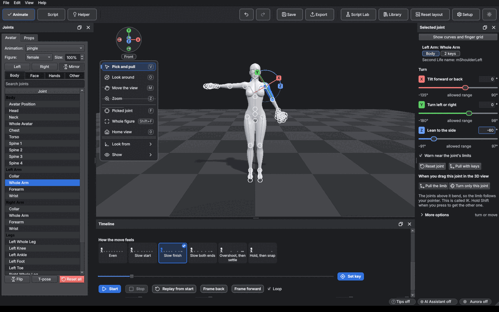

Het paneel **Selected joint** toont de naam van het gewricht en drie schuifregelaars: **Tilt forward or back**, **Turn left or right** en **Lean to the side**. Elk toont zijn toegestane bereik.

### Stap 3: Zet de eerste key

Druk onderaan het scherm op **Set the first key** (of druk op **K**). Het programma slaat de pose die je nu ziet op als key. De tijdlijn toont nu een rij voor dit gewricht.

Een nieuwe animatie heeft 30 frames. Het eerste frame is vergrendeld om de eerste pose te beschermen. Je eerste key komt dus op frame 2. Om het eerste frame te ontgrendelen, zet je **Edit > Lock the first frame** uit.

### Stap 4: Kies een later moment

Sleep de tijdmarkering (de schuifregelaar boven de knop **Start**) naar rechts. De tekst **Frame ... of ...** onderaan de tijdlijn toont waar je bent. De figuur houdt de pose van de key ervoor.

Het paneel Timeline is niet hoog. Als je de schuifregelaar en de afspeelknoppen niet ziet, scrol dan binnen de Timeline of sleep de scheidingslijn erboven omhoog.

### Stap 5: Poseer

Doe een van deze dingen:

- Typ een getal in een vak van het paneel Selected joint, bijvoorbeeld `-60` in **Lean to the side**, en druk op Enter.
- Sleep een schuifregelaar.
- Sleep een gekleurde ring op de figuur. Rood draait om X, groen om Y en blauw om Z.
- Sleep het gewricht zelf. Het ledemaat volgt de aanwijzer. Houd **Shift** ingedrukt om alleen dat gewricht te draaien.

Een gewricht draaien slaat meteen een key voor dat gewricht op. De tijdlijn toont hem. De statusregel zegt "Key set at frame ... for ...".

### Stap 6: Kies hoe de beweging aanvoelt

Als een key is gekozen, toont de tijdlijn zes tegels onder **How the move feels**:

| Tegel | Betekenis |
|---|---|
| Even | De hele tijd dezelfde snelheid. |
| Slow start | Begint zachtjes en gaat dan sneller. |
| Slow finish | Beweegt met vaart en komt dan tot rust. Goed om een hand neer te leggen. |
| Slow both ends | Begint en stopt zacht. Dit is de standaard voor een nieuwe key. |
| Overshoot, then settle | Gaat een beetje te ver en komt dan terug. |
| Hold, then snap | Blijft stil en springt dan. |

### Stap 7: Afspelen

1. Druk op **Start**. De animatie speelt af.
2. Druk op **Stop** om te stoppen.
3. **Replay from start** speelt af vanaf het eerste frame.
4. **Loop** (standaard aangevinkt) speelt steeds opnieuw af.
5. **Frame back** en **Frame forward** gaan één frame terug of vooruit.

### Stap 8: Opslaan

1. Kies **File > Save as...** (Ctrl+A) of druk bovenaan op **Save**.
2. Kies een naam. Het bestand eindigt op `.dingle`. Dit is het werkformaat. Het bewaart al je werk.

### Stap 9: Exporteren voor Second Life

1. Druk bovenaan op **Export** of kies **File > Export for Second Life (.anim)...** (Ctrl+Shift+E).
2. Er opent een klein venster.

   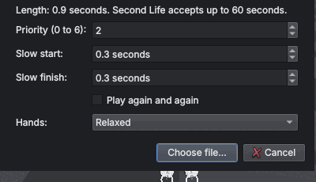

   - **Length** wordt als tekst getoond. Second Life accepteert tot 60 seconden.
   - **Priority (0 to 6):** als twee animaties hetzelfde gewricht bewegen, wint het hogere getal.
   - **Slow start** en **Slow finish:** hoe lang de animatie erover doet om in en uit te faden.
   - **Play again and again:** gebruik de luspunten.
   - **Hands:** hoe de vingers eruitzien tijdens het afspelen.
3. Druk op **Choose file...** en kies een naam. Het bestand eindigt op `.anim`.

Het programma controleert de animatie tijdens het exporteren aan de regels van Second Life.

### Stap 10: Uploaden naar Second Life

Uploaden gebeurt in de Second Life-viewer, niet in PinglyMotion.

1. Kies in de viewer **Build > Upload > Animation**. (De exacte menunaam hangt af van je viewer.)
2. Kies je `.anim`-bestand.
3. Stel dezelfde prioriteit en lus in als in het exportvenster. De viewer vraagt om een kleine vergoeding.
4. Draag of speel de animatie af om hem te zien.

Een eerlijke opmerking: export, upload en afspelen zijn op 21 november 2026 in Firestorm gevalideerd. Andere viewers zijn niet getest. Uploaden kost in Second Life een kleine vergoeding.

### Als er iets misgaat

- **De figuur beweegt niet.** Je zit misschien op het vergrendelde eerste frame. Sleep de tijdmarkering naar een later frame.
- **Een gewricht wil niet verder draaien.** Het zit op het verste punt. Draai het terug of druk in de waarschuwing op **Turn limits off**.
- **Je vindt een key niet mooi.** Druk op Ctrl+Z om ongedaan te maken.
- **Je bent het overzicht kwijt.** Druk op **0** voor de beginweergave of druk op **Whole figure** (Shift+F).
- **Er beweegt niets bij het afspelen.** Een gewricht heeft twee keys op verschillende frames nodig.

---

## Hoofdstuk 4: Poseren in detail

### Het paneel Joints

Het paneel heeft twee tabbladen: **Avatar** en **Props** (Hoofdstuk 7).

Op het tabblad Avatar, van boven naar beneden:

- **Animation:** de naam van de geopende animatie. Een nieuwe animatie heet `pingle`.
- **Figure:** `female` of `male`. Dit verandert alleen wat je ziet.
- **Size:** de grootte van de figuur in de weergave (100% bij de start).
- **Left**, **Right** en **Mirror**: welke kant de lijst toont en welke kant een bewerking verandert. De tip bij **Mirror** zegt: "turning one side turns the other side too". Beweegt de andere arm mee terwijl je er maar één wilde, druk dan op **Mirror** om het uit te zetten.
- Vier tabbladen: **Body**, **Face**, **Hands** en **Other**.
- **Search joints:** typ een deel van een naam.
- De lijst met gewrichten, in groepen: Body, Left Arm, Right Arm, Legs en meer.
- **Flip:** spiegelt de hele pose van links naar rechts.
- **T-pose:** armen recht opzij.
- **Reset all:** zet elk gewricht terug.

### Het paneel Selected joint

Als een gewricht is gekozen, toont het paneel:

- zijn naam en hoeveel keys het heeft,
- zijn naam in Second Life (bijvoorbeeld `mShoulderLeft`),
- drie schuifregelaars met getalvakken (in graden) en het **toegestane bereik**,
- een waarschuwing als je dicht bij de grens komt. **Turn limits off** haalt de grens weg. **Warn near the joint's limits** zet de waarschuwing uit,
- **Reset joint** en **Pull with keys**,
- **Pull the limb** en **Turn only this joint**: wat slepen aan het gewricht doet,
- **More options** met **turn or move**: het gewricht draaien of verplaatsen,
- **Show curves and finger grid**, een knop bovenaan het paneel. Hij toont de extra bedieningselementen van de Expert-modus. Een tweede knop, **Show all joints**, verschijnt als er niets is gekozen.

Als je niets hebt gekozen, toont het paneel drie korte stappen en een knop die een gewricht voor je kiest.

### Een ledemaat trekken

Druk op een gewricht op de figuur en sleep. De gewrichten erboven buigen zodat het ledemaat de aanwijzer volgt. Dit heet IK (inverse kinematica). Laat los om een key te zetten. Esc annuleert. Houd **Shift** ingedrukt als je op het gewricht drukt om alleen dat gewricht te draaien.

Geen muis? Druk op **Enter** op het gekozen gewricht. Gebruik de pijltjestoetsen. Druk op Enter om een key te zetten. Esc annuleert.

### Handen

Op het tabblad **Hands** krijg je:

- negen kant-en-klare vingerposes,
- één **Bend**-schuifregelaar voor elke vinger,
- **Reset hand**,
- in de Expert-modus een raster van elk vingergewricht in graden.

**Mirror** kopieert een wijziging naar de andere hand. De regel bovenaan zegt aan welke hand je werkt, bijvoorbeeld "Right hand. The other hand copies it."

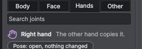

**Voorbeeld.** Open het tabblad **Hands**. Kies een van de kant-en-klare poses. Druk op **Set key**.

### Face en Other

Het tabblad **Face** toont de Bento-gezichtsgewrichten: hoofd, wenkbrauwen, ogen, oren en meer. Het tabblad **Other** toont de extra Bento-gewrichten: staart, achterpoten en vleugels. Gebruik **View > Joint groups** om deze groepen te tonen of te verbergen. **Hide in lists** laat verborgen gewrichten weg uit de lijsten.

De gezichtsgewrichten zijn geparkeerd: ze zijn er, maar krijgen nog geen speciale aandacht.

### Gewrichtsgrenzen

Elk gewricht heeft het bereik dat Second Life toestaat. Bij de grens waarschuwt het paneel je. De grenzen staan standaard aan.

---

## Hoofdstuk 5: De tijdlijn, keys en afspelen

### Rijen

De tijdlijn toont een rij voor elk gewricht met wijzigingen en voor het gekozen gewricht. Rijen zijn gekleurd en benoemd naar lichaamsdeel. Het vak **Show rows for** filtert op lichaamsdeel. De Expert-modus voegt een schakelaar toe om elk gewricht te tonen.

Zonder keys zegt de tijdlijn **No keys yet** en biedt **Set the first key** aan.

### Keys

- **Set key** (K) slaat de pose op die je nu ziet.
- Een gewricht draaien zet vanzelf een key.
- Een markering in de tijdlijn toont elke key.
- Kies een key om zijn easing te veranderen (Hoofdstuk 3, stap 6).
- In de Expert-modus tekent **Edit curve...** je eigen snelheidscurve voor een beweging. Het venster onthoudt zijn plek en grootte.

### Selecteren, kopiëren en plakken

1. Houd **Shift** ingedrukt en sleep in de tijdlijn, of gebruik Shift en de pijltjestoetsen, om een stuk te selecteren.
2. **Edit > Copy** (Ctrl+C), **Cut** (Ctrl+X) of **Paste** (Ctrl+V).
3. **Paste mirrored** (Ctrl+Shift+V, Expert-modus) plakt met links en rechts verwisseld. Een linkerstap wordt een rechterstap.

### Ongedaan maken en Opnieuw

Ctrl+Z maakt ongedaan. Ctrl+Shift+Z of Ctrl+Y doet opnieuw. Elke bewerking of sleepbeweging is één stap. De geschiedenis bevat tot 100 stappen en overleeft Save.

### Luspunten

Onderaan de tijdlijn vind je:

- **Loop starts at** en **Loop ends at**: de twee frames waartussen de animatie loopt, met hun plek in procenten,
- **Frame ... of ...**: waar je bent en hoeveel frames er zijn,
- **Frames per second** (30 bij de start).

Het exportvenster gebruikt de lusframes als **Play again and again** is aangevinkt.

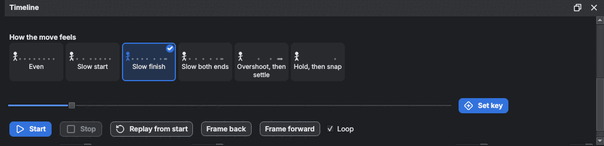

### Notitieregel

Sommige animaties dragen lesnotities. Volgens de projectdocumenten toont dan een regel onder de tijdlijn de notitie van het huidige frame, met **Hide notes**. (Een controle van `wave.dingle` in de Linux-versie toonde geen notitieregel, beschouw dit dus als onbevestigd.)

**Voorbeeld.** Open `wave.dingle` uit de map `examples`. Druk op **Start**. Kijk hoe de figuur zwaait. Druk op **Stop**.

### Langzaam voorbeeld

`jump_slow.dingle` is `jump.dingle` met elke key 2,5 keer later. Het draait op 40 procent van de snelheid, zodat je de sprong langzaam kunt bekijken.

---

## Hoofdstuk 6: De 3D-weergave en de camera

### Muis en toetsen

De standaardstijl, PinglyMotion genoemd, werkt zo:

| Wat | Hoe |
|---|---|
| Rondkijken (orbit) | Sleep op lege ruimte |
| De weergave verplaatsen (pan) | Rechts slepen |
| Zoomen | Muiswiel |
| Een gewricht kiezen | Klik erop, of op zijn rij |
| Scherpstellen op het gekozen gewricht | F, of dubbelklik erop |

In **Setup** of **Help > Camera and keys...** kun je in plaats daarvan de stijl van Maya, Blender of Second Life kiezen. Hoofdstuk 14 heeft de tabellen.

### De weergavebalk

Linksboven in de 3D-weergave:

- De **view-direction widget:** klik op het uiteinde van een as om vanaf daar te kijken.
- **Pick and pull** (V), **Look around** (O), **Move the view** (M), **Zoom** (Z).
- **Picked joint** (F), **Whole figure** (Shift+F), **Home view** (0).
- **Look from** (Front, Side, Top).
- **Show:** het vloerraster, draairingen, gewrichtspunten en gereedschapsnamen.

Elke instelling staat ook in het menu **View**.

### Het menu View

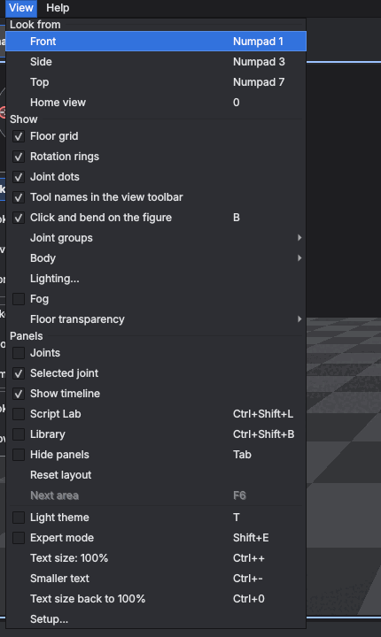

- **Look from:** Front (Numpad 1), Side (Numpad 3), Top (Numpad 7), Home view (0).
- **Show:** Floor grid, Rotation rings, Joint dots, Tool names in the view toolbar, **Click and bend on the figure** (B), Joint groups, Body, Lighting..., Fog, Floor transparency.
- **Joint groups** toont of verbergt groepen extra gewrichten: Wings, Tail, Hind limbs, Face en Fingers and toes. Verbergen verandert alleen wat je ziet. **Hide in lists** laat verborgen gewrichten weg uit de tijdlijn en de gewrichtenlijst. Staat het uit, dan worden ze gedimd getoond.
- **Body** kiest het lichaamsraster: **Ruth2** of **Max**. Het verandert alleen hoe de figuur eruitziet.
- **Lighting...** opent een klein venster met de schuifregelaars **Brightness** (Dark tot Bright), **Shine** (Matt tot Shiny) en **Warmth** (Cool tot Warm), een vinkje **Shadow on the floor** en de knoppen **Reset** en **Close**.
- **Fog** laat het verre eind van de vloer vervagen. Het staat bij de start uit.
- **Floor transparency:** 0, 25, 33, 50 of 75 procent.
- **Panels:** Joints, Selected joint, Show timeline, Script Lab, Library, Hide panels (Tab), Reset layout, Next area (F6).
- **Light theme** (T), **Expert mode** (Shift+E), tekstgrootte en **Setup...**.

**Voorbeeld.** Beweeg de aanwijzer over de 3D-weergave. Druk op **O** (look around) en sleep. Druk op **M** en sleep om de weergave te verplaatsen. Druk op **V** om terug te gaan naar gewrichten kiezen. Druk op **0** om thuis te komen.

### Tekstgrootte

**Ctrl++** maakt de tekst groter, **Ctrl+-** kleiner en **Ctrl+0** terug naar 100 procent. Setup biedt 100, 125, 150, 175 en 200 procent.

### Click and bend

Met **Click and bend** aan (B) kiest een klik op de figuur een gewricht en buigt slepen het. Staat het uit, dan doen klikken op de figuur niets. Gebruik de lijst Joints en de schuifregelaars.

---

## Hoofdstuk 7: Props

Een **prop** is een eenvoudige 3D-vorm in de scène. Hij staat voor een object. Een prop kan aan een gewricht worden vastgemaakt, zodat hij met dat gewricht meebeweegt.

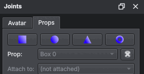

1. Kies **View > Joints**. Open het tabblad **Props**.
2. Druk op een vormknop: doos, bol, kegel of torus (een ring).
3. Het programma geeft hem een naam, bijvoorbeeld **Box 0**. De volgende doos is **Box 1**. Een prop kan nog niet worden hernoemd.
4. Plaats hem met **Place**, **Turn** en **Size** in het paneel rechts, dat nu **Selected prop** heet. Daar kun je ook de **Shape** veranderen: Box, Ring, Cone of Ball. Een klein vak boven de 3D-weergave, **Edit prop**, heeft de gereedschappen **Move**, **Turn** en **Size** om hem te slepen.
5. Kies een gewricht bij **Attach to**. De prop beweegt met dat gewricht mee.
6. De knop met het kruisje verwijdert de prop.

**File > Save** bewaart de props in het animatiebestand. **File > Open** haalt ze terug. **File > Open props...** en **Save props...** gebruiken de oudere `.prp`-bestanden. Een `.prp` openen verwijdert eerst de huidige props.

**Voorbeeld.** Open `throne.dingle` uit de map `examples`. De figuur zit. Kies **File > Open props...** en kies `throne.prp`. Er verschijnen dozen rond de figuur. De gekozen is blauw. Kies een andere naam in de lijst **Prop:** om hem te selecteren.

---

## Hoofdstuk 8: De bibliotheek

De bibliotheek bevat 106 kant-en-klare bewegingen. Gebruik er een als begin.

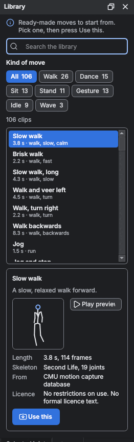

1. Druk bovenaan op **Library** (of Ctrl+Shift+B, of **View > Library**).
2. Zoek, of kies een soort beweging: Walk, Dance, Sit, Stand, Gesture, Idle, Wave.
3. Kies een clip. Het paneel toont een voorbeeld op een kleine figuur en **Play preview**.
4. Het toont ook lengte, skelet, waar het vandaan komt en de licentie.
5. Druk op **Use this**. De clip opent als jouw animatie. Het programma vraagt eerst door als je niet-opgeslagen wijzigingen hebt. De statusregel zegt "Opened Slow walk from the library. Save it under your own name." De eigen naam van de clip is de naam van de animatie tot je opslaat.

De Library deelt de rechterkant met Selected joint. Schakel met de tabbladen onderaan. In de Expert-modus zet **Add as a second figure** een clip in plaats daarvan naast je figuur.

**Voorbeeld.** Druk op **Library**. Kies **Slow walk**. Druk op **Use this**. Druk op **Start**. De Timeline toont dan 114 frames.

De bibliotheek komt uit de CMU-motioncapturedatabase en van Mesh2Motion. Zie [Hoofdstuk 17](#hoofdstuk-17-dank-en-bronnen).

Zegt het paneel **No library found**, dan ontbreekt de map `library` naast het programma. Installeer het programma opnieuw.

---

## Hoofdstuk 9: Bestanden en formaten

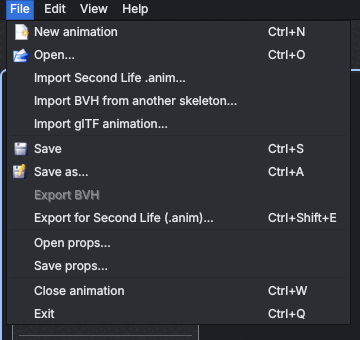

### De formaten

| Extensie | Wat | Opmerkingen |
|---|---|---|
| `.dingle` | Het eigen werkformaat van PinglyMotion | Bewaart alles. Geschreven als tekst (JSON). |
| `.anim` | Second Life-animatie | Export en import. |
| `.bvh` | Een gangbaar bewegingsbestand | Export, en openen. Een geopende `.bvh` blijft ongemoeid tot je opslaat. |
| `.avm` | Het oude formaat | Gaat open. Wordt als `.dingle` opgeslagen. |
| `.prp` | Oud propsbestand | Open props en Save props. |
| `.glb`, `.gltf` | 3D-animatie uit andere programma's | Alleen import. |

### Het menu File

- **New animation** (Ctrl+N), **Open...** (Ctrl+O), **Save** (Ctrl+S), **Save as...** (Ctrl+A).
- **Import Second Life .anim...** opent een `.anim` als een nieuwe, niet-opgeslagen animatie. Een lijst **What could not be imported** zegt wat is weggelaten.
- **Import BVH from another skeleton...** toont welke gewrichten zijn gekoppeld en welke zijn weggelaten. Vink **My file starts in a T-pose or A-pose** aan als het eerste frame een staande pose is. Druk op **Open the animation**. Een koppeling die je maakt, kan in een klein `.jointmap`-bestand worden bewaard.
- **Import glTF animation...** opent `.glb` of `.gltf`. Heeft het bestand meer dan één animatie, kies dan de gewenste.
- **Export BVH** maakt een `.bvh`-bestand.
- **Export for Second Life (.anim)...** (Ctrl+Shift+E).
- **Open props...** en **Save props...**.
- **Close animation** (Ctrl+W) en **Exit** (Ctrl+Q).

Elke import opent als een naamloze animatie. Je oorspronkelijke bestand wordt niet veranderd. Sla het op om het te bewaren.

**Voorbeeld.** Kies **File > Open** en kies `jump.dingle` in `examples`. Kies **File > Save as...** en sla het onder een nieuwe naam op. Kies **File > Export for Second Life (.anim)...** en maak `jump.anim`. Kies **File > Import Second Life .anim...** en open het opnieuw. Een melding zegt "Opened jump.anim." en somt op wat niet kon worden geïmporteerd. Voor dit bestand zegt ze dat prioriteit, zachte start en afloop, en handen niet bewaard blijven. De beweging zelf komt terug.

### De map voor AI-assistenten

Een AI-assistent kan alleen bestanden openen en opslaan in één map: `PinglyMotion` in je map Documenten. Zie [Hoofdstuk 11](#hoofdstuk-11-ai-assistenten).

---

## Hoofdstuk 10: Script Lab voor beginners

Het Script Lab is een veilige zandbak. Je kunt RLV- en LSL-scripts op je computer draaien. Niets bereikt Second Life.

Eerst een paar woorden.

- **LSL** is de scripttaal van Second Life.
- Een **script** is een klein programma in een object.
- Een **object** is gemaakt van **prims**. Een prim is één onderdeel, zoals een doos.
- **RLV** (Restrained Love Viewer) is een reeks opdrachten die een script naar een viewer kan sturen. Ze beperken wat een avatar mag doen, bijvoorbeeld `@detach=n` betekent "dit kan niet worden afgedaan".
- **RLVa** is een viewer die RLV en meer begrijpt.
- Een **kanaal** (channel) is een getal dat scripts gebruiken om te praten, zoals een radiokanaal.

**Eerlijke stand.** Het Script Lab is in veel onderdelen gebouwd. Niets erin is in Second Life getest. De zandbak is nooit identiek aan Second Life. Zie [Wat af is en wat niet](#wat-af-is-en-wat-niet).

Open het Script Lab met de knop **Script** (F8) of de knop **Script Lab** (Ctrl+Shift+L).

### De bovenkant van het venster

- **Viewer rules:** **RLV** of **RLVa**. De start is RLVa. Omschakelen verwijdert elke beperking, zoals na een nieuwe aanmelding.
- Een chip toont hoeveel beperkingen worden vastgehouden ("0 held").
- Vijf tabbladen: **Live scripts**, **Type commands**, **Who talks to whom**, **Player**, **Improve a setup**.
- **Pop out** verplaatst het Script Lab naar een eigen venster.

### Maak het voorbeeldproject

1. Druk op **Script**.
2. Druk op **Make example project**.

Het programma kopieert het voorbeeld **First colour** naar je eigen map (`Documents/PinglyMotion/Scripts/First_colour`). Het voegt een doos toe aan de scène. Het bekijkt de map. Een kaart **Steps** toont vijf stappen en vinkt ze af.

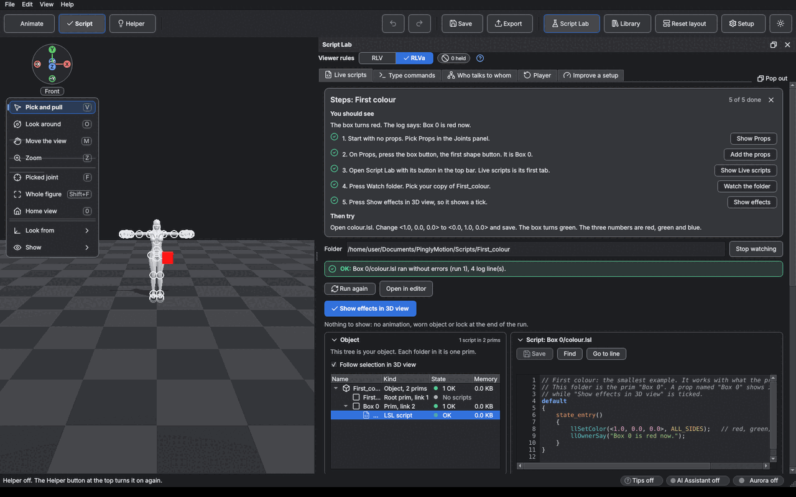

Je zou moeten zien:

- een rode doos naast de figuur,
- de melding **OK: Box 0/colour.lsl ran without errors**,
- de logregel "Box 0 is red now."

### De boom

Het vak **Object** toont je object als boom. Elke map is één prim. De map **Box 0** is een prim. Het script erin is de rij **LSL script**. De kolommen zijn **Name**, **Kind**, **State** en **Memory**.

Klik op een rij. Met **Follow selection in 3D view** aangevinkt licht de prop met dezelfde naam op in de 3D-weergave.

### Verander het script

1. Het script staat open in de editor rechts. (**Open in editor** opent het opnieuw.)
2. Verander `<1.0, 0.0, 0.0>` in `<0.0, 1.0, 0.0>`.
3. Druk op **Save**.

De doos wordt groen. De drie getallen zijn rood, groen en blauw. Elke keer opslaan voert de map opnieuw uit. Druk op **Run again** om hem zonder wijziging uit te voeren.

De editor heeft **Save**, **Find** en **Go to line**. Hij toont suggesties en hulpteksten voor LSL-functies terwijl je typt. Hij stelt ook RLV-opdrachten voor binnen `llOwnerSay("@...")`, met duidelijke waarschuwingen. Schakel in Setup over op **Show suggestions only when I press Ctrl+Space** als je dat liever hebt.

### Effecten tonen in de 3D-weergave

De knop **Show effects in 3D view** laat props zien wat de scripts doen: kleur en doorzichtigheid. Een prop met dezelfde naam als een prim toont het effect van de scripts van die prim. Op een prop klikken telt als een aanraking. Een menu dat een script toont (`llDialog`) verschijnt als een vak boven de 3D-weergave. Druk daarin op een knop, of op **Ignore** (Esc).

### Andere voorbeelden

De map `examples/objects` heeft zes objecten meer: Button HUD, Gear set, Timed lock, RLV relay en Work system. `examples/scriptlab` heeft losse scripts. Druk op **Try the example scripts** (als er geen map wordt bekeken) om `rlv_lock.lsl` uit te voeren.

**Watch folder...** bekijkt elke map van jezelf. Een map is een object. **New folder** maakt een nieuwe.

### Type commands

Het tabblad **Type commands** is voor RLV-regels.

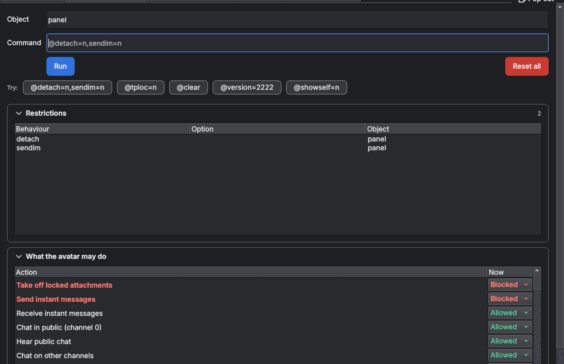

1. Open het tabblad **Type commands**.
2. Klik in het vak **Command**, typ `@detach=n,sendim=n` en druk op Enter.
3. Het tabblad toont **Restrictions** (detach en sendim), vastgehouden door het object `panel`. Onder **What the avatar may do** zeggen **Take off locked attachments** en **Send instant messages** nu **Blocked**.

De chips onder **Try** vullen een kant-en-klaar voorbeeld in. **Reset all** verwijdert elke beperking. Elke rij in de actielijst is een keuze **Allowed / Blocked** die je kunt instellen. Het logboek **Replies and messages** toont de antwoorden die een script zou horen.

Het tabblad heeft ook schakelaars voor cameralimieten, omgeving en weergavemodi in de 3D-weergave, en een onderdeel genaamd **Vision sphere**.

### Who talks to whom

Het tabblad **Who talks to whom** tekent een kaart terwijl een map wordt bekeken. Open het onderdeel **Who talks to whom** door op de kop te klikken. Bij het voorbeeld First colour zie je een vak **Box 0** met een pijl naar het gestippelde vak **You**, met het opschrift `owner say: "Box 0 is red now."`.

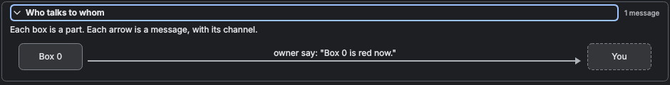

In grotere opstellingen zijn de vakken de prims, en ook **You**, **Your viewer (RLV)** en **Web server**. Pijlen tonen chat, linkberichten, menu's en RLV-regels, met hun kanaal. Een pijl die niemand hoort, is gestippeld, rood en zegt waarom. Een prim die luistert en opdrachten doorgeeft, is gemarkeerd met **(hub)**. Een klik op een pijl toont de scriptregel die hem verstuurde.

### Player

Druk op het tabblad **Player** op **Record what I do**. Klik op props of druk op menuknoppen. Elke actie is een stap. Druk op **Stop recording**.

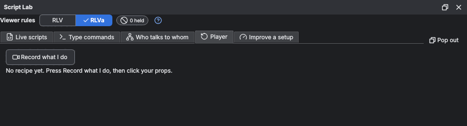

Het programma slaat de stappen op als `recipe.rlvtest` in de objectmap. Het speelt ze opnieuw af en zegt wat er sinds de vorige keer is veranderd. De speler heeft dezelfde knoppen Start, Stop, Step back en Step forward als de tijdlijn. Hij toont de momenten en wat er op elk moment waar was. **Go to first difference** springt naar de eerste wijziging.

Not built: de speler beweegt de animatie, de camera, de omgeving of het menuvak niet. Die tonen de live run.

### Improve a setup

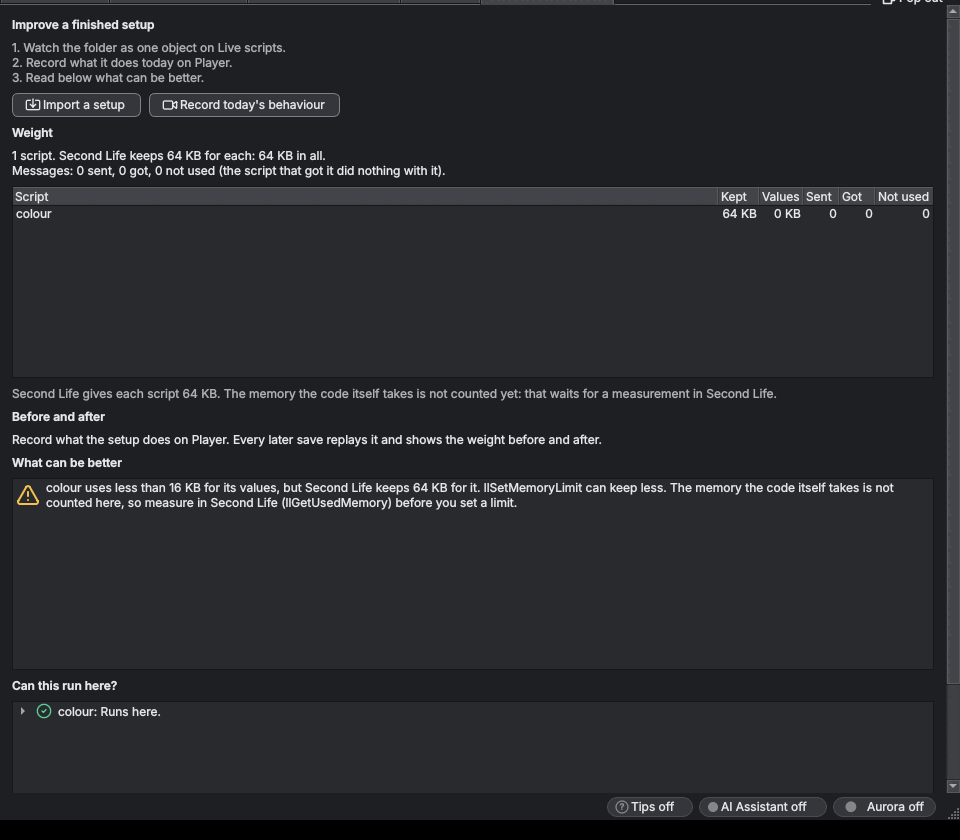

Voor een afgemaakte opstelling, zoals een halsband:

1. Bekijk de map als één object (Live scripts).
2. Neem op wat hij doet (Player).
3. Lees het tabblad **Improve a setup**.

Het toont hoe zwaar elk script is (**Kept**, **Values**, **Sent**, **Got**, **Not used**), wat beter kan, en per script of het hier kan draaien. **Import a setup** en **Record today's behaviour** staan op het tabblad.

Het geheugen van de code zelf wordt nog niet meegeteld. Daarvoor is een meting in Second Life nodig.

### Het OpenCollar-voorbeeld

`examples/improve/OpenCollar` bevat de 23 scripts van de openbare OpenCollar-halsband. Ze zijn ongewijzigd gekopieerd, met hun licentie (GPL 2). Bekijk de map. De halsband start en toont zijn menu als je erop klikt. **Not tested in Second Life.**

### Lua (een proef)

Lua is een nieuwere scripttaal in Second Life. Ze heet SLua.

1. Open **Setup**. Vink **Lua (trial): show the language choice in the editor** aan.
2. De editor toont een vak **Language** met **LSL** en **SLua (Lua, trial)**.
3. Kies SLua. Scrol omlaag in het tabblad Live scripts. Druk aan het rechteruiteinde van de regel onder de tekst op **Convert to SLua**.

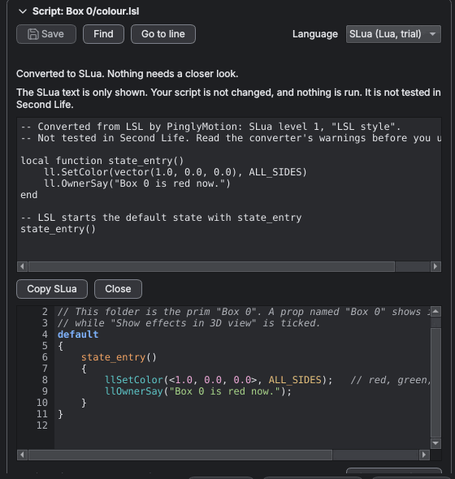

Het deelvenster toont de omgezette tekst en opmerkingen. Je script wordt niet veranderd. Er wordt niets uitgevoerd. **Copy SLua** kopieert de tekst. **Close** sluit het deelvenster.

Lua is een proef. De omzetter wordt gecontroleerd met tests die exacte tekst vergelijken. Hij is **not tested in Second Life**. Er zijn geen Lua-controles of suggesties, en Lua draait niet.

### Stappen en de gids

**Help > Script Lab steps** toont de stappenkaart opnieuw.

---

## Hoofdstuk 11: AI-assistenten

Een AI-assistent op je eigen computer kan de figuur poseren, afspelen, bekijken en opslaan. Dit is optioneel. Hij staat **bij elke start uit** en gaat nooit uit zichzelf aan.

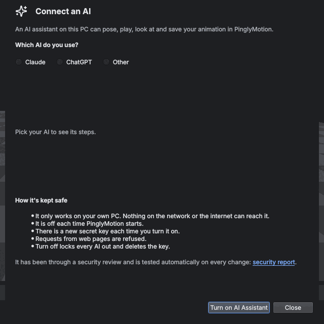

### Zet hem aan

1. Klik op de knop **AI Assistant** in de statusbalk (rechtsonder).
2. Het venster **Connect an AI** vraagt "Which AI do you use?" Kies **Claude**, **ChatGPT** of **Other**. Elk toont alleen zijn eigen stappen.
3. Druk op **Turn on AI Assistant**.

De knop toont een stip en zijn toestand:

| Stip | Tekst | Betekenis |
|---|---|---|
| Grijs | AI Assistant off | Uit. |
| Geel | AI Assistant on, waiting for an AI | Aan, geen AI verbonden. |
| Groen | AI Assistant: Claude | Een AI is verbonden. |
| Rood | A wrong key was refused | Iets probeerde een verkeerde sleutel. |

De venstertitel zegt "AI Assistant on" zolang hij aan staat. Klik nogmaals op de knop om hem uit te zetten. Uitzetten sluit elke AI buiten.

### Hoe hij veilig wordt gehouden

- Hij werkt alleen op je eigen pc. Niets op het netwerk kan erbij.
- Hij staat uit elke keer dat PinglyMotion start.
- Er is elke keer dat je hem aanzet een nieuwe geheime sleutel.
- Verzoeken van webpagina's worden geweigerd.

### Wat een assistent kan doen

Een assistent gebruikt de opdrachten van de besturingsinterface: de toestand bekijken, gewrichten poseren, frames instellen, afspelen, een schermafbeelding maken, de pose en de beweging in woorden beschrijven, een hele animatie als een kleine teksttabel lezen en schrijven, een animatie controleren aan de regels van Second Life, `.anim` exporteren, de bibliotheek doorzoeken en het Script Lab gebruiken (RLV-opdrachten en LSL-scripts). De volledige lijst staat in `docs/CONTROL.md` en `tools/mcp/commands.json`.

De assistent kan alleen bestanden openen en opslaan in de map `Documents/PinglyMotion`.

### Stand

- **Claude:** het Windows-zipbestand bevat `mcp/PinglyMotion.mcpb`, een extensie voor de Claude-app.
- **ChatGPT:** de installatie is beschreven. De knop schrijft de configuratie van de desktopapp. **Door ons niet getest.**
- **Andere hulpmiddelen:** het bestand `pinglymotion_mcp.js` bedient andere hulpmiddelen die MCP spreken. **Door ons niet getest.**

Handwerk werkt altijd zonder AI. De volledige statuslijst staat in [Wat af is en wat niet](#wat-af-is-en-wat-niet).

---

**Voorbeeld.** Druk op de knop **AI Assistant**. Kies **Claude** en lees de stappen. Druk alleen op **Turn on AI Assistant** als je een AI wilt verbinden. Druk op **Close**. De knop zegt nog steeds "AI Assistant off".

### De besturingsopdrachten

De opdrachten die een assistent kan gebruiken, zijn dezelfde voor elk programma op je pc dat gewoon HTTP spreekt. Ze staan in `GET /api/commands` en in `docs/CONTROL.md`. In het kort:

| Groep | Opdrachten |
|---|---|
| Kijken | `state`, `joints`, `get_pose`, `keys`, `screenshot`, `describe_pose`, `describe_motion`, `describe_body` |
| Pose en tijd | `set_pose`, `set_position`, `delete_key`, `set_frame`, `set_frame_count`, `set_fps`, `set_loop`, `play`, `stop` |
| Bestanden | `new_animation`, `open_file`, `save_file`, `export_anim` |
| De weergave | `set_figure`, `set_camera` |
| Hele animaties als tekst | `motion_script`, `load_motion_script`, `check_animation` |
| Bibliotheek | `find_reference`, `load_reference` |
| Script Lab | `rlv_command`, `rlv_state`, `rlv_reset`, `lsl_check`, `lsl_lint`, `lsl_run`, `lsl_event`, `lab_watch`, `lab_unwatch`, `lab_result`, `lab_replay` |

Je hoeft deze niet te kennen om PinglyMotion te gebruiken. Ze zijn voor AI-hulpmiddelen en voor mensen die scripts rond het programma schrijven.

---

## Hoofdstuk 12: De live koppeling met Aurora

Aurora is een Second Life-viewer. PinglyMotion kan je pose op je eigen avatar in Aurora tonen terwijl je werkt. Alleen jij ziet het. Er wordt niets geüpload.

**Stand.** Het werkt op Windows. Het heeft een Aurora nodig die is gebouwd uit de fork die in `docs/AURORA_LINK.md` wordt genoemd. Met de gewone Aurora werkt het nog niet.

**Voorbeeld.** Met de Aurora-fork actief:

1. Kies in Aurora **Build > LiveMesh > Enable preview**.
2. Vink in PinglyMotion **Live link to Aurora** aan in **Setup**, of klik op de stip in de statusbalk.
3. De statusbalk zegt "Waiting for Aurora", daarna "Aurora live".
4. Draai een gewricht. Je avatar neemt de pose aan.

De koppeling staat bij elke start uit.

---

## Hoofdstuk 13: Instellingen, thema's en hulp

Druk op **Setup** (het tandwiel rechtsboven).

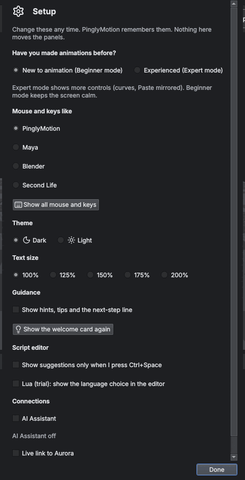

- **Have you made animations before?** New to animation (Beginner-modus) of Experienced (Expert-modus).
- **Mouse and keys like:** PinglyMotion, Maya, Blender of Second Life. **Show all mouse and keys** opent de tabel.
- **Theme:** Dark of Light.
- **Text size:** 100, 125, 150, 175 of 200 procent.
- **Guidance:** **Show hints, tips and the next-step line** en **Show the welcome card again**.
- **Script editor:** **Show suggestions only when I press Ctrl+Space** en de schakelaar **Lua (trial)**.
- **Connections:** **AI Assistant** en **Live link to Aurora**.

PinglyMotion onthoudt deze keuzes.

### Het menu Help

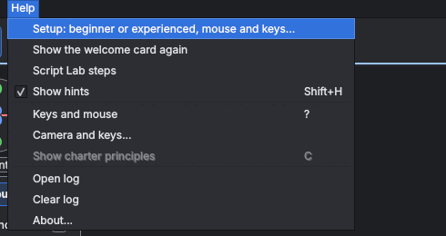

- **Setup: beginner or experienced, mouse and keys...**
- **Show the welcome card again**
- **Script Lab steps**
- **Show hints** (Shift+H)
- **Keys and mouse** (?)
- **Camera and keys...**
- **Show charter principles** (C), indien beschikbaar
- **Open log** en **Clear log**
- **About...**: wie de avatarlichamen heeft gemaakt en onder welke licentie.

**Voorbeeld.** Druk op **Setup**. Kies onder **Theme** **Light**. Kies onder **Text size** **150%**. Druk op **Done**. Beide wijzigingen blijven bewaard bij de volgende start.

### Hints en tips

Negen hintkaarten begeleiden de eerste stappen. **Next** gaat verder. **Turn hints off** stopt ze. De statusbalkschakelaar **Tips on/off** toont of verbergt korte hulp als de muis op een bedieningselement rust.

---

## Hoofdstuk 14: Sneltoetsen en muis

### Overal

| Toetsen | Wat |
|---|---|
| Ctrl+N | New animation |
| Ctrl+O | Open |
| Ctrl+S | Save |
| Ctrl+A | Save as |
| Ctrl+Shift+E | Export for Second Life |
| Ctrl+W | Close animation |
| Ctrl+Q | Exit |
| Ctrl+Z | Ongedaan maken |
| Ctrl+Shift+Z of Ctrl+Y | Opnieuw |
| K | Set key |
| Ctrl+X, Ctrl+C, Ctrl+V | Knippen, kopiëren, plakken |
| Ctrl+Shift+V | Paste mirrored (Expert-modus) |
| F7, F8 | Kant Animate, kant Script |
| Ctrl+Shift+L | Script Lab |
| Ctrl+Shift+B | Library |
| Tab | Alle panelen verbergen of tonen |
| F6 | Next area |
| T | Licht of donker thema |
| Shift+E | Expert-modus |
| Shift+H | Hints aan of uit |
| ? | Keys and mouse |
| Ctrl++, Ctrl+-, Ctrl+0 | Tekst groter, kleiner, terug naar 100% |
| Alt+1, Alt+2 | De eerste of tweede figuur kiezen (Expert-modus) |

### In de 3D-weergave

| Toetsen | Wat |
|---|---|
| V, O, M, Z | Gereedschappen: pick and pull, look around, move the view, zoom |
| F | Scherpstellen op het gekozen gewricht |
| Shift+F | Whole figure |
| 0 | Home view |
| Numpad 1, 3, 7 (of 1, 3, 7) | Front, side, top |
| Alt + pijltjestoetsen | Rondkijken met toetsen |
| Page Up, Page Down | Zoomen met toetsen |
| B | Click and bend aan of uit |
| Esc | Een sleepbeweging annuleren |
| Enter op een gekozen gewricht | Trekken met de pijltjestoetsen; Enter zet een key |

### De camerastijlen

| Actie | PinglyMotion | Maya | Blender | Second Life |
|---|---|---|---|---|
| Rondkijken | Sleep op lege ruimte | Alt + links slepen | Midden slepen | Alt + slepen (zijwaarts), Ctrl + Alt + slepen |
| De weergave verplaatsen | Rechts slepen | Alt + midden slepen | Shift + midden slepen | Ctrl + Alt + Shift + slepen |
| Zoomen | Muiswiel | Alt + rechts slepen, of wiel | Ctrl + midden slepen, of wiel | Alt + omhoog of omlaag slepen, of wiel |
| Een gewricht kiezen | Klik erop, of op zijn rij | Klik | Klik | Klik |
| Scherpstellen op het gewricht | F, of dubbelklik | F | Numpad . | Alt + klik |

### Gewrichten

| Wat | Hoe |
|---|---|
| Een ledemaat trekken | Druk op een gewricht en sleep. Laat los om een key te zetten. Esc annuleert. |
| Alleen dat gewricht draaien | Houd Shift ingedrukt als je op het gewricht drukt |
| Op één as draaien | Sleep de rode X-, groene Y- of blauwe Z-ring |

Dezelfde tabel staat in het programma: **Help > Keys and mouse**.

**Voorbeeld.** Druk op **?** om de tabel te openen. Sluit hem. Druk op **Shift+E** om de Expert-modus aan te zetten en druk er nogmaals op om hem uit te zetten.

---

## Hoofdstuk 15: Elk menu-item

### File

Zie [Hoofdstuk 9](#hoofdstuk-9-bestanden-en-formaten).

### Edit

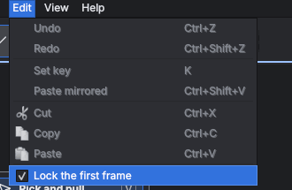

| Item | Toetsen | Wat |
|---|---|---|
| Undo, Redo | Ctrl+Z, Ctrl+Shift+Z | Een bewerking terugnemen en opnieuw doen. |
| Set key | K | De pose nu als key opslaan. |
| Paste mirrored | Ctrl+Shift+V | Plakken met links en rechts verwisseld. |
| Cut, Copy, Paste | Ctrl+X, C, V | Op het geselecteerde stuk van de tijdlijn. |
| Lock the first frame | | Standaard aan. Houdt de eerste pose veilig. |

### View

Zie [Hoofdstuk 6](#hoofdstuk-6-de-3d-weergave-en-de-camera).

### Help

Zie [Hoofdstuk 13](#hoofdstuk-13-instellingen-themas-en-hulp).

**Voorbeeld.** Open het menu **Help** en kies **About...**. Sluit het. Open **View** en kies **Floor transparency**, daarna 50%.

### Knoppen van de bovenbalk

| Knop | Wat |
|---|---|
| Animate, Script | Van kant wisselen (F7, F8) |
| Helper | Helper-paneel aan of uit |
| Undo, Redo | Hetzelfde als Edit |
| Save | De animatie opslaan |
| Export | Exporteren voor Second Life |
| Script Lab | Het Script Lab openen |
| Library | De Library openen |
| Reset layout | Elk paneel terugzetten |
| Setup | Setup openen |
| Zonknop | Donker of licht thema |

---

## Hoofdstuk 16: Problemen oplossen en feedback

- **De 3D-weergave is zwart.** Werk de videodriver bij. PinglyMotion heeft OpenGL 3.3 nodig.
- **Windows waarschuwt voor een onbekende uitgever.** Het programma is nog niet ondertekend. Dit is te verwachten in de vroege preview.
- **Een paneel is verdwenen.** Druk op **Reset layout**.
- **De tekst is te klein.** Druk op Ctrl++ of kies een tekstgrootte in Setup.
- **De bibliotheek zegt "No library found".** De map `library` moet naast het programma staan.
- **Een geïmporteerd bestand beweegt niet goed.** Open de lijst in het importvenster. Gewrichten gemarkeerd met **Left out** zijn niet overgenomen.
- **Een script doet niets in het Script Lab.** Lees het onderdeel **Errors and warnings**. De zandbak voert het meeste van LSL uit, maar niet alles.
- **Er is iets kapotgegaan.** Kies **Help > Open log**. Het logboek is een gewoon tekstbestand van wat het programma deed.

### Een bug melden of feedback geven

Ga naar <https://github.com/pingledingle-tech/PinglyMotion/issues> en open een issue. Zeg wat je deed, wat je verwachtte en wat er gebeurde. Zet geen persoonsgegevens in het issue. De website heeft ook pagina's voor bugmeldingen en suggesties.

---

## Hoofdstuk 17: Dank en bronnen

PinglyMotion is gratis en open source. Het is gebaseerd op QAvimator. De avatarlichamen, de bibliotheekclips, de voorbeeldhalsband en het andere materiaal van buitenaf staan vermeld in het bestand [CREDITS.md](../CREDITS.md) en in **Help > About...**.

De kant-en-klare bewegingen komen uit de CMU-motioncapturedatabase en van Mesh2Motion (CC0). De voorbeeldhalsband is het openbare OpenCollar-project (GPL 2).

---

## Woordenlijst

| Woord | Betekenis |
|---|---|
| Animatie | Alle beweging in één bestand. |
| Key | Een opgeslagen pose op één moment. |
| Frame | Eén stap in de tijd. |
| Tijdmarkering | De markering die je sleept om een moment te kiezen. |
| Tijdlijn | De strook die je keys over tijd toont. |
| Gewricht | Een onderdeel dat draait, zoals een elleboog. |
| Pose | Hoe de figuur op één moment staat. |
| Easing | Hoe een beweging tussen twee keys versnelt of vertraagt. |
| Lus | De animatie speelt steeds opnieuw af. |
| T-pose | Staan met de armen recht opzij. |
| Prop | Een eenvoudige 3D-vorm in de scène. |
| Prim | Eén onderdeel van een object in Second Life. |
| LSL | De scripttaal van Second Life. |
| RLV | Opdrachten die een script kan sturen om een avatar te beperken. |
| Kanaal | Een getal dat scripts gebruiken om te praten. |
| Zandbak | Een veilige plek om dingen uit te proberen. Niets verlaat hem. |
| IK | Een hand verplaatsen verplaatst de gewrichten erboven. |
