# Brukerveiledning for PinglyMotion

For PinglyMotion 0.3.0, en tidlig forhåndsversjon. Skrevet for folk som er nye innen animasjon og skripting.

Denne veiledningen sier hva hver del av programmet gjør. Den sier hva som er ferdig og hva som ikke er det. Der noe er en prøveversjon, eller ikke testet i Second Life, står det.

*Maskinoversatt fra den engelske veiledningen. Ingen som har norsk som morsmål har sjekket den. Hvis noe er uklart, gjelder den [engelske veiledningen](manual.html).*

Alle bildene er ekte skjermbilder av programmet (Linux-versjon, mørkt tema). Bildet som er merket «diagram» er tegnet for denne veiledningen.

**Innhold**

- [Begynn her](#begynn-her): hva det er, helhetsbildet, hvem det er for, hvor du starter
- [Hurtigstart: de første fem minuttene](#hurtigstart-de-første-fem-minuttene)
- [Hva som er ferdig og hva som ikke er det](#hva-som-er-ferdig-og-hva-som-ikke-er-det)
- [Kapittel 1: Installer og start](#kapittel-1-installer-og-start)
- [Kapittel 2: Vinduet på ett bilde](#kapittel-2-vinduet-på-ett-bilde)
- [Kapittel 3: Din første animasjon](#kapittel-3-din-første-animasjon)
- [Kapittel 4: Posering i detalj](#kapittel-4-posering-i-detalj)
- [Kapittel 5: Tidslinjen, nøkler og avspilling](#kapittel-5-tidslinjen-nøkler-og-avspilling)
- [Kapittel 6: 3D-visningen og kameraet](#kapittel-6-3d-visningen-og-kameraet)
- [Kapittel 7: Rekvisitter](#kapittel-7-rekvisitter)
- [Kapittel 8: Biblioteket](#kapittel-8-biblioteket)
- [Kapittel 9: Filer og formater](#kapittel-9-filer-og-formater)
- [Kapittel 10: Script Lab for nybegynnere](#kapittel-10-script-lab-for-nybegynnere)
- [Kapittel 11: AI-assistenter](#kapittel-11-ai-assistenter)
- [Kapittel 12: Den direkte koblingen til Aurora](#kapittel-12-den-direkte-koblingen-til-aurora)
- [Kapittel 13: Oppsett, temaer og hjelp](#kapittel-13-oppsett-temaer-og-hjelp)
- [Kapittel 14: Hurtigtaster og mus](#kapittel-14-hurtigtaster-og-mus)
- [Kapittel 15: Alle menyvalg](#kapittel-15-alle-menyvalg)
- [Kapittel 16: Feilsøking og tilbakemelding](#kapittel-16-feilsøking-og-tilbakemelding)
- [Kapittel 17: Takk og kilder](#kapittel-17-takk-og-kilder)
- [Ordliste](#ordliste)

---

## Begynn her

### Hva PinglyMotion er til for

Second Life er en virtuell verden. Folk der bruker animasjoner for at avatarene deres skal stå, sitte, danse og vinke. En **animasjon** er en bevegelse som er lagret i en fil.

PinglyMotion hjelper deg å lage slike bevegelser. Det er gratis. Det er åpen kildekode, som betyr at hvem som helst kan lese og forbedre programmet.

PinglyMotion gjør tre ting:

1. **Animere en figur.** Du bøyer leddene på en 3D-figur. Du lagrer posituren på bestemte tidspunkter. Programmet fyller inn bevegelsen mellom dem. Du eksporterer resultatet til Second Life.
2. **Teste skript trygt.** Objekter i Second Life bruker skript. PinglyMotion har en trygg sandkasse, **Script Lab**, der du kan kjøre RLV- og LSL-skript på din egen datamaskin. Ingenting du gjør der når Second Life. Bruk skript du stoler på. Script Lab er nytt, og et svært uvanlig skript kan få programmet til å krasje, så lagre animasjonen din først.
3. **Jobbe med en AI-hjelper, hvis du vil.** En AI-assistent på din egen datamaskin kan sette figuren i positur for deg. Den er av helt til du slår den på. Alt fungerer uten den.

PinglyMotion er en **tidlig forhåndsversjon**. Den er laget for utprøving og tilbakemeldinger. Regn med ujevnheter. Se [Hva som er ferdig og hva som ikke er det](#hva-som-er-ferdig-og-hva-som-ikke-er-det).

### Helhetsbildet

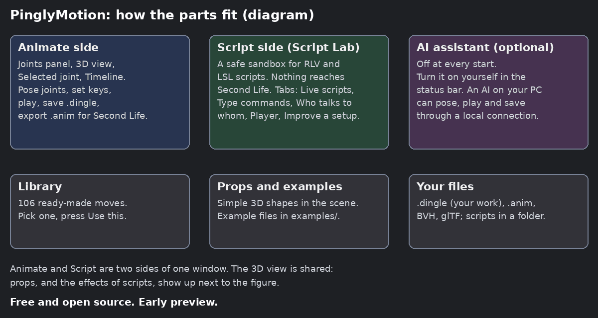

*Diagram tegnet for denne veiledningen.*

Programmet er ett vindu med to sider. Du bytter med knappene **Animate** og **Script** øverst til venstre.

- **Animate** viser panelene for å lage en animasjon: Joints-listen, 3D-visningen, panelet Selected joint og Timeline.
- **Script** gir det meste av vinduet til Script Lab. 3D-visningen blir stående til venstre.

Hver side husker sin egen oppsetting av paneler. 3D-visningen er felles. En rekvisitt (en enkel 3D-form) eller virkningen av et skript vises ved siden av figuren.

Andre deler:

- **Library** inneholder 106 ferdige bevegelser. Du kan starte med en av dem.
- **Rekvisitter** er enkle former du kan plassere i scenen.
- Mappen **examples** ved siden av programmet inneholder filer du kan åpne og følge med på sammen med denne veiledningen.
- **AI Assistant** er en bryter nederst til høyre. Den er av ved hver oppstart.

### Hvem det er for

- **Nybegynnere.** Du har aldri laget en animasjon eller skrevet et skript. Programmet starter i Beginner-modus. Det viser et velkomstkort, hintkort og et Helper-panel. Denne veiledningen forklarer hvert ord.
- **Erfarne brukere.** Du kan animasjonsverktøy som Maya eller Blender. Slå på Expert-modus (Shift+E). Da får du flere kontroller, for eksempel kurveredigering og en andre figur. Du kan velge mus- og tastestil fra Maya, Blender eller Second Life.

### Hvor skal jeg starte?

- **Jeg vil lage en animasjon.** Les [Hurtigstart](#hurtigstart-de-første-fem-minuttene). Følg deretter [Kapittel 3: Din første animasjon](#kapittel-3-din-første-animasjon).
- **Jeg vil teste skript.** Gå til [Kapittel 10: Script Lab for nybegynnere](#kapittel-10-script-lab-for-nybegynnere). Du trenger ingen animasjon først.
- **Jeg vil ha hjelp av en AI.** Les [Kapittel 11](#kapittel-11-ai-assistenter).
- **Jeg vil vite hva som fungerer.** Les [Hva som er ferdig og hva som ikke er det](#hva-som-er-ferdig-og-hva-som-ikke-er-det).

---

## Hurtigstart: de første fem minuttene

1. **Last ned.** Hent Windows-zip-filen eller Linux-AppImage fra utgivelsessiden (se [Kapittel 1](#kapittel-1-installer-og-start)).
2. **Start.** På Windows pakker du ut zip-filen. Start `PinglyMotion.exe`. På Linux gjør du AppImage kjørbar og starter den.
3. **Velkomstkort.** Første oppstart viser «Make your first animation». Velg **New to animation**. Trykk **Standing**.

   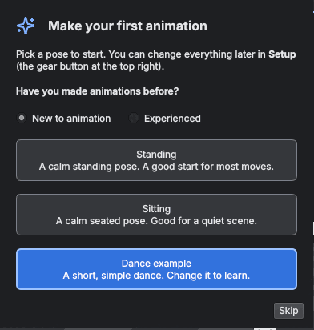

4. **Åpne Joints-listen.** Velg **View > Joints**. Klikk **Left Arm: Whole Arm** i listen. Figuren viser ringer på det leddet.
5. **Lagre en første nøkkel.** Trykk **Set the first key** nederst på skjermen. En nøkkel er en lagret positur på ett tidspunkt.
6. **Sett i positur.** Dra tidsmarkøren (glideren over Start-knappen) mot høyre. I panelet **Selected joint** skriver du `-60` i boksen **Lean to the side**. Trykk Enter. Armen senkes. Programmet lagrer en nøkkel for deg.
7. **Spill av.** Trykk **Start**. Trykk **Stop** for å stoppe.
8. **Lagre.** Trykk **Save** øverst og velg et navn. Filen ender på `.dingle`.

Det er en hel animasjon. [Kapittel 3](#kapittel-3-din-første-animasjon) forklarer hvert trinn. For å lage en fil til Second Life trykker du **Export** (se [Kapittel 9](#kapittel-9-filer-og-formater)).

Det som ikke er ferdig, står i [Hva som er ferdig og hva som ikke er det](#hva-som-er-ferdig-og-hva-som-ikke-er-det).

---

## Hva som er ferdig og hva som ikke er det

Hvert punkt har ett av disse ordene:

- **Built.** Det fungerer i programmet og har automatiske tester.
- **Partly built.** Noe av det fungerer. Teksten sier hva som mangler.
- **Trial.** Det finnes, men det er en prøve. Det kan endre seg eller gå i stykker.
- **Not built.** Det er planlagt eller bare en idé.
- **Not tested in Second Life.** Programmet gjør det det skal på din datamaskin. Ingen har ennå sjekket at Second Life godtar eller kjører resultatet.

Datoene er fra prosjektets dokumenter per 25. november 2026.

| Del | Status | Merknader |
|---|---|---|
| Sette ledd i positur, nøkler, tidslinje, avspilling, angre | Built | Kapittel 3 til 5. |
| Lagre som `.dingle`, åpne `.dingle`, `.bvh`, `.avm` | Built | Gamle `.avm`-filer åpnes og lagres som `.dingle`. |
| Eksport til Second Life (`.anim`) | Built | Eksport, opplasting og avspilling av en testanimasjon er prøvd i Second Life. |
| Importere `.anim`, BVH fra et annet skjelett, glTF | Built | Fotlås (hindrer at føttene glir) er **not built**. |
| Bibliotek med 106 bevegelser | Built | Bevegelsene kommer fra åpne kilder. Lisensene vises i panelet. |
| Rekvisitter (boks, kule, kjegle, ring) | Built | Det er enkle former. En rekvisitt kan ikke gis nytt navn ennå. |
| To figurer i én scene (Expert-modus) | Built | Bare i Expert-modus. |
| Ansiktsledd | Partly built | Ansiktsleddene er satt på vent. Fanen Face finnes, men ansiktet er ikke et satsingsområde. |
| Script Lab: RLV-kommandoer | Built | En sandkasse med mer enn 200 RLV-atferder. **Not tested in Second Life.** Den endelige testen er alltid i Second Life. |
| Script Lab: LSL-skript kjører i en sandkasse | Partly built | Mer enn 280 innebygde funksjoner, en simulert klokke. Noen funksjoner registrerer bare hva de ble bedt om. Mange gjør ingenting ennå. **Not tested in Second Life.** |
| Script Lab: Live scripts, tre, rekvisitter fra prims | Built | Én mappe er ett objekt. En rekvisitt med samme navn som en prim hører til den. |
| Script Lab: Player, Who talks to whom, Record what I do | Built | **Not tested in Second Life.** Noen deler av 3D-visningen følger ikke spilleren (se Kapittel 10). |
| Script Lab: Improve a setup | Partly built | Minnetallene tar ikke med minnet som selve koden bruker. Det krever en måling i Second Life. |
| Script Lab: OpenCollar-eksempel | Built | Et ekte halsbånd med 23 skript kjører i sandkassen. **Not tested in Second Life.** |
| Script Lab: Lua (SLua) | **Trial** | Bak en bryter som er av ved start. Editoren får et språkvalg og en knapp **Convert to SLua**. Ingenting kjører Lua ennå. Ingen Lua-sjekker eller forslag. **Not tested in Second Life.** |
| Nettversjon (i en nettleser) | **Trial** | Det finnes bare en prøvebygging. Den fungerer ikke godt ennå. Ikke planlegg å bruke den. |
| AI-assistent (lokal styring) | Built | Av ved hver oppstart. Claude: en utvidelse følger med. ChatGPT og andre verktøy: oppsettet er skrevet, men **ikke testet av oss**. |
| Direkte kobling til Aurora | Partly built | Fungerer på Windows med en spesialbygd versjon (en fork) av Aurora-viseren. Fungerer ikke med vanlig Aurora ennå. |
| Oversettelser | Not built | Programmet finnes bare på engelsk. Rørleggerarbeidet er på plass. |
| Kodesignering for Windows | Not built | Windows kan advare om ukjent utgiver. |
| Installasjonsprogram | Not built | Windows-nedlastingen er en zip-fil. |

Noen forskjeller mellom programmet og den klikkbare mockupen på nettstedet blir fortsatt rettet. Hvis en skjerm i mockupen ser annerledes ut, stol på denne veiledningen og programmet.

---

## Kapittel 1: Installer og start

### Windows

1. Åpne prosjektets utgivelsesside: <https://github.com/pingledingle-tech/PinglyMotion/releases>.
2. Last ned Windows-zip-filen. Last også ned `SHA256SUMS` hvis du vil kontrollere nedlastingen.
3. Pakk ut zip-filen til en mappe du velger. La mappen `data` ligge ved siden av programmet.
4. Start `PinglyMotion.exe`.

Zip-filen inneholder også mappen `examples` (filer som brukes i denne veiledningen), mappen `library` og mappen `mcp` (for AI-assistenter).

Det finnes ikke noe installasjonsprogram. For å fjerne programmet sletter du mappen.

### Linux

1. Last ned AppImage fra utgivelsessiden.
2. Gjør den kjørbar: `chmod +x PinglyMotion*.AppImage`.
3. Start den.

### Hva du trenger

Et grafikkort og en driver med OpenGL 3.3 eller nyere. Hvis 3D-visningen forblir svart, oppdater grafikkdriveren.

### Hva programmet skriver på datamaskinen din

- Innstillinger: en vanlig fil (`%APPDATA%\PinglyMotion` på Windows, `~/.config/PinglyMotion` på Linux).
- En feillogg og tilkoblingsfilen for AI-assistenten: i `%LOCALAPPDATA%\PinglyMotion` på Windows eller `~/.local/share/PinglyMotion` på Linux.
- Script Lab-eksempler du lager: i `Documents/PinglyMotion/Scripts`.

PinglyMotion samler ingen personopplysninger og sender ingen telemetri. Programmet ser omtrent én gang i uken, når det starter, etter en nyere versjon (den «Update check»).

### Første oppstart

Første oppstart viser velkomstkortet (se Hurtigstart). Velg **Skip** hvis du vil ha en tom figur. Du kan vise kortet igjen med **Help > Show the welcome card again**.

**Eksempel.** Start programmet. Trykk **Skip** på velkomstkortet. Du ser en figur i T-positur (armene rett ut til sidene) på et rutete gulv.

---

## Kapittel 2: Vinduet på ett bilde

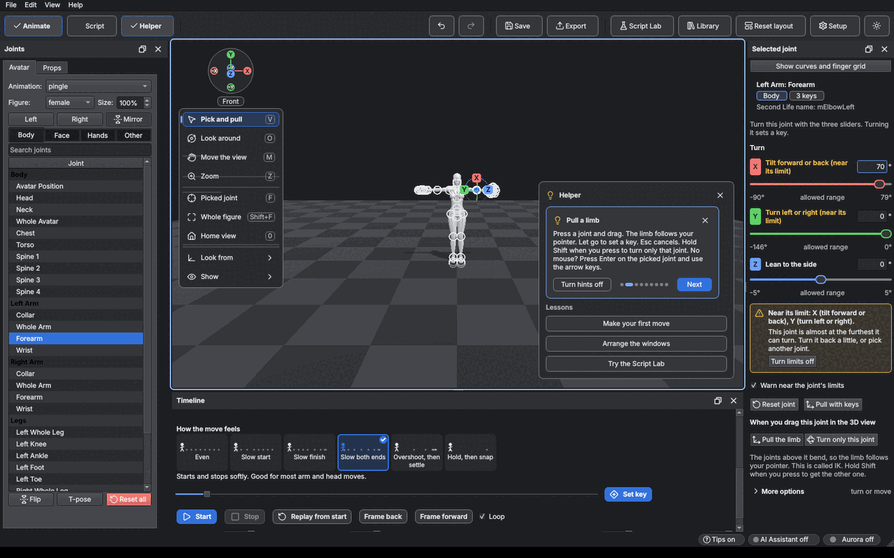

Ovenfra og ned:

- **Menylinje:** File, Edit, View, Help. Hvert menyvalg er listet i [Kapittel 15](#kapittel-15-alle-menyvalg).
- **Toppfelt.** Fra venstre til høyre:
  - **Animate** og **Script** bytter mellom de to sidene (F7 og F8).
  - **Helper** slår Helper-panelet av og på.
  - Pilene for Undo og Redo.
  - **Save** og **Export**.
  - **Script Lab** og **Library** åpner de panelene.
  - **Reset layout** setter hvert panel tilbake dit det startet.
  - **Setup** åpner innstillingene.
  - Solknappen bytter mellom mørkt og lyst tema.
- **Joints-panel** (til venstre): listen over ledd, med fanene Avatar og Props.
- **3D-visning** (midten): figuren og gulvet. Øverst til venstre er **view-direction widget** (klikk på enden av en akse for å se derfra). Under den er **view toolbar** med verktøyene Pick and pull, Look around, Move the view og Zoom.
- **Selected joint-panel** (til høyre): dreier leddet du har valgt.
- **Timeline** (nederst): nøkler over tid, easing-flisene, tidsmarkøren og avspillingsknappene.
- **Statuslinje** (aller nederst): en hjelpelinje til venstre. Til høyre: bryterne **Tips**, **AI Assistant** og **Aurora**.

### Paneler du kan flytte og endre størrelse på

Hvert panel kan:

- dras etter tittelen til et nytt sted,
- **løsrives** til et eget vindu (det lille firkantikonet i tittelen),
- få ny størrelse ved at du drar i skillelinjene mellom panelene,
- skjules med X-en i tittelen.

Trykk **Tab** for å skjule eller vise alle panelene. **View > Reset layout** (eller knappen **Reset layout**) setter alt tilbake. Reset layout nullstiller begge sidene.

**Eksempel.** Dra Timeline etter tittelen til høyre side. Trykk **Reset layout**. Den hopper tilbake til bunnen.

### Animate og Script

Trykk **Script** (eller F8). Script Lab fyller høyre side av vinduet.

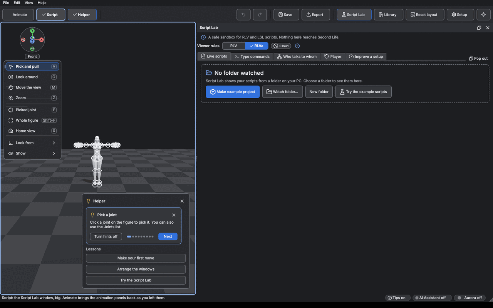

Trykk **Animate** (eller F7). Animasjonspanelene dine er tilbake slik du forlot dem.

### Helper

Knappen **Helper** viser et lite panel nederst til høyre i 3D-visningen. Det viser neste hintkort og tre korte leksjoner:

- **Make your first move:** velg et ledd, drei det, lagre en nøkkel og se på det.
- **Arrange the windows:** åpne Library, og sett så hvert vindu tilbake.
- **Try the Script Lab:** bytt til Script og tilbake.

En ring markerer den virkelige kontrollen et trinn snakker om. Et trinn går videre når du gjør det. Trykk **Turn hints off** for å stoppe hintkortene. Slå Helper av, så er programmet rent.

Helper-knappen og **Help > Show hints** (Shift+H) er den samme innstillingen.

### Beginner og Expert

**View > Expert mode** (Shift+E) viser flere kontroller. Expert-modus legger til:

- **Paste mirrored**,
- **Edit curve** i tidslinjen,
- et rutenett med hvert fingerledd i grader på fanen Hands,
- en bryter for å vise hvert ledd i tidslinjen,
- den andre figuren (File > Add a second figure, i Library-panelet: Add as a second figure).

Den samme bryteren finnes i **Setup**.

---

## Kapittel 3: Din første animasjon

Du skal lage en kort armbevegelse på omtrent ti minutter.

Først tre ord.

- En **nøkkel** er en lagret positur på ett tidspunkt. Programmet fyller inn bevegelsen mellom to nøkler.
- En **ramme** (frame) er ett steg i tid.
- **Tidsmarkøren** er glideren som velger tidspunktet du ser.

### Trinn 1: Start

1. Velg **File > New animation** (Ctrl+N). En figur dukker opp.
2. Eller velg **File > Open** og velg `wave.dingle` i mappen `examples` ved siden av programmet. Det er en ferdig animasjon å se på.

Figuren står i T-positur.

### Trinn 2: Åpne Joints-listen og velg et ledd

1. Velg **View > Joints**. Joints-panelet åpnes til venstre.
2. Klikk **Whole Arm** under **Left Arm** i listen. Eller klikk på armen på figuren.

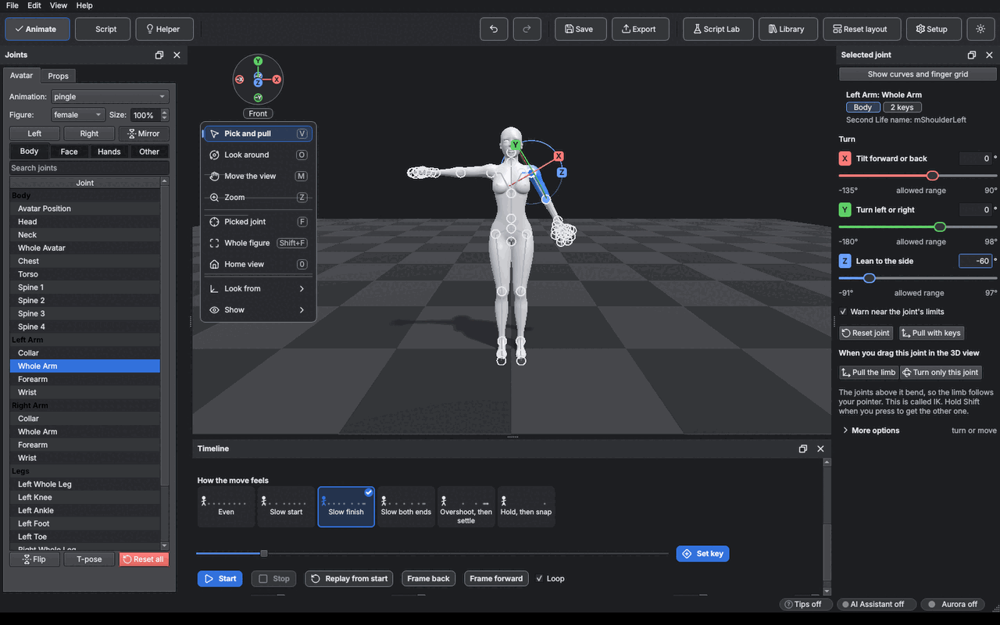

Panelet **Selected joint** viser navnet på leddet og tre glidere: **Tilt forward or back**, **Turn left or right** og **Lean to the side**. Hver av dem viser sitt tillatte område.

### Trinn 3: Sett den første nøkkelen

Trykk **Set the first key** nederst på skjermen (eller trykk **K**). Programmet lagrer posituren du ser nå som en nøkkel. Tidslinjen viser nå en rad for dette leddet.

En ny animasjon har 30 rammer. Den første rammen er låst for å beskytte den første posituren. Så den første nøkkelen din havner på ramme 2. For å låse opp den første rammen slår du av **Edit > Lock the first frame**.

### Trinn 4: Velg et senere tidspunkt

Dra tidsmarkøren (glideren over knappen **Start**) mot høyre. Teksten **Frame ... of ...** nederst i tidslinjen viser hvor du er. Figuren beholder posituren fra nøkkelen før.

Timeline-panelet er ikke høyt. Hvis du ikke ser glideren og avspillingsknappene, rull inne i Timeline, eller dra skillelinjen over den oppover.

### Trinn 5: Sett i positur

Gjør ett av disse:

- Skriv et tall i en boks i panelet Selected joint, for eksempel `-60` i **Lean to the side**, og trykk Enter.
- Dra en glider.
- Dra en farget ring på figuren. Rød dreier rundt X, grønn rundt Y og blå rundt Z.
- Dra selve leddet. Lemmen følger pekeren. Hold **Shift** for å dreie bare det leddet.

Å dreie et ledd lagrer en nøkkel for det leddet med én gang. Tidslinjen viser den. Statuslinjen sier «Key set at frame ... for ...».

### Trinn 6: Velg hvordan bevegelsen føles

Når en nøkkel er valgt, viser tidslinjen seks fliser under **How the move feels**:

| Flis | Betydning |
|---|---|
| Even | Samme fart hele veien. |
| Slow start | Starter rolig, og øker så farten. |
| Slow finish | Beveger seg i fart, og roer seg så. Bra for å legge ned en hånd. |
| Slow both ends | Starter og stopper mykt. Dette er standard for en ny nøkkel. |
| Overshoot, then settle | Går litt for langt, og kommer så tilbake. |
| Hold, then snap | Står stille, og hopper så. |

### Trinn 7: Spill av

1. Trykk **Start**. Animasjonen spilles av.
2. Trykk **Stop** for å stoppe.
3. **Replay from start** spiller fra første ramme.
4. **Loop** (avkrysset som standard) spiller om og om igjen.
5. **Frame back** og **Frame forward** flytter én ramme.

### Trinn 8: Lagre

1. Velg **File > Save as...** (Ctrl+A) eller trykk **Save** øverst.
2. Velg et navn. Filen ender på `.dingle`. Dette er arbeidsformatet. Det beholder alt arbeidet ditt.

### Trinn 9: Eksporter til Second Life

1. Trykk **Export** øverst, eller velg **File > Export for Second Life (.anim)...** (Ctrl+Shift+E).
2. En liten boks åpnes.

   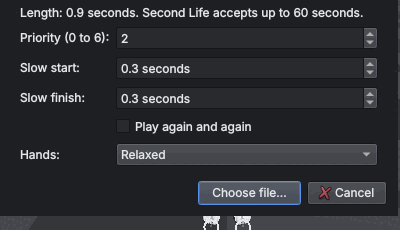

   - **Length** vises som tekst. Second Life godtar opptil 60 sekunder.
   - **Priority (0 to 6):** når to animasjoner beveger samme ledd, vinner det høyeste tallet.
   - **Slow start** og **Slow finish:** hvor lenge animasjonen bruker på å tone inn og ut.
   - **Play again and again:** bruk løkkepunktene.
   - **Hands:** hvordan fingrene ser ut mens den spilles.
3. Trykk **Choose file...** og velg et navn. Filen ender på `.anim`.

Programmet sjekker animasjonen mot reglene til Second Life mens du eksporterer.

### Trinn 10: Last opp til Second Life

Opplasting gjøres i Second Life-viseren, ikke i PinglyMotion.

1. Velg **Build > Upload > Animation** i viseren. (Det nøyaktige menynavnet avhenger av viseren din.)
2. Velg `.anim`-filen din.
3. Sett samme prioritet og løkke som i eksportboksen. Viseren ber om en liten avgift.
4. Ta på deg eller spill av animasjonen for å se den.

En ærlig merknad: eksport, opplasting og avspilling av en testanimasjon er prøvd i Second Life. Opplasting koster en liten avgift i Second Life.

### Hvis noe går galt

- **Figuren beveger seg ikke.** Du kan være på den låste første rammen. Dra tidsmarkøren til en senere ramme.
- **Et ledd vil ikke dreie lenger.** Det er så langt det kan dreie. Drei det tilbake, eller trykk **Turn limits off** i advarselen.
- **Du liker ikke en nøkkel.** Trykk Ctrl+Z for å angre.
- **Du har mistet oversikten i visningen.** Trykk **0** for hjemmevisningen, eller trykk **Whole figure** (Shift+F).
- **Ingenting beveger seg når du spiller av.** Et ledd trenger to nøkler på ulike rammer.

---

## Kapittel 4: Posering i detalj

### Joints-panelet

Panelet har to faner: **Avatar** og **Props** (Kapittel 7).

På fanen Avatar, ovenfra og ned:

- **Animation:** navnet på den åpne animasjonen. En ny animasjon heter `pingle`.
- **Figure:** `female` eller `male`. Dette endrer bare det du ser.
- **Size:** størrelsen på figuren i visningen (100 % ved start).
- **Left**, **Right** og **Mirror**: hvilken side listen viser og hvilken side en endring påvirker. Tipset på **Mirror** sier: «turning one side turns the other side too». Hvis den andre armen beveger seg når du bare ville ha én, trykk **Mirror** for å slå den av.
- Fire faner: **Body**, **Face**, **Hands** og **Other**.
- **Search joints:** skriv en del av et navn.
- Listen over ledd, i grupper: Body, Left Arm, Right Arm, Legs og flere.
- **Flip:** speilvender hele posituren fra venstre til høyre.
- **T-pose:** armene rett ut til sidene.
- **Reset all:** nullstill hvert ledd.

### Panelet Selected joint

Når et ledd er valgt, viser panelet:

- navnet og hvor mange nøkler det har,
- navnet i Second Life (for eksempel `mShoulderLeft`),
- tre glidere med tallbokser (i grader) og det **tillatte området**,
- en advarsel når du er nær grensen. **Turn limits off** fjerner grensen. **Warn near the joint's limits** slår advarselen av,
- **Reset joint** og **Pull with keys**,
- **Pull the limb** og **Turn only this joint**: hva det betyr å dra i leddet,
- **More options** med **turn or move**: drei eller flytt leddet,
- **Show curves and finger grid**, en knapp øverst i panelet. Den viser de ekstra kontrollene i Expert-modus. En andre knapp, **Show all joints**, vises når ingenting er valgt.

Når du ikke har valgt noe, viser panelet tre korte trinn og en knapp som velger et ledd for deg.

### Å dra i en lem

Trykk på et ledd på figuren og dra. Leddene over det bøyer seg slik at lemmen følger pekeren. Dette kalles IK (invers kinematikk). Slipp for å sette en nøkkel. Esc avbryter. Hold **Shift** når du trykker på leddet for å dreie bare det leddet.

Ingen mus? Trykk **Enter** på det valgte leddet. Bruk piltastene. Trykk Enter for å sette en nøkkel. Esc avbryter.

### Hender

På fanen **Hands** får du:

- ni ferdige fingerposituer,
- én **Bend**-glider for hver finger,
- **Reset hand**,
- i Expert-modus, et rutenett med hvert fingerledd i grader.

**Mirror** kopierer en endring til den andre hånden. Linjen øverst sier hvilken hånd du arbeider med, for eksempel «Right hand. The other hand copies it.»

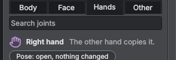

**Eksempel.** Åpne fanen **Hands**. Velg en av de ferdige positurene. Trykk **Set key**.

### Ansikt og Other

Fanen **Face** lister Bento-ansiktsleddene: hode, bryn, øyne, ører og mer. Fanen **Other** lister de ekstra Bento-leddene: hale, bakbein og vinger. Bruk **View > Joint groups** for å vise eller skjule disse gruppene. **Hide in lists** utelater skjulte ledd fra listene.

Ansiktsleddene er satt på vent: de finnes, men de får ingen spesiell oppmerksomhet ennå.

### Leddgrenser

Hvert ledd har det området Second Life tillater. Nær grensen advarer panelet deg. Grensene er på som standard.

---

## Kapittel 5: Tidslinjen, nøkler og avspilling

### Rader

Tidslinjen viser en rad for hvert ledd med endringer, og for det valgte leddet. Radene har farger og navn etter kroppsområde. Boksen **Show rows for** filtrerer etter kroppsområde. Expert-modus legger til en bryter for å vise hvert ledd.

Uten nøkler sier tidslinjen **No keys yet** og tilbyr **Set the first key**.

### Nøkler

- **Set key** (K) lagrer posituren du ser nå.
- Å dreie et ledd setter en nøkkel av seg selv.
- Et merke i tidslinjen viser hver nøkkel.
- Velg en nøkkel for å endre dens easing (Kapittel 3, trinn 6).
- I Expert-modus tegner **Edit curve...** din egen fartskurve for en bevegelse. Vinduet husker plass og størrelse.

### Merk, kopier og lim inn

1. Hold **Shift** og dra i tidslinjen, eller bruk Shift og piltastene, for å merke et strekk.
2. **Edit > Copy** (Ctrl+C), **Cut** (Ctrl+X) eller **Paste** (Ctrl+V).
3. **Paste mirrored** (Ctrl+Shift+V, Expert-modus) limer inn med venstre og høyre byttet om. Et venstretrinn blir et høyretrinn.

### Angre og gjør om

Ctrl+Z angrer. Ctrl+Shift+Z eller Ctrl+Y gjør om. Hver endring eller hvert drag er ett trinn. Historikken rommer opptil 100 trinn og overlever Save.

### Løkkepunkter

Nederst i tidslinjen finner du:

- **Loop starts at** og **Loop ends at**: de to rammene animasjonen går i løkke mellom, med plasseringen i prosent,
- **Frame ... of ...**: hvor du er og hvor mange rammer det er,
- **Frames per second** (30 ved start).

Eksportboksen bruker løkkerammene når **Play again and again** er avkrysset.

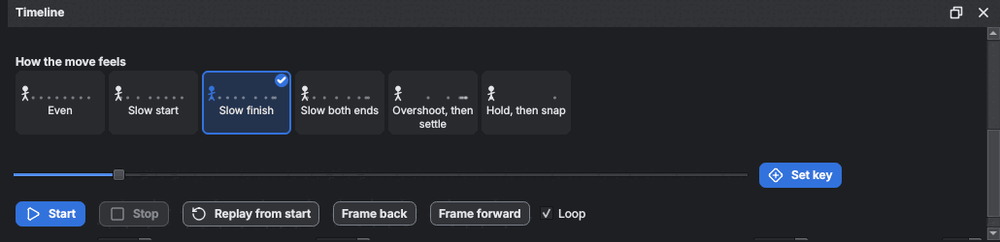

### Notatlinjen

Noen animasjoner har med undervisningsnotater. Ifølge prosjektets dokumenter viser en linje under tidslinjen da notatet for den gjeldende rammen, med **Hide notes**. (En sjekk av `wave.dingle` i Linux-versjonen viste ingen notatlinje, så regn dette som ubekreftet.)

**Eksempel.** Åpne `wave.dingle` fra mappen `examples`. Trykk **Start**. Se på figuren som vinker. Trykk **Stop**.

### Sakte eksempel

`jump_slow.dingle` er `jump.dingle` med hver nøkkel 2,5 ganger senere. Den går med 40 prosent av farten, så du kan se hoppet sakte.

---

## Kapittel 6: 3D-visningen og kameraet

### Mus og taster

Standardstilen, kalt PinglyMotion, fungerer slik:

| Hva | Hvordan |
|---|---|
| Se deg rundt (orbit) | Dra i tomt rom |
| Flytt visningen (pan) | Høyredra |
| Zoom | Musehjul |
| Velg et ledd | Klikk på det, eller på raden |
| Fokuser på det valgte leddet | F, eller dobbeltklikk på det |

I **Setup** eller **Help > Camera and keys...** kan du velge stilen til Maya, Blender eller Second Life i stedet. Kapittel 14 har tabellene.

### Visningsverktøylinjen

Øverst til venstre i 3D-visningen:

- **View-direction widget:** klikk på enden av en akse for å se derfra.
- **Pick and pull** (V), **Look around** (O), **Move the view** (M), **Zoom** (Z).
- **Picked joint** (F), **Whole figure** (Shift+F), **Home view** (0).
- **Look from** (Front, Side, Top).
- **Show:** gulvrutenettet, rotasjonsringer, leddprikker og verktøynavn.

Hver innstilling finnes også i menyen **View**.

### Menyen View

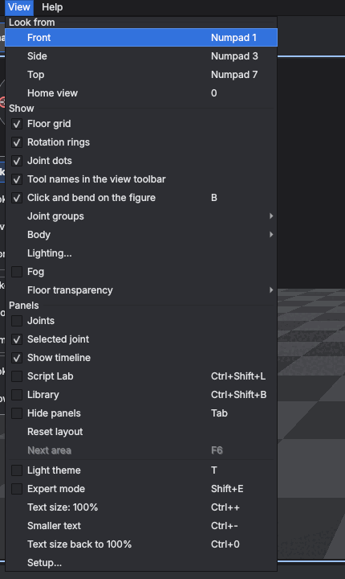

- **Look from:** Front (Numpad 1), Side (Numpad 3), Top (Numpad 7), Home view (0).
- **Show:** Floor grid, Rotation rings, Joint dots, Tool names in the view toolbar, **Click and bend on the figure** (B), Joint groups, Body, Lighting..., Fog, Floor transparency.
- **Joint groups** viser eller skjuler grupper av ekstra ledd: Wings, Tail, Hind limbs, Face og Fingers and toes. Å skjule endrer bare det du ser. **Hide in lists** utelater skjulte ledd fra tidslinjen og leddlisten. Hvis den er av, vises de dempet.
- **Body** velger kroppsnettet: **Ruth2** eller **Max**. Det endrer bare hvordan figuren ser ut.
- **Lighting...** åpner en liten boks med glidere for **Brightness** (Dark til Bright), **Shine** (Matt til Shiny) og **Warmth** (Cool til Warm), et valg **Shadow on the floor**, og knappene **Reset** og **Close**.
- **Fog** tåker bort den fjerne enden av gulvet. Den er av ved start.
- **Floor transparency:** 0, 25, 33, 50 eller 75 prosent.
- **Panels:** Joints, Selected joint, Show timeline, Script Lab, Library, Hide panels (Tab), Reset layout, Next area (F6).
- **Light theme** (T), **Expert mode** (Shift+E), tekststørrelse og **Setup...**.

**Eksempel.** Hold musepekeren over 3D-visningen. Trykk **O** (look around) og dra. Trykk **M** og dra for å flytte visningen. Trykk **V** for å gå tilbake til å velge ledd. Trykk **0** for å komme hjem.

### Tekststørrelse

**Ctrl++** gjør teksten større, **Ctrl+-** mindre og **Ctrl+0** tilbake til 100 prosent. Setup tilbyr 100, 125, 150, 175 og 200 prosent.

### Click and bend

Med **Click and bend** på (B) velger et klikk på figuren et ledd, og et drag bøyer det. Når den er av, gjør klikk på figuren ingenting. Bruk Joints-listen og glidere.

---

## Kapittel 7: Rekvisitter

En **rekvisitt** (prop) er en enkel 3D-form i scenen. Den står for et objekt. En rekvisitt kan festes til et ledd, så den beveger seg med leddet.

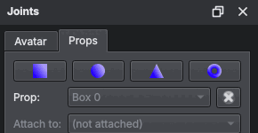

1. Velg **View > Joints**. Åpne fanen **Props**.
2. Trykk en formknapp: boks, kule, kjegle eller ring (torus).
3. Programmet gir den et navn, for eksempel **Box 0**. Den neste boksen er **Box 1**. En rekvisitt kan ikke gis nytt navn ennå.
4. Plasser den med **Place**, **Turn** og **Size** i panelet til høyre, som nå heter **Selected prop**. Der kan du også endre **Shape**: Box, Ring, Cone eller Ball. En liten boks over 3D-visningen, **Edit prop**, har verktøyene **Move**, **Turn** og **Size** for å dra i den.
5. Velg et ledd i **Attach to**. Rekvisitten beveger seg med leddet.
6. Knappen med X sletter rekvisitten.

**File > Save** beholder rekvisittene inne i animasjonsfilen. **File > Open** henter dem tilbake. **File > Open props...** og **Save props...** bruker de eldre `.prp`-filene. Å åpne en `.prp` fjerner de nåværende rekvisittene først.

**Eksempel.** Åpne `throne.dingle` fra mappen `examples`. Figuren sitter. Velg **File > Open props...** og velg `throne.prp`. Bokser dukker opp rundt figuren. Den valgte er blå. Velg et annet navn i listen **Prop:** for å velge den.

---

## Kapittel 8: Biblioteket

Biblioteket inneholder 106 ferdige bevegelser. Bruk en som start.

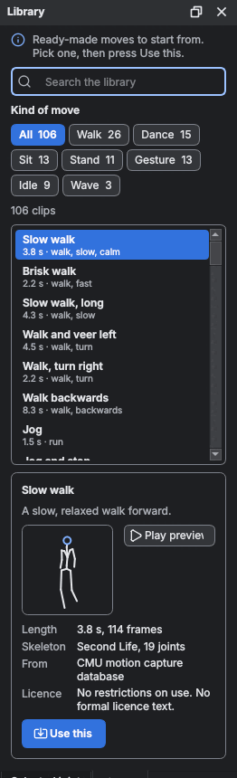

1. Trykk **Library** øverst (eller Ctrl+Shift+B, eller **View > Library**).
2. Søk, eller velg en type bevegelse: Walk, Dance, Sit, Stand, Gesture, Idle, Wave.
3. Velg et klipp. Panelet viser en forhåndsvisning på en liten figur og **Play preview**.
4. Det viser også lengde, skjelett, hvor det kommer fra og lisensen.
5. Trykk **Use this**. Klippet åpnes som din animasjon. Programmet spør først hvis du har ulagrede endringer. Statuslinjen sier «Opened Slow walk from the library. Save it under your own name.» Klippets eget navn er navnet på animasjonen til du lagrer.

Library deler høyre side med Selected joint. Bytt med fanene nederst. I Expert-modus setter **Add as a second figure** et klipp ved siden av figuren din i stedet.

**Eksempel.** Trykk **Library**. Velg **Slow walk**. Trykk **Use this**. Trykk **Start**. Timeline viser da 114 rammer.

Biblioteket kommer fra CMU motion capture-databasen og fra Mesh2Motion. Se [Kapittel 17](#kapittel-17-takk-og-kilder).

Hvis panelet sier **No library found**, mangler mappen `library` ved siden av programmet. Installer programmet på nytt.

---

## Kapittel 9: Filer og formater

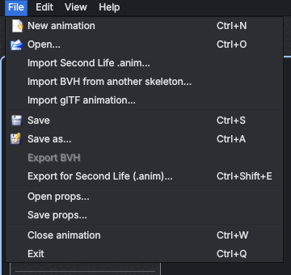

### Formatene

| Endelse | Hva | Merknader |
|---|---|---|
| `.dingle` | PinglyMotions eget arbeidsformat | Beholder alt. Skrevet som tekst (JSON). |
| `.anim` | Second Life-animasjon | Eksport og import. |
| `.bvh` | En vanlig bevegelsesfil | Eksport, og åpne. En åpnet `.bvh` blir urørt til du lagrer. |
| `.avm` | Det gamle formatet | Åpnes. Lagres som `.dingle`. |
| `.prp` | Gammel rekvisittfil | Open props og Save props. |
| `.glb`, `.gltf` | 3D-animasjon fra andre verktøy | Bare import. |

### Menyen File

- **New animation** (Ctrl+N), **Open...** (Ctrl+O), **Save** (Ctrl+S), **Save as...** (Ctrl+A).
- **Import Second Life .anim...** åpner en `.anim` som en ny, ulagret animasjon. En liste **What could not be imported** sier hva som ble utelatt.
- **Import BVH from another skeleton...** viser hvilke ledd som ble koblet og hvilke som ble utelatt. Kryss av **My file starts in a T-pose or A-pose** hvis første ramme er en stående positur. Trykk **Open the animation**. En kobling du lager, kan lagres i en liten `.jointmap`-fil.
- **Import glTF animation...** åpner `.glb` eller `.gltf`. Hvis filen har mer enn én animasjon, velg de du vil ha.
- **Export BVH** lager en `.bvh`-fil.
- **Export for Second Life (.anim)...** (Ctrl+Shift+E).
- **Open props...** og **Save props...**.
- **Close animation** (Ctrl+W) og **Exit** (Ctrl+Q).

Hver import åpnes som en animasjon uten navn. Originalfilen din endres ikke. Lagre den for å beholde den.

**Eksempel.** Velg **File > Open** og velg `jump.dingle` i `examples`. Velg **File > Save as...** og lagre den under et nytt navn. Velg **File > Export for Second Life (.anim)...** og lag `jump.anim`. Velg **File > Import Second Life .anim...** og åpne den igjen. En melding sier «Opened jump.anim.» og lister hva som ikke kunne importeres. For denne filen sier den at prioritet, myk start og slutt, og hender ikke blir med. Selve bevegelsen kommer tilbake.

### Mappen for AI-assistenter

En AI-assistent kan bare åpne og lagre filer i én mappe: `PinglyMotion` i Dokumenter-mappen din. Se [Kapittel 11](#kapittel-11-ai-assistenter).

---

## Kapittel 10: Script Lab for nybegynnere

Script Lab er en trygg sandkasse. Du kan kjøre RLV- og LSL-skript på datamaskinen din. Ingenting når Second Life. Bruk skript du stoler på. Script Lab er nytt, og et svært uvanlig skript kan få programmet til å krasje, så lagre animasjonen din først.

Noen ord først.

- **LSL** er skriptspråket i Second Life.
- Et **skript** er et lite program inne i et objekt.
- Et **objekt** er laget av **prims**. En prim er én del, for eksempel en boks.
- **RLV** (Restrained Love Viewer) er et sett kommandoer et skript kan sende til en viser. De begrenser hva en avatar kan gjøre, for eksempel betyr `@detach=n` «dette kan ikke tas av».
- **RLVa** er en viser som forstår RLV og mer.
- En **kanal** (channel) er et tall skript bruker for å snakke sammen, som en radiokanal.

**Ærlig status.** Script Lab er bygget i mange deler. Ingenting i det er testet i Second Life. Sandkassen er aldri identisk med Second Life. Se [Hva som er ferdig og hva som ikke er det](#hva-som-er-ferdig-og-hva-som-ikke-er-det).

Åpne Script Lab med knappen **Script** (F8) eller knappen **Script Lab** (Ctrl+Shift+L).

### Øverst i vinduet

- **Viewer rules:** **RLV** eller **RLVa**. Starten er RLVa. Å bytte fjerner alle begrensninger, som etter en ny pålogging.
- En brikke viser hvor mange begrensninger som holdes («0 held»).
- Fem faner: **Live scripts**, **Type commands**, **Who talks to whom**, **Player**, **Improve a setup**.
- **Pop out** flytter Script Lab til et eget vindu.

### Lag eksempelprosjektet

1. Trykk **Script**.
2. Trykk **Make example project**.

Programmet kopierer eksempelet **First colour** til din egen mappe (`Documents/PinglyMotion/Scripts/First_colour`). Det legger en boks i scenen. Det overvåker mappen. Et kort **Steps** lister fem trinn og krysser dem av.

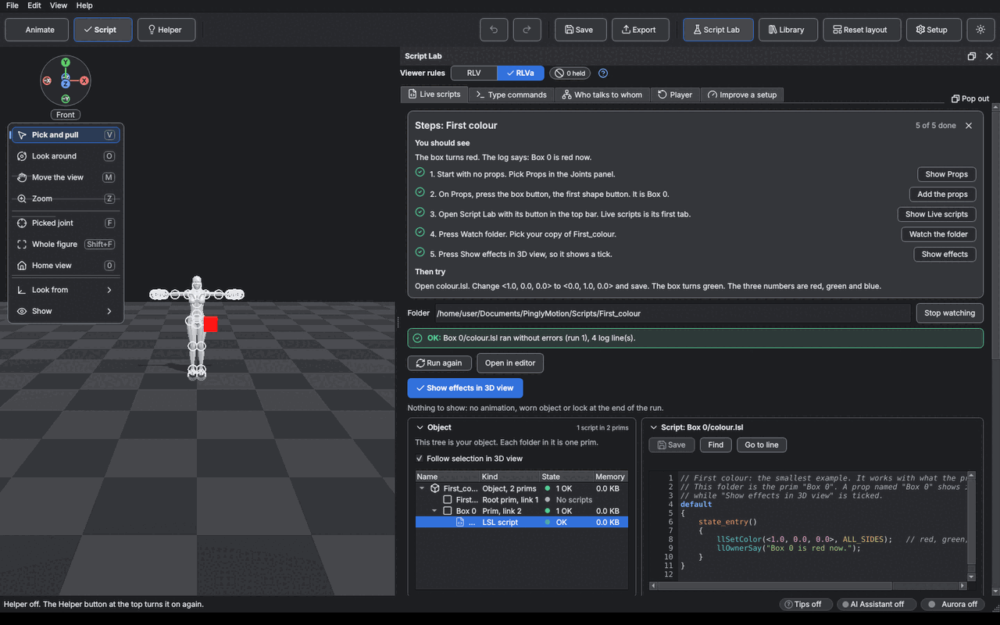

Du bør se:

- en rød boks ved siden av figuren,
- meldingen **OK: Box 0/colour.lsl ran without errors**,
- loggraden «Box 0 is red now.»

### Treet

Boksen **Object** viser objektet ditt som et tre. Hver mappe er én prim. Mappen **Box 0** er en prim. Skriptet inni den er raden **LSL script**. Kolonnene er **Name**, **Kind**, **State** og **Memory**.

Klikk på en rad. Med **Follow selection in 3D view** avkrysset lyser rekvisitten med samme navn opp i 3D-visningen.

### Endre skriptet

1. Skriptet er åpent i editoren til høyre. (**Open in editor** åpner det igjen.)
2. Endre `<1.0, 0.0, 0.0>` til `<0.0, 1.0, 0.0>`.
3. Trykk **Save**.

Boksen blir grønn. De tre tallene er rød, grønn og blå. Hver lagring kjører mappen på nytt. Trykk **Run again** for å kjøre uten endring.

Editoren har **Save**, **Find** og **Go to line**. Den viser forslag og hjelpetekst for LSL-funksjoner mens du skriver. Den foreslår også RLV-kommandoer inne i `llOwnerSay("@...")`, med enkle advarsler. Bytt til **Show suggestions only when I press Ctrl+Space** i Setup hvis du foretrekker det.

### Vis effekter i 3D-visningen

Knappen **Show effects in 3D view** får rekvisitter til å vise hva skriptene gjør: farge og hvor klar den er. En rekvisitt med samme navn som en prim viser virkningen av skriptene til den primen. Å klikke på en rekvisitt teller som en berøring. En meny et skript viser (`llDialog`) vises som en boks over 3D-visningen. Trykk en knapp i den, eller **Ignore** (Esc).

### Andre eksempler

Mappen `examples/objects` har seks objekter til: Button HUD, Gear set, Timed lock, RLV relay og Work system. `examples/scriptlab` har løse skript. Trykk **Try the example scripts** (når ingen mappe overvåkes) for å kjøre `rlv_lock.lsl`.

**Watch folder...** overvåker en hvilken som helst mappe du eier. En mappe er et objekt. **New folder** lager en ny.

### Type commands

Fanen **Type commands** er for RLV-linjer.

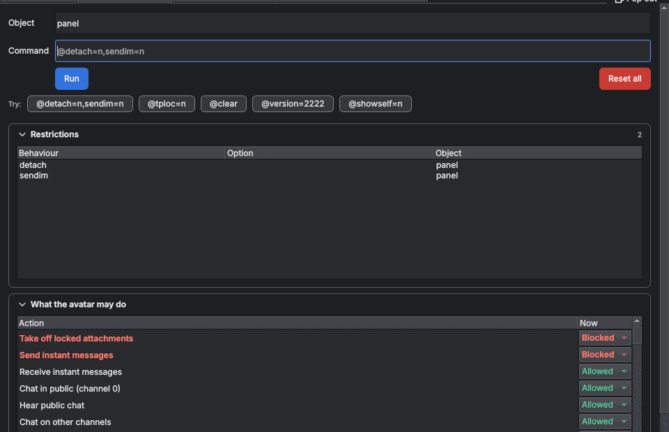

1. Åpne fanen **Type commands**.
2. Klikk i boksen **Command**, skriv `@detach=n,sendim=n` og trykk Enter.
3. Fanen viser **Restrictions** (detach og sendim), holdt av objektet `panel`. Under **What the avatar may do** sier **Take off locked attachments** og **Send instant messages** nå **Blocked**.

Brikkene under **Try** fyller inn et ferdig eksempel. **Reset all** fjerner alle begrensninger. Hver rad i handlingslisten er et valg **Allowed / Blocked** du kan sette. Loggen **Replies and messages** viser svarene et skript ville hørt.

Fanen har også brytere for kamerabegrensninger, miljø og visningsmoduser i 3D-visningen, og en del som heter **Vision sphere**.

### Who talks to whom

Fanen **Who talks to whom** tegner et kart mens en mappe overvåkes. Åpne delen **Who talks to whom** ved å klikke på overskriften. For eksempelet First colour ser du en boks **Box 0** med en pil til den stiplede boksen **You**, merket `owner say: "Box 0 is red now."`.

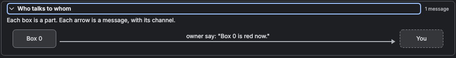

I større oppsett er boksene primene, og også **You**, **Your viewer (RLV)** og **Web server**. Piler viser chat, linkmeldinger, menyer og RLV-linjer, med kanalen deres. En pil som ingen hører, er stiplet, rød og sier hvorfor. En prim som lytter og sender kommandoer videre, er merket **(hub)**. Et klikk på en pil viser skriptlinjen som sendte den.

### Player

Trykk **Record what I do** på fanen **Player**. Klikk på rekvisitter eller trykk menyknapper. Hver handling er et trinn. Trykk **Stop recording**.

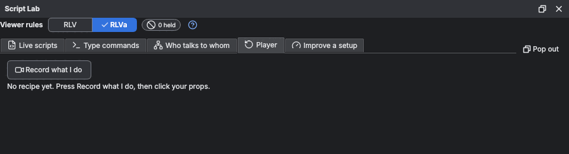

Programmet lagrer trinnene som `recipe.rlvtest` i objektmappen. Det spiller dem av igjen og sier hva som har endret seg siden sist. Spilleren har de samme knappene Start, Stop, Step back og Step forward som tidslinjen. Den lister øyeblikkene og hva som var sant i hvert. **Go to first difference** hopper til den første endringen.

Not built: spilleren flytter ikke animasjonen, kameraet, miljøet eller menyboksen. Disse viser den levende kjøringen.

### Improve a setup

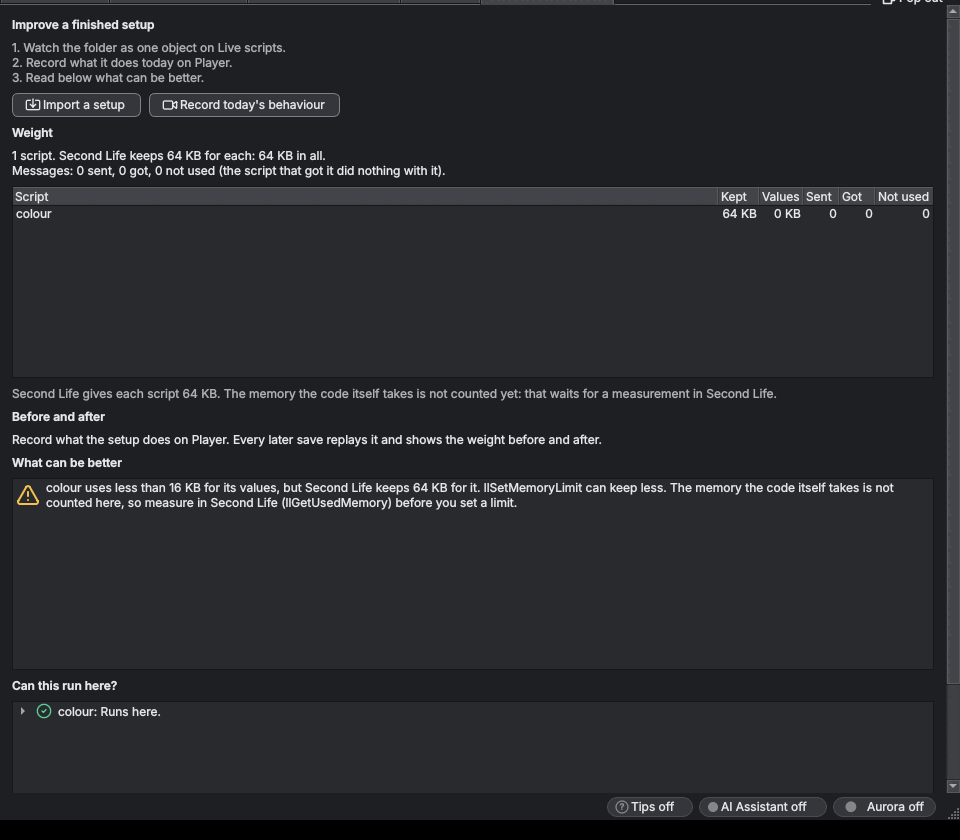

For et ferdig oppsett, for eksempel et halsbånd:

1. Overvåk mappen som ett objekt (Live scripts).
2. Ta opp hva det gjør (Player).
3. Les fanen **Improve a setup**.

Den viser hvor tungt hvert skript er (**Kept**, **Values**, **Sent**, **Got**, **Not used**), hva som kan bli bedre, og for hvert skript om det kan kjøre her. **Import a setup** og **Record today's behaviour** finnes på fanen.

Minnet som selve koden bruker, telles ikke ennå. Det krever en måling i Second Life.

### OpenCollar-eksempelet

`examples/improve/OpenCollar` inneholder de 23 skriptene til det offentlige OpenCollar-halsbåndet. De er kopiert uendret, med lisensen sin (GPL 2). Overvåk mappen. Halsbåndet starter og viser menyen sin når du klikker på det. **Not tested in Second Life.**

### Lua (en prøveversjon)

Lua er et nyere skriptspråk i Second Life. Det heter SLua.

1. Åpne **Setup**. Kryss av **Lua (trial): show the language choice in the editor**.
2. Editoren viser en boks **Language** med **LSL** og **SLua (Lua, trial)**.
3. Velg SLua. Rull ned i fanen Live scripts. Helt til høyre på linjen under teksten trykker du **Convert to SLua**.

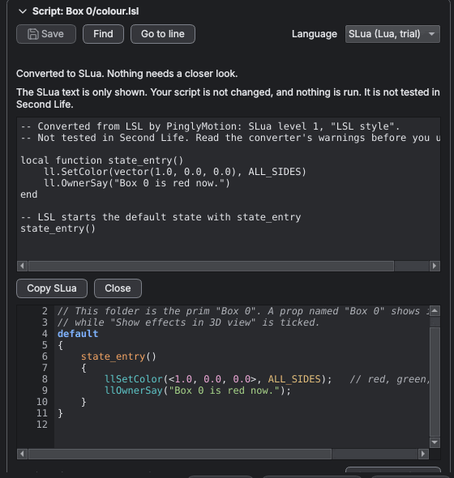

Ruten viser den konverterte teksten og merknader. Skriptet ditt endres ikke. Ingenting kjøres. **Copy SLua** kopierer teksten. **Close** lukker ruten.

Lua er en prøveversjon. Konverteren er sjekket av tester som sammenligner nøyaktig tekst. Den er **not tested in Second Life**. Det finnes ingen Lua-sjekker eller forslag, og Lua kjører ikke.

### Trinn og veiledningen

**Help > Script Lab steps** viser trinnkortet igjen.

---

## Kapittel 11: AI-assistenter

En AI-assistent på din egen datamaskin kan sette figuren i positur, spille den av, se på den og lagre den. Dette er valgfritt. Den er **av ved hver oppstart** og slår seg aldri på av seg selv.

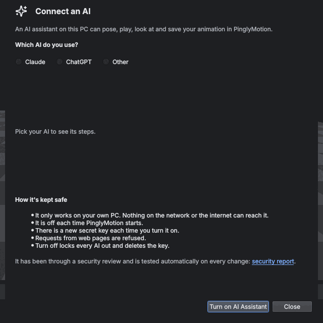

### Slå den på

1. Klikk knappen **AI Assistant** i statuslinjen (nederst til høyre).
2. Dialogen **Connect an AI** spør «Which AI do you use?» Velg **Claude**, **ChatGPT** eller **Other**. Hver viser bare sine egne trinn.
3. Trykk **Turn on AI Assistant**.

Knappen viser en prikk og tilstanden sin:

| Prikk | Tekst | Betydning |
|---|---|---|
| Grå | AI Assistant off | Av. |
| Gul | AI Assistant on, waiting for an AI | På, ingen AI er koblet til. |
| Grønn | AI Assistant: Claude | En AI er koblet til. |
| Rød | A wrong key was refused | Noe prøvde en feil nøkkel. |

Vindustittelen sier «AI Assistant on» mens den er på. Klikk knappen igjen for å slå den av. Å slå den av stenger alle AI-er ute.

### Hvordan den holdes trygg

- Den virker bare på din egen PC. Ingenting på nettverket kan nå den.
- Den er av hver gang PinglyMotion starter.
- Det lages en ny hemmelig nøkkel hver gang du slår den på.
- Nettsider kan ikke gi den kommandoer: hver kommando trenger den hemmelige nøkkelen.

### Hva en assistent kan gjøre

En assistent bruker kommandoene i kontrollgrensesnittet: se på tilstanden, sette ledd i positur, sette rammer, spille av, ta et skjermbilde, beskrive posituren og bevegelsen med ord, lese og skrive en hel animasjon som en liten teksttabell, sjekke en animasjon mot reglene til Second Life, eksportere `.anim`, søke i biblioteket og bruke Script Lab (RLV-kommandoer og LSL-skript). Hele listen står i `docs/CONTROL.md` og `tools/mcp/commands.json`.

Assistenten kan bare åpne og lagre filer i mappen `Documents/PinglyMotion`. En AI-assistent du kobler til, kan også be programmet lese skriptfiler fra en mappe. Det gjør programmet bare mens AI Assistant er på.

### Status

- **Claude:** Windows-zip-filen har `mcp/PinglyMotion.mcpb`, en utvidelse for Claude-appen.
- **ChatGPT:** oppsettet er skrevet. Knappen skriver konfigurasjonen til skrivebordsappen. **Ikke testet av oss.**
- **Andre verktøy:** filen `pinglymotion_mcp.js` betjener andre verktøy som snakker MCP. **Ikke testet av oss.**

Manuelt arbeid fungerer alltid uten noen AI. Hele statuslisten står i [Hva som er ferdig og hva som ikke er det](#hva-som-er-ferdig-og-hva-som-ikke-er-det).

---

**Eksempel.** Trykk knappen **AI Assistant**. Velg **Claude** og les trinnene. Ikke trykk **Turn on AI Assistant** med mindre du vil koble til en AI. Trykk **Close**. Knappen sier fortsatt «AI Assistant off».

### Kontrollkommandoene

Kommandoene en assistent kan bruke, er de samme for ethvert program på din PC som snakker vanlig HTTP. De er listet av `GET /api/commands` og i `docs/CONTROL.md`. I korte trekk:

| Gruppe | Kommandoer |
|---|---|
| Se | `state`, `joints`, `get_pose`, `keys`, `screenshot`, `describe_pose`, `describe_motion`, `describe_body` |
| Positur og tid | `set_pose`, `set_position`, `delete_key`, `set_frame`, `set_frame_count`, `set_fps`, `set_loop`, `play`, `stop` |
| Filer | `new_animation`, `open_file`, `save_file`, `export_anim` |
| Visningen | `set_figure`, `set_camera` |
| Hele animasjoner som tekst | `motion_script`, `load_motion_script`, `check_animation` |
| Bibliotek | `find_reference`, `load_reference` |
| Script Lab | `rlv_command`, `rlv_state`, `rlv_reset`, `lsl_check`, `lsl_lint`, `lsl_run`, `lsl_event`, `lab_watch`, `lab_unwatch`, `lab_result`, `lab_replay` |

Du trenger ikke kunne disse for å bruke PinglyMotion. De er for AI-verktøy og for folk som skriver skript rundt programmet.

---

## Kapittel 12: Den direkte koblingen til Aurora

Aurora er en Second Life-viser. PinglyMotion kan vise posituren din på din egen avatar i Aurora mens du jobber. Bare du ser det. Ingenting lastes opp.

**Status.** Det fungerer på Windows. Det trenger Aurora bygget fra forken som er nevnt i `docs/AURORA_LINK.md`. Det fungerer ikke med vanlig Aurora ennå.

**Eksempel.** Med Aurora-forken i gang:

1. Velg **Build > LiveMesh > Enable preview** i Aurora.
2. I PinglyMotion krysser du av **Live link to Aurora** i **Setup**, eller klikker på prikken i statuslinjen.
3. Statuslinjen sier «Waiting for Aurora», så «Aurora live».
4. Drei et ledd. Avataren din tar posituren.

Koblingen er av ved hver oppstart.

---

## Kapittel 13: Oppsett, temaer og hjelp

Trykk **Setup** (tannhjulet øverst til høyre).

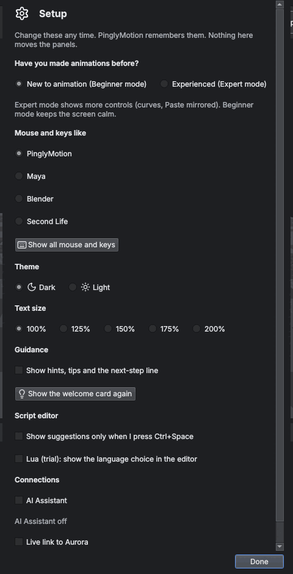

- **Have you made animations before?** New to animation (Beginner-modus) eller Experienced (Expert-modus).
- **Mouse and keys like:** PinglyMotion, Maya, Blender eller Second Life. **Show all mouse and keys** åpner tabellen.
- **Theme:** Dark eller Light.
- **Text size:** 100, 125, 150, 175 eller 200 prosent.
- **Guidance:** **Show hints, tips and the next-step line**, og **Show the welcome card again**.
- **Script editor:** **Show suggestions only when I press Ctrl+Space**, og bryteren **Lua (trial)**.
- **Connections:** **AI Assistant** og **Live link to Aurora**.

PinglyMotion husker disse valgene.

### Menyen Help

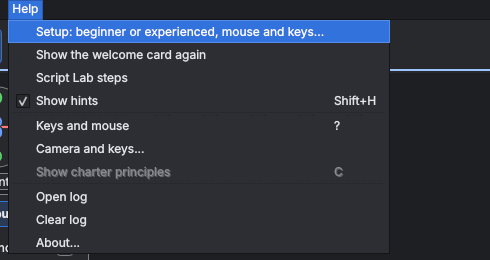

- **Setup: beginner or experienced, mouse and keys...**
- **Show the welcome card again**
- **Script Lab steps**
- **Show hints** (Shift+H)
- **Keys and mouse** (?)
- **Camera and keys...**
- **Show charter principles** (C), når tilgjengelig
- **Open log** og **Clear log**
- **About...**: hvem som har laget avatarkroppene og under hvilken lisens.

**Eksempel.** Trykk **Setup**. Under **Theme** velger du **Light**. Under **Text size** velger du **150%**. Trykk **Done**. Begge endringene beholdes neste gang du starter.

### Hint og tips

Ni hintkort veileder de første trekkene. **Next** går videre. **Turn hints off** stopper dem. Statuslinjebryteren **Tips on/off** viser eller skjuler kort hjelp når musepekeren hviler på en kontroll.

---

## Kapittel 14: Hurtigtaster og mus

### Overalt

| Taster | Hva |
|---|---|
| Ctrl+N | New animation |
| Ctrl+O | Open |
| Ctrl+S | Save |
| Ctrl+A | Save as |
| Ctrl+Shift+E | Export for Second Life |
| Ctrl+W | Close animation |
| Ctrl+Q | Exit |
| Ctrl+Z | Angre |
| Ctrl+Shift+Z eller Ctrl+Y | Gjør om |
| K | Set key |
| Ctrl+X, Ctrl+C, Ctrl+V | Klipp ut, kopier, lim inn |
| Ctrl+Shift+V | Paste mirrored (Expert-modus) |
| F7, F8 | Animate-siden, Script-siden |
| Ctrl+Shift+L | Script Lab |
| Ctrl+Shift+B | Library |
| Tab | Skjul eller vis alle paneler |
| F6 | Next area |
| T | Lyst eller mørkt tema |
| Shift+E | Expert-modus |
| Shift+H | Hint av eller på |
| ? | Keys and mouse |
| Ctrl++, Ctrl+-, Ctrl+0 | Tekst større, mindre, tilbake til 100 % |
| Alt+1, Alt+2 | Velg første eller andre figur (Expert-modus) |

### I 3D-visningen

| Taster | Hva |
|---|---|
| V, O, M, Z | Verktøy: pick and pull, look around, move the view, zoom |
| F | Fokuser på det valgte leddet |
| Shift+F | Whole figure |
| 0 | Home view |
| Numpad 1, 3, 7 (eller 1, 3, 7) | Front, side, top |
| Alt + piltaster | Se deg rundt med taster |
| Page Up, Page Down | Zoom med taster |
| B | Click and bend av eller på |
| Esc | Avbryt et drag |
| Enter på et valgt ledd | Dra med piltastene; Enter setter en nøkkel |

### Kamerastilene

| Handling | PinglyMotion | Maya | Blender | Second Life |
|---|---|---|---|---|
| Se deg rundt | Dra i tomt rom | Alt + venstredra | Midtredra | Alt + dra (sideveis), Ctrl + Alt + dra |
| Flytt visningen | Høyredra | Alt + midtredra | Shift + midtredra | Ctrl + Alt + Shift + dra |
| Zoom | Musehjul | Alt + høyredra, eller hjul | Ctrl + midtredra, eller hjul | Alt + dra opp eller ned, eller hjul |
| Velg et ledd | Klikk på det, eller på raden | Klikk | Klikk | Klikk |
| Fokuser på leddet | F, eller dobbeltklikk | F | Numpad . | Alt + klikk |

### Ledd

| Hva | Hvordan |
|---|---|
| Dra i en lem | Trykk på et ledd og dra. Slipp for å sette en nøkkel. Esc avbryter. |
| Drei bare det leddet | Hold Shift når du trykker på leddet |
| Drei på én akse | Dra den røde X-, grønne Y- eller blå Z-ringen |

Den samme tabellen finnes i programmet: **Help > Keys and mouse**.

**Eksempel.** Trykk **?** for å åpne tabellen. Lukk den. Trykk **Shift+E** for å slå Expert-modus på, og trykk den igjen for å slå den av.

---

## Kapittel 15: Alle menyvalg

### File

Se [Kapittel 9](#kapittel-9-filer-og-formater).

### Edit

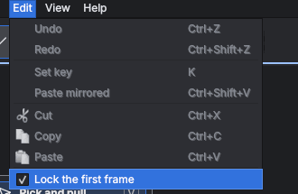

| Valg | Taster | Hva |
|---|---|---|
| Undo, Redo | Ctrl+Z, Ctrl+Shift+Z | Ta tilbake og gjøre om en endring. |
| Set key | K | Lagre posituren nå som en nøkkel. |
| Paste mirrored | Ctrl+Shift+V | Lim inn med venstre og høyre byttet om. |
| Cut, Copy, Paste | Ctrl+X, C, V | På det merkede strekket i tidslinjen. |
| Lock the first frame | | På som standard. Holder den første posituren trygg. |

### View

Se [Kapittel 6](#kapittel-6-3d-visningen-og-kameraet).

### Help

Se [Kapittel 13](#kapittel-13-oppsett-temaer-og-hjelp).

**Eksempel.** Åpne menyen **Help** og velg **About...**. Lukk den. Åpne **View** og velg **Floor transparency**, så 50 %.

### Knapper i toppfeltet

| Knapp | Hva |
|---|---|
| Animate, Script | Bytt side (F7, F8) |
| Helper | Helper-panelet av eller på |
| Undo, Redo | Det samme som Edit |
| Save | Lagre animasjonen |
| Export | Eksporter til Second Life |
| Script Lab | Åpne Script Lab |
| Library | Åpne Library |
| Reset layout | Sett hvert panel tilbake |
| Setup | Åpne Setup |
| Solknapp | Mørkt eller lyst tema |

---

## Kapittel 16: Feilsøking og tilbakemelding

- **3D-visningen er svart.** Oppdater grafikkdriveren. PinglyMotion trenger OpenGL 3.3.
- **Windows advarer om ukjent utgiver.** Programmet er ikke signert ennå. Dette er forventet i den tidlige forhåndsversjonen.
- **Et panel har forsvunnet.** Trykk **Reset layout**.
- **Teksten er for liten.** Trykk Ctrl++ eller velg en tekststørrelse i Setup.
- **Biblioteket sier «No library found».** Mappen `library` må ligge ved siden av programmet.
- **En importert fil beveger seg ikke riktig.** Åpne listen i importboksen. Ledd merket **Left out** ble ikke tatt med.
- **Et skript gjør ingenting i Script Lab.** Les delen **Errors and warnings**. Sandkassen kjører det meste av LSL, men ikke alt.
- **Noe gikk i stykker.** Velg **Help > Open log**. Loggen er en vanlig tekstfil over hva programmet gjorde.

### Meld fra om en feil eller gi tilbakemelding

Gå til <https://github.com/pingledingle-tech/PinglyMotion/issues> og opprett en sak (issue). Skriv hva du gjorde, hva du forventet og hva som skjedde. Ikke skriv personopplysninger i saken. Nettstedet har også sider for feilrapporter og forslag.

---

## Kapittel 17: Takk og kilder

PinglyMotion er gratis og har åpen kildekode. Det bygger på QAvimator. Avatarkroppene, bibliotekklippene, eksempelhalsbåndet og annet utenforstående materiale er kreditert i filen [CREDITS.md](../CREDITS.md) og i **Help > About...**.

De ferdige bevegelsene kommer fra CMU motion capture-databasen og fra Mesh2Motion (CC0). Eksempelhalsbåndet er det offentlige OpenCollar-prosjektet (GPL 2).

PinglyMotion er fri programvare. Du kan bruke, studere, dele og endre det under GNU General Public License, versjon 2 eller senere. Det inneholder andres arbeid under deres egne lisenser, for eksempel Qt-verktøyet, avatarkropper, bevegelsesklipp og eksempelskript. Hele listen med hver lisens står i [CREDITS.md](../CREDITS.md).

PinglyMotion er et uavhengig prosjekt. Det er ikke laget, godkjent eller støttet av Linden Research, Inc. (Linden Lab). Second Life og Linden Lab er varemerker som tilhører Linden Research, Inc. Firestorm, Aurora, OpenCollar og andre navn tilhører sine eiere.

---

## Ordliste

| Ord | Betydning |
|---|---|
| Animasjon | All bevegelsen i én fil. |
| Nøkkel | En lagret positur på ett tidspunkt. |
| Ramme | Ett steg i tid. |
| Tidsmarkør | Markøren du drar for å velge et tidspunkt. |
| Tidslinje | Stripen som viser nøklene dine over tid. |
| Ledd | En del som dreier, for eksempel en albue. |
| Positur | Hvordan figuren står på ett tidspunkt. |
| Easing | Hvordan en bevegelse øker eller reduserer farten mellom to nøkler. |
| Løkke | Animasjonen spilles om og om igjen. |
| T-positur | Å stå med armene rett ut til sidene. |
| Rekvisitt | En enkel 3D-form i scenen. |
| Prim | Én del av et objekt i Second Life. |
| LSL | Skriptspråket i Second Life. |
| RLV | Kommandoer et skript kan sende for å begrense en avatar. |
| Kanal | Et tall skript bruker for å snakke sammen. |
| Sandkasse | Et trygt sted å prøve ting. Ingenting forlater den. |
| IK | Når du flytter en hånd, flytter leddene over den seg. |
