# Podręcznik użytkownika PinglyMotion

Dla PinglyMotion 0.3.0, wczesnej wersji zapoznawczej. Napisany dla osób, które dopiero zaczynają z animacją i skryptami.

Ten podręcznik mówi, co robi każda część programu. Mówi, co jest gotowe, a co nie. Tam, gdzie coś jest próbą albo nie zostało przetestowane w Second Life, jest to napisane.

*Tłumaczenie maszynowe angielskiego podręcznika. Żadna osoba, dla której polski jest językiem ojczystym, go nie sprawdziła. W razie wątpliwości obowiązuje [podręcznik angielski](manual.html).*

Wszystkie obrazy to prawdziwe zrzuty ekranu programu (wersja na Linuksa, ciemny motyw). Jeden obraz oznaczony jako „diagram” został narysowany na potrzeby tego podręcznika.

**Spis treści**

- [Zacznij tutaj](#zacznij-tutaj): czym to jest, ogólny obraz, dla kogo, od czego zacząć
- [Szybki start: pierwsze pięć minut](#szybki-start-pierwsze-pięć-minut)
- [Co jest gotowe, a co nie](#co-jest-gotowe-a-co-nie)
- [Rozdział 1: Instalacja i uruchomienie](#rozdział-1-instalacja-i-uruchomienie)
- [Rozdział 2: Okno na jednym obrazie](#rozdział-2-okno-na-jednym-obrazie)
- [Rozdział 3: Twoja pierwsza animacja](#rozdział-3-twoja-pierwsza-animacja)
- [Rozdział 4: Pozowanie w szczegółach](#rozdział-4-pozowanie-w-szczegółach)
- [Rozdział 5: Oś czasu, klucze i odtwarzanie](#rozdział-5-oś-czasu-klucze-i-odtwarzanie)
- [Rozdział 6: Widok 3D i kamera](#rozdział-6-widok-3d-i-kamera)
- [Rozdział 7: Rekwizyty](#rozdział-7-rekwizyty)
- [Rozdział 8: Biblioteka](#rozdział-8-biblioteka)
- [Rozdział 9: Pliki i formaty](#rozdział-9-pliki-i-formaty)
- [Rozdział 10: Script Lab dla początkujących](#rozdział-10-script-lab-dla-początkujących)
- [Rozdział 11: Asystenci AI](#rozdział-11-asystenci-ai)
- [Rozdział 12: Połączenie na żywo z Aurorą](#rozdział-12-połączenie-na-żywo-z-aurorą)
- [Rozdział 13: Ustawienia, motywy i pomoc](#rozdział-13-ustawienia-motywy-i-pomoc)
- [Rozdział 14: Skróty klawiszowe i mysz](#rozdział-14-skróty-klawiszowe-i-mysz)
- [Rozdział 15: Każda pozycja menu](#rozdział-15-każda-pozycja-menu)
- [Rozdział 16: Rozwiązywanie problemów i opinie](#rozdział-16-rozwiązywanie-problemów-i-opinie)
- [Rozdział 17: Podziękowania i źródła](#rozdział-17-podziękowania-i-źródła)
- [Słowniczek](#słowniczek)

---

## Zacznij tutaj

### Do czego służy PinglyMotion

Second Life to wirtualny świat. Ludzie używają tam animacji, żeby ich awatary stały, siedziały, tańczyły i machały. **Animacja** to ruch zapisany w pliku.

PinglyMotion pomaga robić takie ruchy. Jest darmowy. Ma otwarty kod źródłowy, co znaczy, że każdy może czytać i ulepszać program.

PinglyMotion robi trzy rzeczy:

1. **Animowanie postaci.** Zginasz stawy postaci 3D. Zapisujesz pozy w wybranych momentach. Program wypełnia ruch pomiędzy nimi. Wynik eksportujesz do Second Life.
2. **Bezpieczne testowanie skryptów.** Obiekty w Second Life używają skryptów. PinglyMotion ma bezpieczną piaskownicę, **Script Lab**, w której możesz uruchamiać skrypty RLV i LSL na własnym komputerze. Nic, co tam robisz, nie dociera do Second Life.
3. **Praca z pomocnikiem AI, jeśli chcesz.** Asystent AI na twoim własnym komputerze może ustawić postać w pozie za ciebie. Jest wyłączony, dopóki go nie włączysz. Wszystko działa bez niego.

PinglyMotion to **wczesna wersja zapoznawcza**. Jest zrobiony do wypróbowywania i do opinii. Spodziewaj się niedociągnięć. Zobacz [Co jest gotowe, a co nie](#co-jest-gotowe-a-co-nie).

### Ogólny obraz

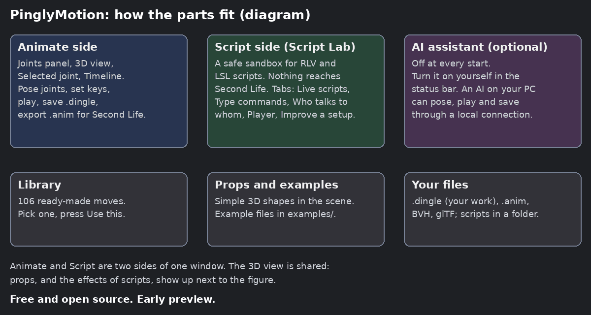

*Diagram narysowany na potrzeby tego podręcznika.*

Program to jedno okno z dwiema stronami. Przełączasz je przyciskami **Animate** i **Script** w lewym górnym rogu.

- **Animate** pokazuje panele do tworzenia animacji: listę Joints, widok 3D, panel Selected joint i Timeline.
- **Script** oddaje większość okna Script Lab. Widok 3D zostaje po lewej.

Każda strona pamięta własny układ. Widok 3D jest wspólny. Rekwizyt (prosty kształt 3D) albo efekt skryptu pojawia się obok postaci.

Inne części:

- **Library** zawiera 106 gotowych ruchów. Możesz zacząć od jednego z nich.
- **Rekwizyty** to proste kształty, które możesz umieścić w scenie.
- Folder **examples** obok programu zawiera pliki, które możesz otworzyć i śledzić razem z tym podręcznikiem.
- **AI Assistant** to przełącznik w prawym dolnym rogu. Przy każdym uruchomieniu jest wyłączony.

### Dla kogo

- **Początkujący.** Nigdy nie zrobiłeś animacji ani nie napisałeś skryptu. Program startuje w trybie Beginner. Pokazuje kartę powitalną, karty podpowiedzi i panel Helper. Ten podręcznik wyjaśnia każde słowo.
- **Doświadczeni użytkownicy.** Znasz narzędzia do animacji, takie jak Maya czy Blender. Włącz tryb Expert (Shift+E). Dostaniesz więcej elementów sterujących, na przykład edycję krzywych i drugą postać. Możesz wybrać styl myszy i klawiszy: Maya, Blender albo Second Life.

### Od czego zacząć?

- **Chcę zrobić animację.** Przeczytaj [Szybki start](#szybki-start-pierwsze-pięć-minut). Potem przejdź [Rozdział 3: Twoja pierwsza animacja](#rozdział-3-twoja-pierwsza-animacja).
- **Chcę testować skrypty.** Przejdź do [Rozdziału 10: Script Lab dla początkujących](#rozdział-10-script-lab-dla-początkujących). Nie potrzebujesz wcześniej żadnej animacji.
- **Chcę, żeby pomogła mi AI.** Przeczytaj [Rozdział 11](#rozdział-11-asystenci-ai).
- **Chcę wiedzieć, co działa.** Przeczytaj [Co jest gotowe, a co nie](#co-jest-gotowe-a-co-nie).

---

## Szybki start: pierwsze pięć minut

1. **Pobierz.** Ściągnij plik zip dla Windows albo AppImage dla Linuksa ze strony wydań (zobacz [Rozdział 1](#rozdział-1-instalacja-i-uruchomienie)).
2. **Uruchom.** W Windows rozpakuj plik zip. Uruchom `PinglyMotion.exe`. W Linuksie nadaj AppImage prawo wykonywania i uruchom go.
3. **Karta powitalna.** Pierwsze uruchomienie pokazuje „Make your first animation”. Wybierz **New to animation**. Naciśnij **Standing**.

   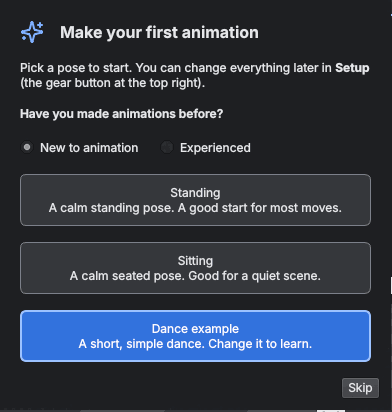

4. **Otwórz listę Joints.** Wybierz **View > Joints**. Kliknij na liście **Left Arm: Whole Arm**. Postać pokazuje pierścienie na tym stawie.
5. **Zapisz pierwszy klucz.** Naciśnij **Set the first key** na dole ekranu. Klucz to zapisana poza w jednym momencie.
6. **Ustaw pozę.** Przeciągnij znacznik czasu (suwak nad przyciskiem Start) w prawo. W panelu **Selected joint** wpisz `-60` w polu **Lean to the side**. Naciśnij Enter. Ramię się opuszcza. Program zapisuje klucz za ciebie.
7. **Odtwórz.** Naciśnij **Start**. Naciśnij **Stop**, żeby zatrzymać.
8. **Zapisz.** Naciśnij **Save** u góry i wybierz nazwę. Plik kończy się na `.dingle`.

To cała animacja. [Rozdział 3](#rozdział-3-twoja-pierwsza-animacja) wyjaśnia każdy krok. Żeby zrobić plik dla Second Life, naciśnij **Export** (zobacz [Rozdział 9](#rozdział-9-pliki-i-formaty)).

To, co nie jest gotowe, jest wymienione w [Co jest gotowe, a co nie](#co-jest-gotowe-a-co-nie).

---

## Co jest gotowe, a co nie

Każda pozycja ma jedno z tych słów:

- **Built.** Działa w programie i ma automatyczne testy.
- **Partly built.** Część działa. Tekst mówi, czego brakuje.
- **Trial.** Istnieje, ale to próba. Może się zmienić albo się zepsuć.
- **Not built.** Jest zaplanowane albo to tylko pomysł.
- **Not tested in Second Life.** Program robi na twoim komputerze to, co powinien. Nikt jeszcze nie sprawdził, czy Second Life przyjmuje lub uruchamia wynik.

Daty pochodzą z dokumentów projektu z 25 listopada 2026.

| Część | Status | Uwagi |
|---|---|---|
| Pozowanie stawów, klucze, oś czasu, odtwarzanie, cofanie | Built | Rozdziały 3 do 5. |
| Zapis jako `.dingle`, otwieranie `.dingle`, `.bvh`, `.avm` | Built | Stare pliki `.avm` się otwierają i są zapisywane jako `.dingle`. |
| Eksport dla Second Life (`.anim`) | Built | Eksport, wgranie i odtwarzanie zostały potwierdzone w Firestorm 21 listopada 2026: czas, pętla, łagodny start i koniec, dłonie, easing. Inne przeglądarki (viewery) nie były sprawdzane. |
| Import `.anim`, BVH z innego szkieletu, glTF | Built | Blokada stóp (żeby stopy się nie ślizgały) jest **not built**. |
| Biblioteka 106 ruchów | Built | Ruchy pochodzą z otwartych źródeł. Ich licencje są pokazane w panelu. |
| Rekwizyty (pudełko, kula, stożek, torus) | Built | To proste kształty. Rekwizytu nie można jeszcze przemianować. |
| Dwie postacie w jednej scenie (tryb Expert) | Built | Tylko w trybie Expert. |
| Stawy twarzy | Partly built | Stawy twarzy są odłożone. Karta Face istnieje, ale twarz nie jest priorytetem. |
| Script Lab: polecenia RLV | Built | Piaskownica ze 206 zachowaniami RLV. **Not tested in Second Life.** Ostateczny test zawsze odbywa się w Second Life. |
| Script Lab: skrypty LSL działają w piaskownicy | Partly built | 282 wbudowane funkcje, symulowany zegar. Niektóre funkcje tylko zapisują, o co je poproszono. Wiele jeszcze nic nie robi. **Not tested in Second Life.** |
| Script Lab: Live scripts, drzewo, rekwizyty z prymów | Built | Jeden folder to jeden obiekt. Rekwizyt o tej samej nazwie co prym należy do niego. |
| Script Lab: Player, Who talks to whom, Record what I do | Built | **Not tested in Second Life.** Niektóre części widoku 3D nie podążają za odtwarzaczem (zobacz Rozdział 10). |
| Script Lab: Improve a setup | Partly built | Liczby pamięci nie obejmują pamięci zajmowanej przez sam kod. To wymaga pomiaru w Second Life. |
| Script Lab: przykład OpenCollar | Built | Prawdziwa obroża z 23 skryptami działa w piaskownicy. **Not tested in Second Life.** |
| Script Lab: Lua (SLua) | **Trial** | Za przełącznikiem, który na starcie jest wyłączony. Edytor dostaje wybór języka i przycisk **Convert to SLua**. Nic jeszcze nie uruchamia Lua. Brak sprawdzania Lua i podpowiedzi. **Not tested in Second Life.** |
| Wersja webowa (w przeglądarce) | **Trial** | Jest tylko próbna kompilacja. Nie działa jeszcze dobrze. Nie planuj jej używać. |
| Asystent AI (sterowanie lokalne) | Built | Wyłączony przy każdym uruchomieniu. Claude: dostarczone jest rozszerzenie. ChatGPT i inne narzędzia: konfiguracja jest opisana, ale **nie testowana przez nas**. |
| Połączenie na żywo z Aurorą | Partly built | Działa w Windows ze specjalną kompilacją (forkiem) przeglądarki Aurora. Ze zwykłą Aurorą jeszcze nie działa. |
| Tłumaczenia | Not built | Program jest tylko po angielsku. Mechanizm istnieje. |
| Podpisywanie kodu dla Windows | Not built | Windows może ostrzegać o nieznanym wydawcy. |
| Instalator | Not built | Pobranie dla Windows to plik zip. |

Niektóre różnice między programem a klikalną makietą na stronie wciąż są poprawiane. Jeśli ekran w makiecie wygląda inaczej, zaufaj temu podręcznikowi i programowi.

---

## Rozdział 1: Instalacja i uruchomienie

### Windows

1. Otwórz stronę wydań projektu: <https://github.com/pingledingle-tech/PinglyMotion/releases>.
2. Pobierz plik zip dla Windows. Pobierz też `SHA256SUMS`, jeśli chcesz sprawdzić pobranie.
3. Rozpakuj plik zip do wybranego folderu. Zostaw folder `data` obok programu.
4. Uruchom `PinglyMotion.exe`.

Plik zip zawiera też folder `examples` (pliki używane w tym podręczniku), folder `library` i folder `mcp` (dla asystentów AI).

Nie ma instalatora. Żeby usunąć program, usuń folder.

### Linux

1. Pobierz AppImage ze strony wydań.
2. Nadaj mu prawo wykonywania: `chmod +x PinglyMotion*.AppImage`.
3. Uruchom go.

### Czego potrzebujesz

Karty graficznej i sterownika z OpenGL 3.3 lub nowszym. Jeśli widok 3D pozostaje czarny, zaktualizuj sterownik karty graficznej.

### Co program zapisuje na twoim komputerze

- Ustawienia: zwykły plik (`%APPDATA%\PinglyMotion` w Windows, `~/.config/PinglyMotion` w Linuksie).
- Dziennik błędów i plik połączenia dla asystenta AI: w `%LOCALAPPDATA%\PinglyMotion` w Windows albo `~/.local/share/PinglyMotion` w Linuksie.
- Przykłady Script Lab, które tworzysz: w `Documents/PinglyMotion/Scripts`.

PinglyMotion nie zbiera danych osobowych i nie wysyła telemetrii. Program raz przy starcie sprawdza, czy jest nowsza wersja („Update check”).

### Pierwsze uruchomienie

Pierwsze uruchomienie pokazuje kartę powitalną (zobacz Szybki start). Wybierz **Skip**, jeśli chcesz pustą postać. Kartę możesz pokazać ponownie przez **Help > Show the welcome card again**.

**Przykład.** Uruchom program. Naciśnij **Skip** na karcie powitalnej. Widzisz postać w pozie T (ręce wyprostowane na boki) na kraciastej podłodze.

---

## Rozdział 2: Okno na jednym obrazie

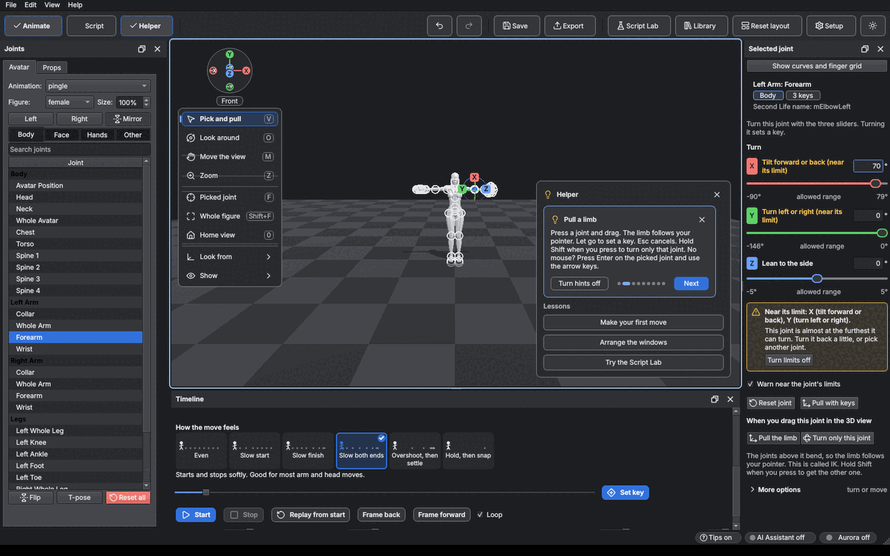

Od góry do dołu:

- **Pasek menu:** File, Edit, View, Help. Każda pozycja menu jest wymieniona w [Rozdziale 15](#rozdział-15-każda-pozycja-menu).
- **Górny pasek.** Od lewej do prawej:
  - **Animate** i **Script** przełączają dwie strony (F7 i F8).
  - **Helper** włącza i wyłącza panel Helper.
  - Strzałki Undo i Redo.
  - **Save** i **Export**.
  - **Script Lab** i **Library** otwierają te panele.
  - **Reset layout** przywraca każdy panel na miejsce startowe.
  - **Setup** otwiera ustawienia.
  - Przycisk słońca przełącza między ciemnym a jasnym motywem.
- **Panel Joints** (po lewej): lista stawów, z kartami Avatar i Props.
- **Widok 3D** (pośrodku): postać i podłoga. W lewym górnym rogu jest **view-direction widget** (kliknij koniec osi, żeby patrzeć stamtąd). Pod nim jest **view toolbar** z narzędziami Pick and pull, Look around, Move the view i Zoom.
- **Panel Selected joint** (po prawej): obraca wybrany staw.
- **Timeline** (na dole): klucze w czasie, kafelki easing, znacznik czasu i przyciski odtwarzania.
- **Pasek stanu** (na samym dole): po lewej wiersz pomocy. Po prawej: przełączniki **Tips**, **AI Assistant** i **Aurora**.

### Panele, które możesz przesuwać i zmieniać ich rozmiar

Każdy panel można:

- przeciągnąć za tytuł w nowe miejsce,
- **wyrwać** do osobnego okna (mała kwadratowa ikona w tytule),
- zmienić jego rozmiar, przeciągając linie podziału między panelami,
- ukryć za pomocą X w tytule.

Naciśnij **Tab**, żeby ukryć lub pokazać wszystkie panele. **View > Reset layout** (albo przycisk **Reset layout**) przywraca wszystko. Reset layout resetuje obie strony.

**Przykład.** Przeciągnij Timeline za tytuł na prawą stronę. Naciśnij **Reset layout**. Wraca na dół.

### Animate i Script

Naciśnij **Script** (albo F8). Script Lab wypełnia prawą stronę okna.

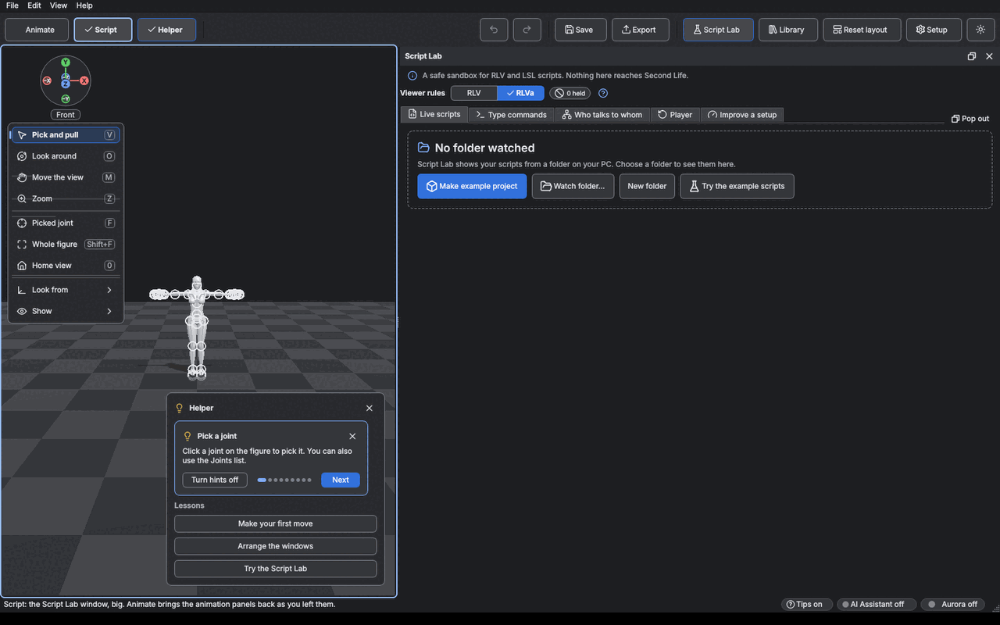

Naciśnij **Animate** (albo F7). Twoje panele animacji wracają tak, jak je zostawiłeś.

### Helper

Przycisk **Helper** pokazuje mały panel w prawym dolnym rogu widoku 3D. Pokazuje następną kartę podpowiedzi i trzy krótkie lekcje:

- **Make your first move:** wybierz staw, obróć go, zapisz klucz i zobacz efekt.
- **Arrange the windows:** otwórz Library, a potem przywróć każde okno.
- **Try the Script Lab:** przełącz na Script i z powrotem.

Pierścień zaznacza prawdziwy element sterujący, o którym mówi krok. Krok idzie dalej, gdy go wykonasz. Naciśnij **Turn hints off**, żeby zatrzymać karty podpowiedzi. Wyłącz Helper, a program jest czysty.

Przycisk Helper i **Help > Show hints** (Shift+H) to to samo ustawienie.

### Beginner i Expert

**View > Expert mode** (Shift+E) pokazuje więcej elementów sterujących. Tryb Expert dodaje:

- **Paste mirrored**,
- **Edit curve** na osi czasu,
- siatkę każdego stawu palca w stopniach na karcie Hands,
- przełącznik pokazujący każdy staw na osi czasu,
- drugą postać (File > Add a second figure, w panelu Library: Add as a second figure).

Ten sam przełącznik jest w **Setup**.

---

## Rozdział 3: Twoja pierwsza animacja

W około dziesięć minut zrobisz krótki ruch ręki.

Najpierw trzy słowa.

- **Klucz** (key) to zapisana poza w jednym momencie. Program wypełnia ruch pomiędzy dwoma kluczami.
- **Klatka** (frame) to jeden krok w czasie.
- **Znacznik czasu** to suwak, który wybiera moment, który widzisz.

### Krok 1: Start

1. Wybierz **File > New animation** (Ctrl+N). Pojawia się postać.
2. Albo wybierz **File > Open** i wskaż `wave.dingle` w folderze `examples` obok programu. To gotowa animacja do obejrzenia.

Postać stoi w pozie T.

### Krok 2: Otwórz listę Joints i wybierz staw

1. Wybierz **View > Joints**. Panel Joints otwiera się po lewej.
2. Na liście kliknij **Whole Arm** pod **Left Arm**. Albo kliknij ramię na postaci.

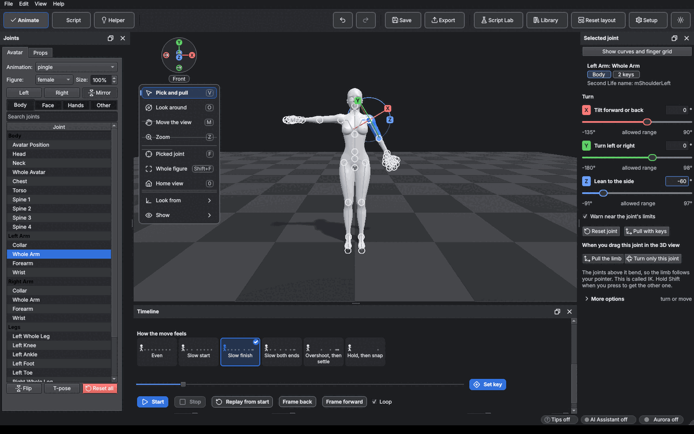

Panel **Selected joint** pokazuje nazwę stawu i trzy suwaki: **Tilt forward or back**, **Turn left or right** i **Lean to the side**. Każdy pokazuje swój dozwolony zakres.

### Krok 3: Ustaw pierwszy klucz

Naciśnij **Set the first key** na dole ekranu (albo naciśnij **K**). Program zapisuje pozę, którą teraz widzisz, jako klucz. Oś czasu pokazuje teraz wiersz dla tego stawu.

Nowa animacja ma 30 klatek. Pierwsza klatka jest zablokowana, żeby chronić pierwszą pozę. Twój pierwszy klucz trafia więc na klatkę 2. Żeby odblokować pierwszą klatkę, wyłącz **Edit > Lock the first frame**.

### Krok 4: Wybierz późniejszy moment

Przeciągnij znacznik czasu (suwak nad przyciskiem **Start**) w prawo. Tekst **Frame ... of ...** na dole osi czasu pokazuje, gdzie jesteś. Postać zachowuje pozę z poprzedniego klucza.

Panel Timeline nie jest wysoki. Jeśli nie widzisz suwaka i przycisków odtwarzania, przewiń wewnątrz Timeline albo przeciągnij linię podziału nad nim do góry.

### Krok 5: Ustaw pozę

Zrób jedno z tych:

- Wpisz liczbę w polu panelu Selected joint, na przykład `-60` w **Lean to the side**, i naciśnij Enter.
- Przeciągnij suwak.
- Przeciągnij kolorowy pierścień na postaci. Czerwony obraca wokół X, zielony wokół Y, a niebieski wokół Z.
- Przeciągnij sam staw. Kończyna podąża za wskaźnikiem. Przytrzymaj **Shift**, żeby obrócić tylko ten staw.

Obrócenie stawu od razu zapisuje klucz dla tego stawu. Oś czasu go pokazuje. Wiersz stanu mówi „Key set at frame ... for ...”.

### Krok 6: Wybierz, jak ruch ma się „czuć”

Gdy klucz jest wybrany, oś czasu pokazuje sześć kafelków pod **How the move feels**:

| Kafelek | Znaczenie |
|---|---|
| Even | Ta sama prędkość przez cały czas. |
| Slow start | Zaczyna łagodnie, potem przyspiesza. |
| Slow finish | Rusza z prędkością, potem się uspokaja. Dobre do odkładania dłoni. |
| Slow both ends | Zaczyna i kończy łagodnie. To domyślne ustawienie nowego klucza. |
| Overshoot, then settle | Wychodzi trochę za daleko, potem wraca. |
| Hold, then snap | Stoi w miejscu, potem skacze. |

### Krok 7: Odtwórz

1. Naciśnij **Start**. Animacja się odtwarza.
2. Naciśnij **Stop**, żeby zatrzymać.
3. **Replay from start** odtwarza od pierwszej klatki.
4. **Loop** (domyślnie zaznaczone) odtwarza w kółko.
5. **Frame back** i **Frame forward** przesuwają o jedną klatkę.

### Krok 8: Zapisz

1. Wybierz **File > Save as...** (Ctrl+A) albo naciśnij **Save** u góry.
2. Wybierz nazwę. Plik kończy się na `.dingle`. To format roboczy. Zachowuje całą twoją pracę.

### Krok 9: Eksport dla Second Life

1. Naciśnij **Export** u góry albo wybierz **File > Export for Second Life (.anim)...** (Ctrl+Shift+E).
2. Otwiera się małe okienko.

   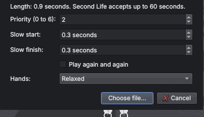

   - **Length** jest pokazana jako tekst. Second Life przyjmuje do 60 sekund.
   - **Priority (0 to 6):** gdy dwie animacje poruszają ten sam staw, wygrywa wyższa liczba.
   - **Slow start** i **Slow finish:** jak długo animacja się wygasza na początku i końcu.
   - **Play again and again:** użyj punktów pętli.
   - **Hands:** jak wyglądają palce podczas odtwarzania.
3. Naciśnij **Choose file...** i wybierz nazwę. Plik kończy się na `.anim`.

Program sprawdza animację pod kątem zasad Second Life podczas eksportu.

### Krok 10: Wgraj do Second Life

Wgrywanie odbywa się w przeglądarce Second Life (viewerze), nie w PinglyMotion.

1. W viewerze wybierz **Build > Upload > Animation**. (Dokładna nazwa menu zależy od twojego viewera.)
2. Wybierz swój plik `.anim`.
3. Ustaw ten sam priorytet i pętlę co w okienku eksportu. Viewer prosi o niewielką opłatę.
4. Załóż lub odtwórz animację, żeby ją zobaczyć.

Szczera uwaga: eksport, wgranie i odtwarzanie zostały potwierdzone w Firestorm 21 listopada 2026. Inne viewery nie były testowane. Wgranie kosztuje w Second Life niewielką opłatę.

### Jeśli coś pójdzie nie tak

- **Postać się nie rusza.** Możesz być na zablokowanej pierwszej klatce. Przeciągnij znacznik czasu na późniejszą klatkę.
- **Staw nie chce się obrócić dalej.** Jest w najdalszym możliwym położeniu. Obróć go z powrotem albo naciśnij **Turn limits off** w ostrzeżeniu.
- **Nie podoba ci się klucz.** Naciśnij Ctrl+Z, żeby cofnąć.
- **Zgubiłeś widok.** Naciśnij **0**, żeby wrócić do widoku domowego, albo naciśnij **Whole figure** (Shift+F).
- **Nic się nie rusza podczas odtwarzania.** Staw potrzebuje dwóch kluczy na różnych klatkach.

---

## Rozdział 4: Pozowanie w szczegółach

### Panel Joints

Panel ma dwie karty: **Avatar** i **Props** (Rozdział 7).

Na karcie Avatar, od góry do dołu:

- **Animation:** nazwa otwartej animacji. Nowa animacja nazywa się `pingle`.
- **Figure:** `female` albo `male`. To zmienia tylko to, co widzisz.
- **Size:** rozmiar postaci w widoku (na początku 100%).
- **Left**, **Right** i **Mirror**: którą stronę pokazuje lista i którą stronę zmienia edycja. Podpowiedź przy **Mirror** mówi: „turning one side turns the other side too”. Jeśli rusza się też druga ręka, choć chciałeś tylko jednej, naciśnij **Mirror**, żeby to wyłączyć.
- Cztery karty: **Body**, **Face**, **Hands** i **Other**.
- **Search joints:** wpisz część nazwy.
- Lista stawów, w grupach: Body, Left Arm, Right Arm, Legs i inne.
- **Flip:** odwraca całą pozę z lewej na prawą.
- **T-pose:** ręce wyprostowane na boki.
- **Reset all:** resetuje każdy staw.

### Panel Selected joint

Gdy staw jest wybrany, panel pokazuje:

- jego nazwę i liczbę jego kluczy,
- jego nazwę w Second Life (na przykład `mShoulderLeft`),
- trzy suwaki z polami liczbowymi (w stopniach) i **dozwolony zakres**,
- ostrzeżenie, gdy jesteś blisko limitu. **Turn limits off** usuwa limit. **Warn near the joint's limits** wyłącza ostrzeżenie,
- **Reset joint** i **Pull with keys**,
- **Pull the limb** i **Turn only this joint**: co robi przeciąganie stawu,
- **More options** z **turn or move**: obróć albo przesuń staw,
- **Show curves and finger grid**, przycisk na górze panelu. Pokazuje dodatkowe elementy trybu Expert. Drugi przycisk, **Show all joints**, pojawia się, gdy nic nie jest wybrane.

Gdy nic nie wybrałeś, panel pokazuje trzy krótkie kroki i przycisk, który wybiera staw za ciebie.

### Przeciąganie kończyny

Naciśnij staw na postaci i przeciągnij. Stawy powyżej zginają się tak, żeby kończyna podążała za wskaźnikiem. To się nazywa IK (kinematyka odwrotna). Puść, żeby ustawić klucz. Esc anuluje. Przytrzymaj **Shift**, naciskając staw, żeby obrócić tylko ten staw.

Bez myszy? Naciśnij **Enter** na wybranym stawie. Użyj klawiszy strzałek. Naciśnij Enter, żeby ustawić klucz. Esc anuluje.

### Dłonie

Na karcie **Hands** dostajesz:

- dziewięć gotowych póz palców,
- jeden suwak **Bend** dla każdego palca,
- **Reset hand**,
- w trybie Expert siatkę każdego stawu palca w stopniach.

**Mirror** kopiuje zmianę na drugą dłoń. Wiersz u góry mówi, nad którą dłonią pracujesz, na przykład „Right hand. The other hand copies it.”

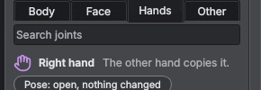

**Przykład.** Otwórz kartę **Hands**. Wybierz jedną z gotowych póz. Naciśnij **Set key**.

### Face i Other

Karta **Face** wymienia stawy twarzy Bento: głowa, brwi, oczy, uszy i inne. Karta **Other** wymienia dodatkowe stawy Bento: ogon, tylne kończyny i skrzydła. Użyj **View > Joint groups**, żeby pokazać lub ukryć te grupy. **Hide in lists** pomija ukryte stawy na listach.

Stawy twarzy są odłożone: są, ale nie dostają jeszcze szczególnej uwagi.

### Limity stawów

Każdy staw ma zakres, na który pozwala Second Life. Blisko limitu panel cię ostrzega. Limity są domyślnie włączone.

---

## Rozdział 5: Oś czasu, klucze i odtwarzanie

### Wiersze

Oś czasu pokazuje wiersz dla każdego stawu ze zmianami i dla wybranego stawu. Wiersze są kolorowane i nazwane według obszaru ciała. Pole **Show rows for** filtruje według obszaru ciała. Tryb Expert dodaje przełącznik pokazujący każdy staw.

Bez kluczy oś czasu mówi **No keys yet** i oferuje **Set the first key**.

### Klucze

- **Set key** (K) zapisuje pozę, którą teraz widzisz.
- Obrócenie stawu samo ustawia klucz.
- Znacznik na osi czasu pokazuje każdy klucz.
- Wybierz klucz, żeby zmienić jego easing (Rozdział 3, krok 6).
- W trybie Expert **Edit curve...** rysuje własną krzywą prędkości dla ruchu. Okno pamięta swoje miejsce i rozmiar.

### Zaznaczanie, kopiowanie i wklejanie

1. Przytrzymaj **Shift** i przeciągnij na osi czasu albo użyj Shift i klawiszy strzałek, żeby zaznaczyć odcinek.
2. **Edit > Copy** (Ctrl+C), **Cut** (Ctrl+X) albo **Paste** (Ctrl+V).
3. **Paste mirrored** (Ctrl+Shift+V, tryb Expert) wkleja z zamienioną lewą i prawą stroną. Lewy krok staje się prawym krokiem.

### Cofnij i Ponów

Ctrl+Z cofa. Ctrl+Shift+Z albo Ctrl+Y ponawia. Każda edycja lub przeciągnięcie to jeden krok. Historia mieści do 100 kroków i przetrwa Save.

### Punkty pętli

Na dole osi czasu znajdziesz:

- **Loop starts at** i **Loop ends at**: dwie klatki, między którymi animacja się zapętla, z ich położeniem w procentach,
- **Frame ... of ...**: gdzie jesteś i ile jest klatek,
- **Frames per second** (na początku 30).

Okienko eksportu używa klatek pętli, gdy zaznaczone jest **Play again and again**.

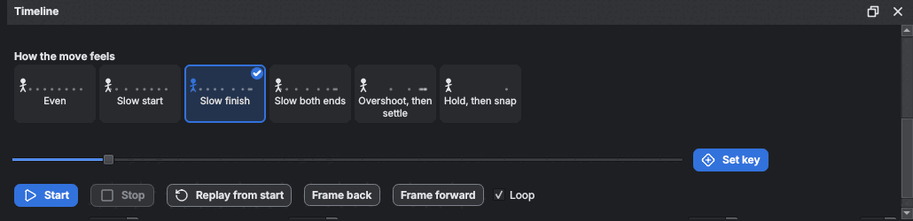

### Wiersz notatek

Niektóre animacje niosą notatki dydaktyczne. Według dokumentów projektu wiersz pod osią czasu pokazuje wtedy notatkę bieżącej klatki, z **Hide notes**. (Sprawdzenie `wave.dingle` w wersji na Linuksa nie pokazało wiersza notatek, więc traktuj to jako niepotwierdzone.)

**Przykład.** Otwórz `wave.dingle` z folderu `examples`. Naciśnij **Start**. Obserwuj, jak postać macha. Naciśnij **Stop**.

### Wolny przykład

`jump_slow.dingle` to `jump.dingle`, w którym każdy klucz jest 2,5 razy później. Działa z prędkością 40 procent, więc możesz obejrzeć skok w zwolnionym tempie.

---

## Rozdział 6: Widok 3D i kamera

### Mysz i klawisze

Domyślny styl, zwany PinglyMotion, działa tak:

| Co | Jak |
|---|---|
| Rozglądanie się (orbit) | Przeciągnij puste miejsce |
| Przesuwanie widoku (pan) | Przeciągnij prawym przyciskiem |
| Zoom | Kółko myszy |
| Wybranie stawu | Kliknij go albo jego wiersz |
| Skupienie na wybranym stawie | F albo dwukrotne kliknięcie |

W **Setup** albo w **Help > Camera and keys...** możesz zamiast tego wybrać styl Maya, Blender albo Second Life. Rozdział 14 ma tabele.

### Pasek widoku

W lewym górnym rogu widoku 3D:

- **View-direction widget:** kliknij koniec osi, żeby patrzeć stamtąd.
- **Pick and pull** (V), **Look around** (O), **Move the view** (M), **Zoom** (Z).
- **Picked joint** (F), **Whole figure** (Shift+F), **Home view** (0).
- **Look from** (Front, Side, Top).
- **Show:** siatka podłogi, pierścienie obrotu, kropki stawów i nazwy narzędzi.

Każde ustawienie jest też w menu **View**.

### Menu View

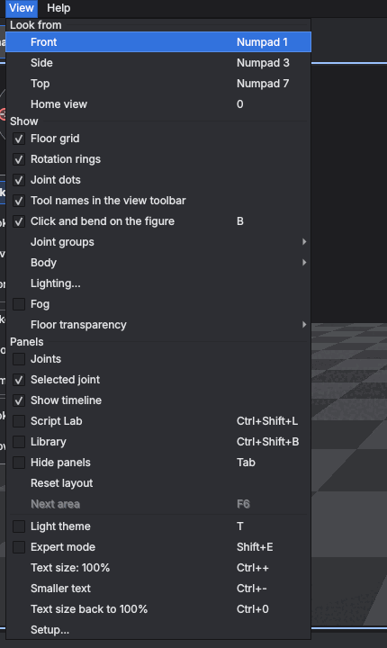

- **Look from:** Front (Numpad 1), Side (Numpad 3), Top (Numpad 7), Home view (0).
- **Show:** Floor grid, Rotation rings, Joint dots, Tool names in the view toolbar, **Click and bend on the figure** (B), Joint groups, Body, Lighting..., Fog, Floor transparency.
- **Joint groups** pokazuje lub ukrywa grupy dodatkowych stawów: Wings, Tail, Hind limbs, Face oraz Fingers and toes. Ukrywanie zmienia tylko to, co widzisz. **Hide in lists** pomija ukryte stawy na osi czasu i na liście stawów. Jeśli jest wyłączone, są pokazane przygaszone.
- **Body** wybiera siatkę ciała: **Ruth2** albo **Max**. Zmienia tylko wygląd postaci.
- **Lighting...** otwiera małe okienko z suwakami **Brightness** (Dark do Bright), **Shine** (Matt do Shiny) i **Warmth** (Cool do Warm), polem **Shadow on the floor** oraz przyciskami **Reset** i **Close**.
- **Fog** zaciera daleki koniec podłogi. Na początku jest wyłączona.
- **Floor transparency:** 0, 25, 33, 50 albo 75 procent.
- **Panels:** Joints, Selected joint, Show timeline, Script Lab, Library, Hide panels (Tab), Reset layout, Next area (F6).
- **Light theme** (T), **Expert mode** (Shift+E), rozmiar tekstu i **Setup...**.

**Przykład.** Najedź wskaźnikiem na widok 3D. Naciśnij **O** (look around) i przeciągnij. Naciśnij **M** i przeciągnij, żeby przesunąć widok. Naciśnij **V**, żeby wrócić do wybierania stawów. Naciśnij **0**, żeby wrócić do domu.

### Rozmiar tekstu

**Ctrl++** powiększa tekst, **Ctrl+-** zmniejsza, a **Ctrl+0** przywraca 100 procent. Setup oferuje 100, 125, 150, 175 i 200 procent.

### Click and bend

Przy włączonym **Click and bend** (B) kliknięcie postaci wybiera staw, a przeciągnięcie go zgina. Gdy jest wyłączone, kliknięcia postaci nic nie robią. Użyj listy Joints i suwaków.

---

## Rozdział 7: Rekwizyty

**Rekwizyt** (prop) to prosty kształt 3D w scenie. Zastępuje obiekt. Rekwizyt można przymocować do stawu, żeby poruszał się razem z tym stawem.

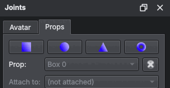

1. Wybierz **View > Joints**. Otwórz kartę **Props**.
2. Naciśnij przycisk kształtu: pudełko, kula, stożek albo torus (pierścień).
3. Program nadaje mu nazwę, na przykład **Box 0**. Następne pudełko to **Box 1**. Rekwizytu nie można jeszcze przemianować.
4. Umieść go za pomocą **Place**, **Turn** i **Size** w panelu po prawej, który teraz nazywa się **Selected prop**. Tam możesz też zmienić **Shape**: Box, Ring, Cone albo Ball. Małe okienko nad widokiem 3D, **Edit prop**, ma narzędzia **Move**, **Turn** i **Size** do przeciągania.
5. Wybierz staw w **Attach to**. Rekwizyt porusza się razem z tym stawem.
6. Przycisk z X usuwa rekwizyt.

**File > Save** zachowuje rekwizyty w pliku animacji. **File > Open** przywraca je. **File > Open props...** i **Save props...** używają starszych plików `.prp`. Otwarcie pliku `.prp` najpierw usuwa bieżące rekwizyty.

**Przykład.** Otwórz `throne.dingle` z folderu `examples`. Postać siedzi. Wybierz **File > Open props...** i wskaż `throne.prp`. Wokół postaci pojawiają się pudełka. Wybrane jest niebieskie. Wybierz inną nazwę na liście **Prop:**, żeby je zaznaczyć.

---

## Rozdział 8: Biblioteka

Biblioteka zawiera 106 gotowych ruchów. Użyj jednego jako początku.

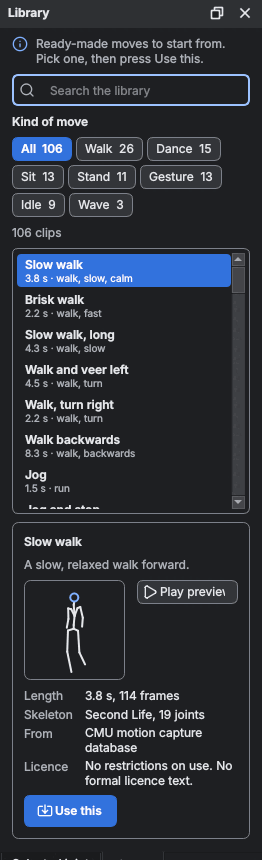

1. Naciśnij **Library** u góry (albo Ctrl+Shift+B, albo **View > Library**).
2. Szukaj albo wybierz rodzaj ruchu: Walk, Dance, Sit, Stand, Gesture, Idle, Wave.
3. Wybierz klip. Panel pokazuje podgląd na małej postaci i **Play preview**.
4. Pokazuje też długość, szkielet, skąd pochodzi i jego licencję.
5. Naciśnij **Use this**. Klip otwiera się jako twoja animacja. Program najpierw pyta, jeśli masz niezapisane zmiany. Wiersz stanu mówi „Opened Slow walk from the library. Save it under your own name.” Nazwa samego klipu jest nazwą animacji, dopóki nie zapiszesz.

Library dzieli prawą stronę z Selected joint. Przełączaj kartami na dole. W trybie Expert **Add as a second figure** stawia klip obok twojej postaci.

**Przykład.** Naciśnij **Library**. Wybierz **Slow walk**. Naciśnij **Use this**. Naciśnij **Start**. Timeline pokazuje wtedy 114 klatek.

Biblioteka pochodzi z bazy danych motion capture CMU i z Mesh2Motion. Zobacz [Rozdział 17](#rozdział-17-podziękowania-i-źródła).

Jeśli panel mówi **No library found**, brakuje folderu `library` obok programu. Zainstaluj program ponownie.

---

## Rozdział 9: Pliki i formaty

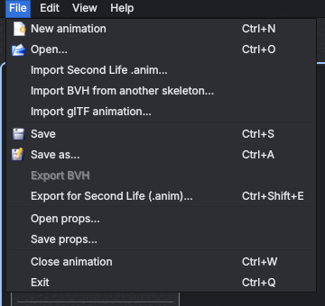

### Formaty

| Rozszerzenie | Co to | Uwagi |
|---|---|---|
| `.dingle` | Własny format roboczy PinglyMotion | Zachowuje wszystko. Zapisany jako tekst (JSON). |
| `.anim` | Animacja Second Life | Eksport i import. |
| `.bvh` | Popularny plik ruchu | Eksport i otwieranie. Otwarty `.bvh` pozostaje nietknięty, dopóki nie zapiszesz. |
| `.avm` | Stary format | Otwiera się. Zapisywany jako `.dingle`. |
| `.prp` | Stary plik rekwizytów | Open props i Save props. |
| `.glb`, `.gltf` | Animacja 3D z innych narzędzi | Tylko import. |

### Menu File

- **New animation** (Ctrl+N), **Open...** (Ctrl+O), **Save** (Ctrl+S), **Save as...** (Ctrl+A).
- **Import Second Life .anim...** otwiera `.anim` jako nową, niezapisaną animację. Lista **What could not be imported** mówi, co pominięto.
- **Import BVH from another skeleton...** pokazuje, które stawy dopasowano, a które pominięto. Zaznacz **My file starts in a T-pose or A-pose**, jeśli pierwsza klatka to poza stojąca. Naciśnij **Open the animation**. Dopasowanie, które zrobisz, można zachować w małym pliku `.jointmap`.
- **Import glTF animation...** otwiera `.glb` albo `.gltf`. Jeśli plik ma więcej niż jedną animację, wybierz te, które chcesz.
- **Export BVH** tworzy plik `.bvh`.
- **Export for Second Life (.anim)...** (Ctrl+Shift+E).
- **Open props...** i **Save props...**.
- **Close animation** (Ctrl+W) i **Exit** (Ctrl+Q).

Każdy import otwiera się jako animacja bez nazwy. Twój oryginalny plik nie jest zmieniany. Zapisz ją, żeby ją zachować.

**Przykład.** Wybierz **File > Open** i wskaż `jump.dingle` w `examples`. Wybierz **File > Save as...** i zapisz pod nową nazwą. Wybierz **File > Export for Second Life (.anim)...** i utwórz `jump.anim`. Wybierz **File > Import Second Life .anim...** i otwórz go ponownie. Komunikat mówi „Opened jump.anim.” i wymienia, czego nie dało się zaimportować. Dla tego pliku mówi, że priorytet, łagodny start i koniec oraz dłonie nie są zachowane. Sam ruch wraca.

### Folder dla asystentów AI

Asystent AI może otwierać i zapisywać pliki tylko w jednym folderze: `PinglyMotion` w twoim folderze Dokumenty. Zobacz [Rozdział 11](#rozdział-11-asystenci-ai).

---

## Rozdział 10: Script Lab dla początkujących

Script Lab to bezpieczna piaskownica. Możesz uruchamiać skrypty RLV i LSL na swoim komputerze. Nic nie dociera do Second Life.

Najpierw kilka słów.

- **LSL** to język skryptowy Second Life.
- **Skrypt** to mały program wewnątrz obiektu.
- **Obiekt** składa się z **prymów** (prim). Prim to jedna część, na przykład pudełko.
- **RLV** (Restrained Love Viewer) to zestaw poleceń, które skrypt może wysłać do viewera. Ograniczają one, co może robić awatar, na przykład `@detach=n` znaczy „tego nie można zdjąć”.
- **RLVa** to viewer, który rozumie RLV i więcej.
- **Kanał** (channel) to liczba, której skrypty używają do rozmowy, jak kanał radiowy.

**Szczery stan.** Script Lab jest zbudowany w wielu częściach. Nic w nim nie zostało przetestowane w Second Life. Piaskownica nigdy nie jest identyczna z Second Life. Zobacz [Co jest gotowe, a co nie](#co-jest-gotowe-a-co-nie).

Otwórz Script Lab przyciskiem **Script** (F8) albo przyciskiem **Script Lab** (Ctrl+Shift+L).

### Góra okna

- **Viewer rules:** **RLV** albo **RLVa**. Start to RLVa. Przełączenie usuwa wszystkie ograniczenia, jak po nowym zalogowaniu.
- Plakietka pokazuje, ile ograniczeń jest utrzymywanych („0 held”).
- Pięć kart: **Live scripts**, **Type commands**, **Who talks to whom**, **Player**, **Improve a setup**.
- **Pop out** przenosi Script Lab do osobnego okna.

### Zrób przykładowy projekt

1. Naciśnij **Script**.
2. Naciśnij **Make example project**.

Program kopiuje przykład **First colour** do twojego własnego folderu (`Documents/PinglyMotion/Scripts/First_colour`). Dodaje pudełko do sceny. Obserwuje folder. Karta **Steps** wymienia pięć kroków i je odhacza.

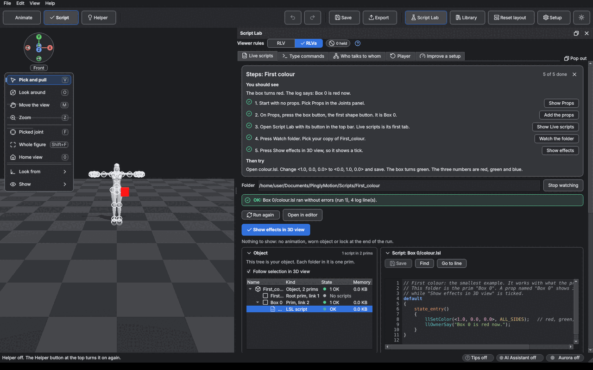

Powinieneś zobaczyć:

- czerwone pudełko obok postaci,
- komunikat **OK: Box 0/colour.lsl ran without errors**,
- wiersz dziennika „Box 0 is red now.”

### Drzewo

Pole **Object** pokazuje twój obiekt jako drzewo. Każdy folder to jeden prim. Folder **Box 0** to prim. Skrypt w nim to wiersz **LSL script**. Kolumny to **Name**, **Kind**, **State** i **Memory**.

Kliknij wiersz. Przy zaznaczonym **Follow selection in 3D view** rekwizyt o tej samej nazwie podświetla się w widoku 3D.

### Zmień skrypt

1. Skrypt jest otwarty w edytorze po prawej. (**Open in editor** otwiera go ponownie.)
2. Zmień `<1.0, 0.0, 0.0>` na `<0.0, 1.0, 0.0>`.
3. Naciśnij **Save**.

Pudełko robi się zielone. Trzy liczby to czerwony, zielony i niebieski. Każdy zapis uruchamia folder ponownie. Naciśnij **Run again**, żeby uruchomić bez zmiany.

Edytor ma **Save**, **Find** i **Go to line**. Podczas pisania pokazuje podpowiedzi i teksty pomocy dla funkcji LSL. Podpowiada też polecenia RLV wewnątrz `llOwnerSay("@...")`, ze zwykłymi ostrzeżeniami. Jeśli wolisz, przełącz w Setup na **Show suggestions only when I press Ctrl+Space**.

### Pokaż efekty w widoku 3D

Przycisk **Show effects in 3D view** sprawia, że rekwizyty pokazują, co robią skrypty: kolor i przezroczystość. Rekwizyt nazwany jak prim pokazuje efekt skryptów tego prima. Kliknięcie rekwizytu liczy się jako dotknięcie. Menu pokazywane przez skrypt (`llDialog`) pojawia się jako okienko nad widokiem 3D. Naciśnij w nim przycisk albo **Ignore** (Esc).

### Inne przykłady

Folder `examples/objects` ma sześć dalszych obiektów: Button HUD, Gear set, Timed lock, RLV relay i Work system. `examples/scriptlab` ma luźne skrypty. Naciśnij **Try the example scripts** (gdy żaden folder nie jest obserwowany), żeby uruchomić `rlv_lock.lsl`.

**Watch folder...** obserwuje dowolny twój folder. Folder to obiekt. **New folder** tworzy nowy.

### Type commands

Karta **Type commands** służy do wierszy RLV.

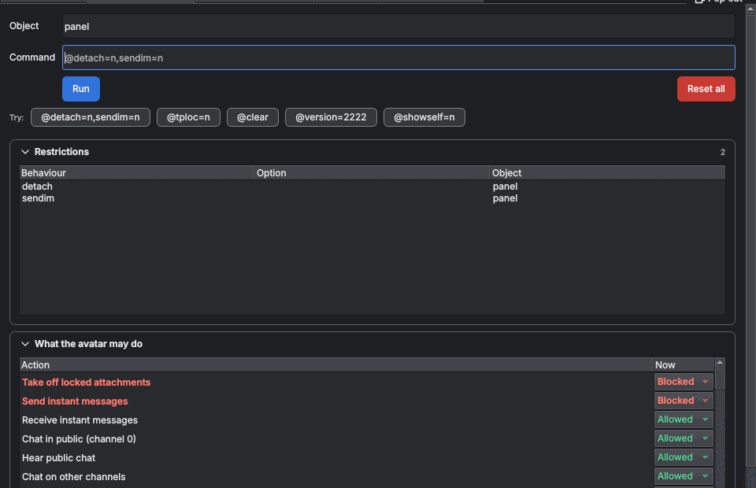

1. Otwórz kartę **Type commands**.
2. Kliknij pole **Command**, wpisz `@detach=n,sendim=n` i naciśnij Enter.
3. Karta pokazuje **Restrictions** (detach i sendim), utrzymywane przez obiekt `panel`. W **What the avatar may do** pozycje **Take off locked attachments** i **Send instant messages** mówią teraz **Blocked**.

Plakietki pod **Try** wypełniają gotowy przykład. **Reset all** usuwa wszystkie ograniczenia. Każdy wiersz listy akcji to wybór **Allowed / Blocked**, który możesz ustawić. Dziennik **Replies and messages** pokazuje odpowiedzi, które usłyszałby skrypt.

Karta ma też przełączniki ograniczeń kamery, środowiska i trybów widoku w widoku 3D oraz część o nazwie **Vision sphere**.

### Who talks to whom

Karta **Who talks to whom** rysuje mapę, gdy folder jest obserwowany. Otwórz część **Who talks to whom**, klikając jej nagłówek. Dla przykładu First colour widzisz pudełko **Box 0** ze strzałką do przerywanego pudełka **You**, opisaną `owner say: "Box 0 is red now."`.

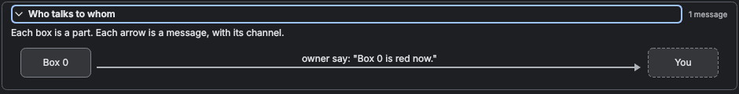

W większych układach pudełka to prymy, a także **You**, **Your viewer (RLV)** i **Web server**. Strzałki pokazują czat, wiadomości między linkami, menu i wiersze RLV, z ich kanałem. Strzałka, której nikt nie słyszy, jest przerywana, czerwona i mówi dlaczego. Prim, który nasłuchuje i przekazuje polecenia, jest oznaczony **(hub)**. Kliknięcie strzałki pokazuje wiersz skryptu, który ją wysłał.

### Player

Naciśnij **Record what I do** na karcie **Player**. Klikaj rekwizyty albo naciskaj przyciski menu. Każda akcja to krok. Naciśnij **Stop recording**.

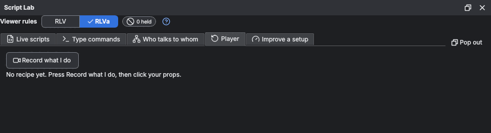

Program zapisuje kroki jako `recipe.rlvtest` w folderze obiektu. Odtwarza je i mówi, co się zmieniło od ostatniego razu. Odtwarzacz ma te same przyciski Start, Stop, Step back i Step forward co oś czasu. Wymienia momenty i co było prawdą w każdym. **Go to first difference** skacze do pierwszej zmiany.

Not built: odtwarzacz nie porusza animacji, kamery, środowiska ani okienka menu. Te pokazują bieg na żywo.

### Improve a setup

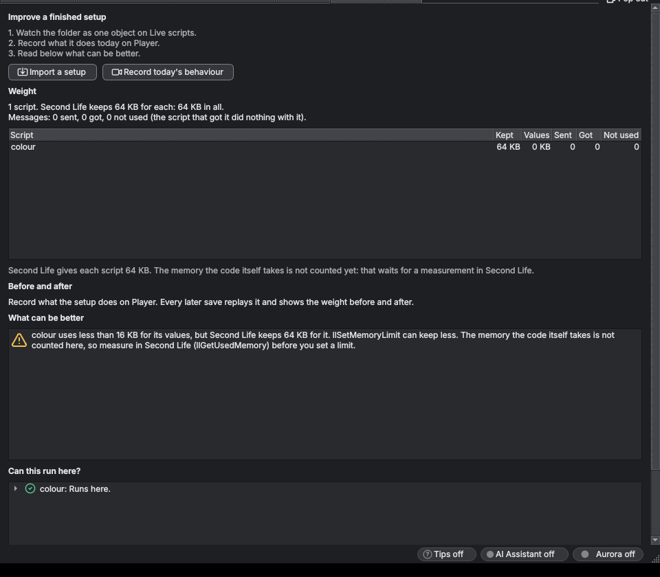

Dla gotowego układu, na przykład obroży:

1. Obserwuj folder jako jeden obiekt (Live scripts).
2. Nagraj, co robi (Player).
3. Przeczytaj kartę **Improve a setup**.

Pokazuje, jak ciężki jest każdy skrypt (**Kept**, **Values**, **Sent**, **Got**, **Not used**), co można poprawić i dla każdego skryptu, czy może tu działać. **Import a setup** i **Record today's behaviour** są na karcie.

Pamięć samego kodu nie jest jeszcze liczona. To wymaga pomiaru w Second Life.

### Przykład OpenCollar

`examples/improve/OpenCollar` zawiera 23 skrypty publicznej obroży OpenCollar. Są skopiowane bez zmian, z ich licencją (GPL 2). Obserwuj folder. Obroża startuje i pokazuje swoje menu, gdy ją klikniesz. **Not tested in Second Life.**

### Lua (próba)

Lua to nowszy język skryptowy w Second Life. Nazywa się SLua.

1. Otwórz **Setup**. Zaznacz **Lua (trial): show the language choice in the editor**.
2. Edytor pokazuje pole **Language** z **LSL** i **SLua (Lua, trial)**.
3. Wybierz SLua. Przewiń w dół na karcie Live scripts. Na prawym końcu wiersza pod tekstem naciśnij **Convert to SLua**.

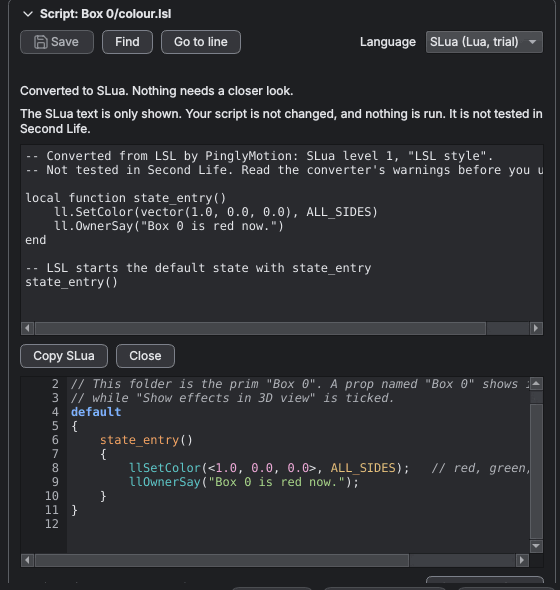

Okienko pokazuje przekonwertowany tekst i uwagi. Twój skrypt nie jest zmieniany. Nic nie jest uruchamiane. **Copy SLua** kopiuje tekst. **Close** zamyka okienko.

Lua to próba. Konwerter jest sprawdzany testami, które porównują dokładny tekst. Jest **not tested in Second Life**. Nie ma sprawdzania Lua ani podpowiedzi, a Lua się nie uruchamia.

### Kroki i przewodnik

**Help > Script Lab steps** pokazuje kartę kroków ponownie.

---

## Rozdział 11: Asystenci AI

Asystent AI na twoim własnym komputerze może ustawiać postać w pozie, odtwarzać ją, patrzeć na nią i zapisywać. To jest opcjonalne. Jest **wyłączony przy każdym uruchomieniu** i nigdy nie włącza się sam.

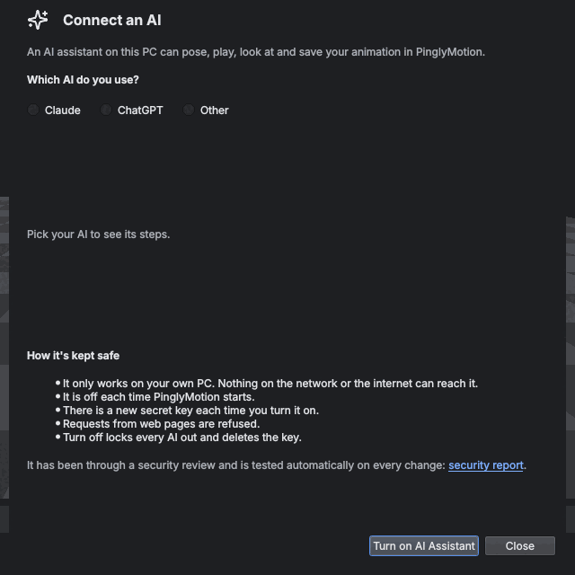

### Włącz go

1. Kliknij przycisk **AI Assistant** na pasku stanu (w prawym dolnym rogu).
2. Okno **Connect an AI** pyta „Which AI do you use?” Wybierz **Claude**, **ChatGPT** albo **Other**. Każdy pokazuje tylko własne kroki.
3. Naciśnij **Turn on AI Assistant**.

Przycisk pokazuje kropkę i swój stan:

| Kropka | Tekst | Znaczenie |
|---|---|---|
| Szara | AI Assistant off | Wyłączony. |
| Żółta | AI Assistant on, waiting for an AI | Włączony, nie ma połączonej AI. |
| Zielona | AI Assistant: Claude | AI jest połączona. |
| Czerwona | A wrong key was refused | Coś próbowało użyć błędnego klucza. |

Tytuł okna mówi „AI Assistant on”, dopóki jest włączony. Kliknij przycisk ponownie, żeby go wyłączyć. Wyłączenie zamyka dostęp każdej AI.

### Jak jest zabezpieczony

- Działa tylko na twoim własnym komputerze. Nic w sieci nie może do niego dotrzeć.
- Jest wyłączony za każdym razem, gdy PinglyMotion się uruchamia.
- Przy każdym włączeniu powstaje nowy tajny klucz.
- Żądania ze stron internetowych są odrzucane.

### Co może zrobić asystent

Asystent używa poleceń interfejsu sterowania: sprawdzić stan, ustawiać stawy w pozie, ustawiać klatki, odtwarzać, zrobić zrzut ekranu, opisać pozę i ruch słowami, czytać i zapisywać całą animację jako małą tabelę tekstową, sprawdzić animację pod kątem zasad Second Life, eksportować `.anim`, przeszukiwać bibliotekę i używać Script Lab (polecenia RLV i skrypty LSL). Pełna lista jest w `docs/CONTROL.md` i `tools/mcp/commands.json`.

Asystent może otwierać i zapisywać pliki tylko w folderze `Documents/PinglyMotion`.

### Stan

- **Claude:** zip dla Windows zawiera `mcp/PinglyMotion.mcpb`, rozszerzenie dla aplikacji Claude.
- **ChatGPT:** konfiguracja jest opisana. Przycisk zapisuje konfigurację aplikacji desktopowej. **Nie testowane przez nas.**
- **Inne narzędzia:** plik `pinglymotion_mcp.js` obsługuje inne narzędzia, które mówią MCP. **Nie testowane przez nas.**

Praca ręczna zawsze działa bez żadnej AI. Pełna lista stanu jest w [Co jest gotowe, a co nie](#co-jest-gotowe-a-co-nie).

---

**Przykład.** Naciśnij przycisk **AI Assistant**. Wybierz **Claude** i przeczytaj kroki. Nie naciskaj **Turn on AI Assistant**, chyba że chcesz połączyć AI. Naciśnij **Close**. Przycisk nadal mówi „AI Assistant off”.

### Polecenia sterujące

Polecenia, których może używać asystent, są takie same dla każdego programu na twoim komputerze, który mówi zwykłym HTTP. Wymienia je `GET /api/commands` i `docs/CONTROL.md`. W skrócie:

| Grupa | Polecenia |
|---|---|
| Podgląd | `state`, `joints`, `get_pose`, `keys`, `screenshot`, `describe_pose`, `describe_motion`, `describe_body` |
| Poza i czas | `set_pose`, `set_position`, `delete_key`, `set_frame`, `set_frame_count`, `set_fps`, `set_loop`, `play`, `stop` |
| Pliki | `new_animation`, `open_file`, `save_file`, `export_anim` |
| Widok | `set_figure`, `set_camera` |
| Całe animacje jako tekst | `motion_script`, `load_motion_script`, `check_animation` |
| Biblioteka | `find_reference`, `load_reference` |
| Script Lab | `rlv_command`, `rlv_state`, `rlv_reset`, `lsl_check`, `lsl_lint`, `lsl_run`, `lsl_event`, `lab_watch`, `lab_unwatch`, `lab_result`, `lab_replay` |

Nie musisz ich znać, żeby używać PinglyMotion. Są dla narzędzi AI i dla osób, które piszą skrypty wokół programu.

---

## Rozdział 12: Połączenie na żywo z Aurorą

Aurora to viewer Second Life. PinglyMotion może pokazywać twoją pozę na twoim własnym awatarze w Aurorze, gdy pracujesz. Widzisz ją tylko ty. Nic nie jest wgrywane.

**Stan.** Działa w Windows. Potrzebuje Aurory zbudowanej z forka wymienionego w `docs/AURORA_LINK.md`. Ze zwykłą Aurorą jeszcze nie działa.

**Przykład.** Przy uruchomionym forku Aurory:

1. W Aurorze wybierz **Build > LiveMesh > Enable preview**.
2. W PinglyMotion zaznacz **Live link to Aurora** w **Setup** albo kliknij kropkę na pasku stanu.
3. Pasek stanu mówi „Waiting for Aurora”, potem „Aurora live”.
4. Obróć staw. Twój awatar przyjmuje pozę.

Połączenie jest wyłączone przy każdym uruchomieniu.

---

## Rozdział 13: Ustawienia, motywy i pomoc

Naciśnij **Setup** (zębatka w prawym górnym rogu).

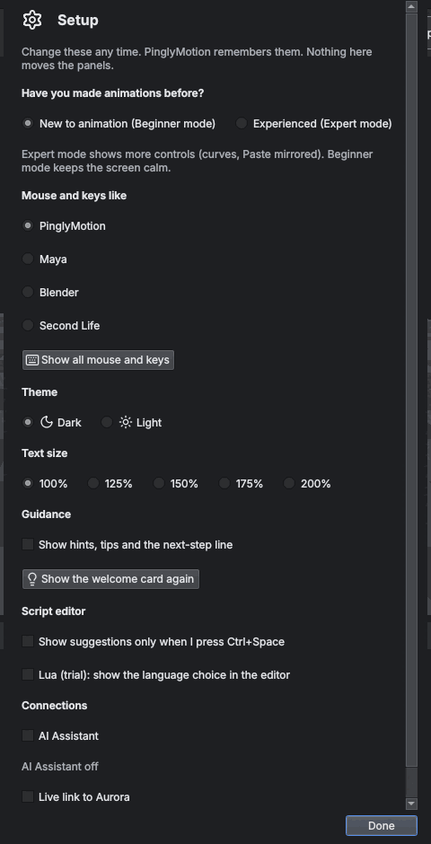

- **Have you made animations before?** New to animation (tryb Beginner) albo Experienced (tryb Expert).
- **Mouse and keys like:** PinglyMotion, Maya, Blender albo Second Life. **Show all mouse and keys** otwiera tabelę.
- **Theme:** Dark albo Light.
- **Text size:** 100, 125, 150, 175 albo 200 procent.
- **Guidance:** **Show hints, tips and the next-step line** i **Show the welcome card again**.
- **Script editor:** **Show suggestions only when I press Ctrl+Space** i przełącznik **Lua (trial)**.
- **Connections:** **AI Assistant** i **Live link to Aurora**.

PinglyMotion pamięta te wybory.

### Menu Help

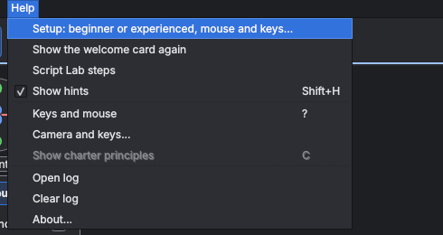

- **Setup: beginner or experienced, mouse and keys...**
- **Show the welcome card again**
- **Script Lab steps**
- **Show hints** (Shift+H)
- **Keys and mouse** (?)
- **Camera and keys...**
- **Show charter principles** (C), gdy dostępne
- **Open log** i **Clear log**
- **About...**: kto zrobił ciała awatarów i na jakiej licencji.

**Przykład.** Naciśnij **Setup**. W **Theme** wybierz **Light**. W **Text size** wybierz **150%**. Naciśnij **Done**. Obie zmiany są zachowane przy następnym uruchomieniu.

### Podpowiedzi i wskazówki

Dziewięć kart podpowiedzi prowadzi przez pierwsze ruchy. **Next** idzie dalej. **Turn hints off** je zatrzymuje. Przełącznik na pasku stanu **Tips on/off** pokazuje lub ukrywa krótką pomoc, gdy wskaźnik myszy spoczywa na elemencie sterującym.

---

## Rozdział 14: Skróty klawiszowe i mysz

### Wszędzie

| Klawisze | Co |
|---|---|
| Ctrl+N | New animation |
| Ctrl+O | Open |
| Ctrl+S | Save |
| Ctrl+A | Save as |
| Ctrl+Shift+E | Export for Second Life |
| Ctrl+W | Close animation |
| Ctrl+Q | Exit |
| Ctrl+Z | Cofnij |
| Ctrl+Shift+Z albo Ctrl+Y | Ponów |
| K | Set key |
| Ctrl+X, Ctrl+C, Ctrl+V | Wytnij, kopiuj, wklej |
| Ctrl+Shift+V | Paste mirrored (tryb Expert) |
| F7, F8 | Strona Animate, strona Script |
| Ctrl+Shift+L | Script Lab |
| Ctrl+Shift+B | Library |
| Tab | Ukryj lub pokaż wszystkie panele |
| F6 | Next area |
| T | Jasny lub ciemny motyw |
| Shift+E | Tryb Expert |
| Shift+H | Podpowiedzi włączone lub wyłączone |
| ? | Keys and mouse |
| Ctrl++, Ctrl+-, Ctrl+0 | Tekst większy, mniejszy, z powrotem do 100% |
| Alt+1, Alt+2 | Wybierz pierwszą lub drugą postać (tryb Expert) |

### W widoku 3D

| Klawisze | Co |
|---|---|
| V, O, M, Z | Narzędzia: pick and pull, look around, move the view, zoom |
| F | Skup się na wybranym stawie |
| Shift+F | Whole figure |
| 0 | Home view |
| Numpad 1, 3, 7 (albo 1, 3, 7) | Front, side, top |
| Alt + klawisze strzałek | Rozglądanie się klawiszami |
| Page Up, Page Down | Zoom klawiszami |
| B | Click and bend włączone lub wyłączone |
| Esc | Anuluj przeciąganie |
| Enter na wybranym stawie | Przeciąganie klawiszami strzałek; Enter ustawia klucz |

### Style kamery

| Działanie | PinglyMotion | Maya | Blender | Second Life |
|---|---|---|---|---|
| Rozglądanie się | Przeciągnij puste miejsce | Alt + przeciągnięcie lewym | Przeciągnięcie środkowym | Alt + przeciągnięcie (na boki), Ctrl + Alt + przeciągnięcie |
| Przesuwanie widoku | Przeciągnięcie prawym | Alt + przeciągnięcie środkowym | Shift + przeciągnięcie środkowym | Ctrl + Alt + Shift + przeciągnięcie |
| Zoom | Kółko myszy | Alt + przeciągnięcie prawym albo kółko | Ctrl + przeciągnięcie środkowym albo kółko | Alt + przeciągnięcie w górę lub w dół albo kółko |
| Wybranie stawu | Kliknij go albo jego wiersz | Klik | Klik | Klik |
| Skupienie na stawie | F albo dwukrotne kliknięcie | F | Numpad . | Alt + klik |

### Stawy

| Co | Jak |
|---|---|
| Przeciągnięcie kończyny | Naciśnij staw i przeciągnij. Puść, żeby ustawić klucz. Esc anuluje. |
| Obrót tylko tego stawu | Przytrzymaj Shift, naciskając staw |
| Obrót na jednej osi | Przeciągnij czerwony pierścień X, zielony Y albo niebieski Z |

Ta sama tabela jest w programie: **Help > Keys and mouse**.

**Przykład.** Naciśnij **?**, żeby otworzyć tabelę. Zamknij ją. Naciśnij **Shift+E**, żeby włączyć tryb Expert, i naciśnij jeszcze raz, żeby go wyłączyć.

---

## Rozdział 15: Każda pozycja menu

### File

Zobacz [Rozdział 9](#rozdział-9-pliki-i-formaty).

### Edit

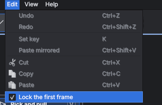

| Pozycja | Klawisze | Co |
|---|---|---|
| Undo, Redo | Ctrl+Z, Ctrl+Shift+Z | Cofnij i przywróć edycję. |
| Set key | K | Zapisz bieżącą pozę jako klucz. |
| Paste mirrored | Ctrl+Shift+V | Wklej z zamienioną lewą i prawą stroną. |
| Cut, Copy, Paste | Ctrl+X, C, V | Na zaznaczonym odcinku osi czasu. |
| Lock the first frame | | Domyślnie włączone. Chroni pierwszą pozę. |

### View

Zobacz [Rozdział 6](#rozdział-6-widok-3d-i-kamera).

### Help

Zobacz [Rozdział 13](#rozdział-13-ustawienia-motywy-i-pomoc).

**Przykład.** Otwórz menu **Help** i wybierz **About...**. Zamknij je. Otwórz **View** i wybierz **Floor transparency**, potem 50%.

### Przyciski górnego paska

| Przycisk | Co |
|---|---|
| Animate, Script | Przełącz strony (F7, F8) |
| Helper | Panel Helper włączony lub wyłączony |
| Undo, Redo | To samo co Edit |
| Save | Zapisz animację |
| Export | Eksport dla Second Life |
| Script Lab | Otwórz Script Lab |
| Library | Otwórz Library |
| Reset layout | Przywróć każdy panel |
| Setup | Otwórz Setup |
| Przycisk słońca | Ciemny lub jasny motyw |

---

## Rozdział 16: Rozwiązywanie problemów i opinie

- **Widok 3D jest czarny.** Zaktualizuj sterownik karty graficznej. PinglyMotion potrzebuje OpenGL 3.3.
- **Windows ostrzega o nieznanym wydawcy.** Program nie jest jeszcze podpisany. We wczesnej wersji zapoznawczej to oczekiwane.
- **Panel zniknął.** Naciśnij **Reset layout**.
- **Tekst jest za mały.** Naciśnij Ctrl++ albo wybierz rozmiar tekstu w Setup.
- **Biblioteka mówi „No library found”.** Folder `library` musi być obok programu.
- **Zaimportowany plik nie rusza się poprawnie.** Otwórz listę w oknie importu. Stawy oznaczone **Left out** nie zostały przeniesione.
- **Skrypt nic nie robi w Script Lab.** Przeczytaj część **Errors and warnings**. Piaskownica uruchamia większość LSL, ale nie całość.
- **Coś się zepsuło.** Wybierz **Help > Open log**. Dziennik to zwykły plik tekstowy z tym, co robił program.

### Zgłoś błąd lub podziel się opinią

Wejdź na <https://github.com/pingledingle-tech/PinglyMotion/issues> i otwórz zgłoszenie (issue). Napisz, co zrobiłeś, czego oczekiwałeś i co się stało. Nie wpisuj w zgłoszeniu danych osobowych. Strona internetowa ma też strony do zgłaszania błędów i propozycji.

---

## Rozdział 17: Podziękowania i źródła

PinglyMotion jest darmowy i ma otwarty kod źródłowy. Opiera się na QAvimator. Ciała awatarów, klipy biblioteki, przykładowa obroża i inne zewnętrzne materiały są wymienione w pliku [CREDITS.md](../CREDITS.md) i w **Help > About...**.

Gotowe ruchy pochodzą z bazy danych motion capture CMU i z Mesh2Motion (CC0). Przykładowa obroża to publiczny projekt OpenCollar (GPL 2).

---

## Słowniczek

| Słowo | Znaczenie |
|---|---|
| Animacja | Cały ruch w jednym pliku. |
| Klucz | Zapisana poza w jednym momencie. |
| Klatka | Jeden krok w czasie. |
| Znacznik czasu | Znacznik, który przeciągasz, żeby wybrać moment. |
| Oś czasu | Pasek, który pokazuje twoje klucze w czasie. |
| Staw | Część, która się obraca, na przykład łokieć. |
| Poza | Jak postać stoi w jednym momencie. |
| Easing | Jak ruch przyspiesza lub zwalnia między dwoma kluczami. |
| Pętla | Animacja odtwarza się w kółko. |
| Poza T | Stanie z rękami wyprostowanymi na boki. |
| Rekwizyt | Prosty kształt 3D w scenie. |
| Prim | Jedna część obiektu w Second Life. |
| LSL | Język skryptowy Second Life. |
| RLV | Polecenia, które skrypt może wysłać, żeby ograniczyć awatara. |
| Kanał | Liczba, której skrypty używają do rozmowy. |
| Piaskownica | Bezpieczne miejsce do wypróbowywania rzeczy. Nic z niego nie wychodzi. |
| IK | Przesunięcie dłoni przesuwa stawy powyżej niej. |
