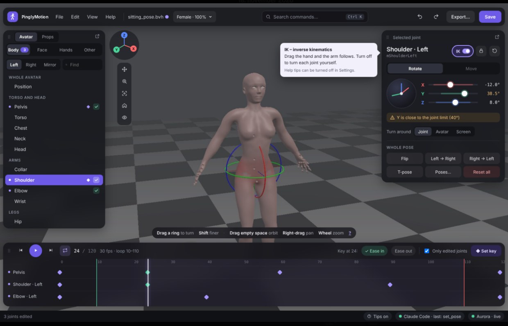
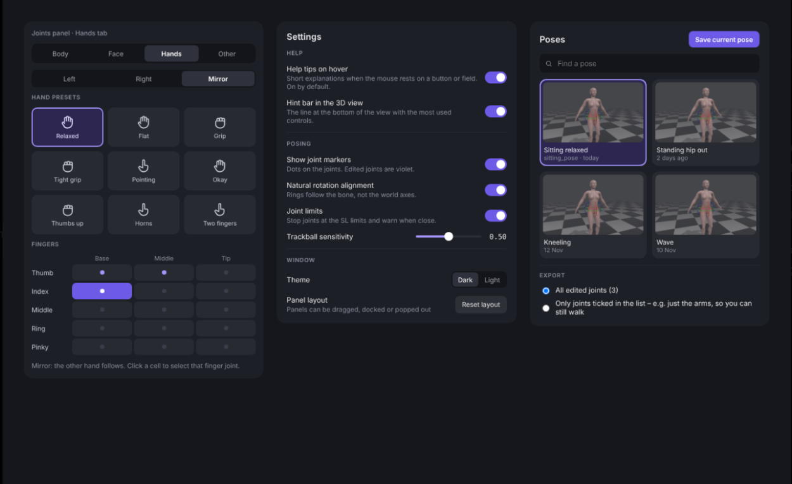
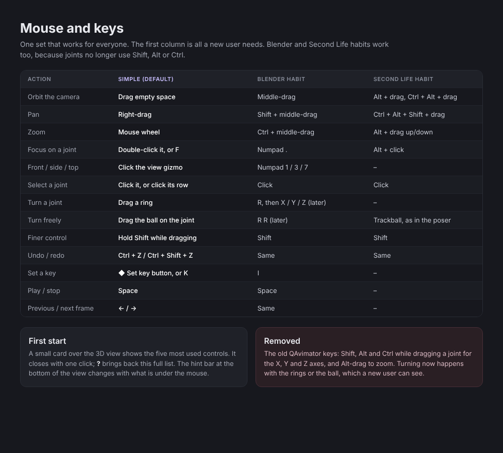

> The design charter (docs/DESIGN_CHARTER.md) wins if this document disagrees.

> Where this page differs from [UX_DECISIONS.md](UX_DECISIONS.md) (20 November 2026), that page wins.

# Posing UX plan (#88)

Agreed with the project owner on 18 November 2026. This page is the plan for the new posing interface: what it should look like, how the mouse and keys work, and the order of the work. Issue #88 tracks it.

The pictures are a **mockup**: they show the direction, not a finished design. The 3D view in them is a real PinglyMotion render; the panels are drawn.

Picture credits: the figure in the 3D view is the "Maxine" variant of the open source Max avatar (https://github.com/RuthAndRoth/Max), CC BY 4.0, rendered by PinglyMotion (see `bin/data/character/max/`). The panels and icons are drawn for this mockup and belong to PinglyMotion (GPLv2 or later, like the rest of the repository).

## Who it is for

New users first: people who want to pose their avatar without knowing animation tools. People with Blender or Second Life viewer habits should feel at home too.

## Where the ideas come from

| Source | What we take | Licence rule |
|---|---|---|
| Aurora viewer (poser and animation editor) | Look and behaviour: friendly joint names, side selector, trackball, whole-pose buttons, edited-joint count | GPLv3: ideas only, no code |
| Firestorm poser | Joint table (names, groups, left/right pairs), 9 hand presets, mirror logic, lock, undo per joint, export selection, World/Avatar/Screen frame | LGPL 2.1: data and code may be reused, keep copyright headers |
| Blender | Mouse and key habits, viewport gizmo, Tab to hide panels | Habits only |
| PinglyMotion | Timeline and key frames: the others only make single poses | – |

## Main window

- The 3D view fills the window. **Joints** (left), **Selected joint** (right) and **Timeline** (bottom) are panels that float over it.
- Panels can be dragged, docked, collapsed or popped out as own windows (useful with two screens). The layout is remembered; **View › Reset layout** brings back the default.
- **Tab** hides and shows all panels. The camera centres the figure in the free area, not behind a panel. On a small screen (1440×900) this matters: with all panels open the free area is about 780×560 pixels.
- Top bar: menu, file name with unsaved mark, figure and size, **command search (Ctrl + K)**, undo / redo, Export, Save.
- **Joints panel:** Avatar / Props switch; tabs Body / Face / Hands / Other (done in #126); Left / Right / Mirror; search; friendly names under section headings; violet dot on edited joints; key marker; tick for "include in export".
- **Selected joint:** friendly name and SL name; IK switch; lock; reset; Rotate / Move (Move only for the pelvis and the avatar position); trackball plus X / Y / Z sliders with value fields; the allowed range is shown on each slider and a warning appears near a joint limit (#59, #129); "Turn around: Joint / Avatar / Screen"; whole pose: Flip, Left → Right, Right → Left, T-pose, Poses…, Reset all.
- **Timeline:** full width; only edited joints by default; loop range; the easing of the selected key's pose change as a row of six tiles (done in #53 step 5, replaces the ease in / out check boxes); Set key.
- **Status bar:** the remote-control indicator from #43 (Claude), the Aurora link status and a "Tips on" switch, all in one place.
- **Help:** short help text when the mouse rests on a control. **On by default**, can be turned off in Settings. A hint bar in the 3D view shows the most used controls for what is under the mouse; `?` opens the full list.
- No **Scale**: BVH and SL `.anim` cannot store joint scale.

## Hands tab, settings and poses

- **Hands tab:** Firestorm's 9 hand presets and a finger grid (finger × base / middle / tip). With Mirror the other hand follows.
- **Settings:** help tips (on by default), hint bar, joint markers, natural rotation alignment, joint limits, trackball sensitivity, theme, reset layout.
- **Poses:** a pose library with pictures, and the export choice: all edited joints, or only the joints ticked in the list (for example only the arms, so walking still works).

## Mouse and keys

One scheme for everyone. The first column is all a new user needs; the other two also work.

| Action | Simple (default) | Blender habit | Second Life habit |
|---|---|---|---|
| Orbit the camera | Drag empty space | Middle-drag | Alt + drag, Ctrl + Alt + drag |
| Pan | Right-drag | Shift + middle-drag | Ctrl + Alt + Shift + drag |
| Zoom | Mouse wheel | Ctrl + middle-drag | Alt + drag up/down |
| Focus on a joint | Double-click it, or F | Numpad . | Alt + click |
| Front / side / top | Click the view gizmo | Numpad 1 / 3 / 7 | – |
| Select a joint | Click it, or its row | Click | Click |
| Turn a joint | Drag a ring | R, then X / Y / Z (later) | – |
| Turn freely | Drag the ball on the joint | R R (later) | Trackball |
| Finer control | Hold Shift while dragging | Shift | Shift |
| Undo / redo | Ctrl + Z / Ctrl + Shift + Z | Same | Same |
| Set a key | Set key button, or K | I | – |
| Play / stop | Space | Space | – |
| Previous / next frame | ← / →, or the Frame back / Frame forward buttons (stop at the first and last frame) | Same | – |

Orbiting turns the camera between 80 degrees above and 80 degrees below the floor, so the figure can also be seen from below. It stops just before straight up or straight down, so the view never flips.

**Removed:** the old QAvimator keys (Shift, Alt, Ctrl while dragging a joint for X, Y, Z, and Alt-drag to zoom). They clash with the Second Life camera keys, and a new user cannot see them. Joints now turn with the rings or the trackball.

**Done in step 1** (camera and keys, `src/animationview.*`, `src/camera.*`):

- The camera turns around the point in the middle of the view. Focus (double-click, F, number pad `.`, Alt + click) puts the joint there, so the camera then turns around that joint.
- A left click selects; a left drag that starts on the body turns the camera too (the joint is not selected then). Rings and prop handles keep the left drag.
- Number pad: 1 front, 3 side (from the figure's right), 7 top; Ctrl + 1 back, Ctrl + 3 the other side. With Num Lock off the same keys work. Number pad `,` (decimal comma keyboards) also focuses.
- Wheel and drag zoom move a share of the distance (closer = smaller steps). Page Up / Page Down still zoom; F9–F12 still restore stored cameras (Shift + F9–F12 store).
- Until the selected-joint card has an IK switch (step 4), **Ctrl + double-click** a hand or foot switches IK on or off (it used to be a plain double-click). **Shift + double-click** still selects the mirrored joint too.
- Shift / Ctrl still show the scale / rotate handles of a selected prop.
- Not yet: the view gizmo, Set key with K / I, R then X / Y / Z, the trackball.

**Done in step 2** (joint list, `src/jointlist.*`, `src/pinglymotionwindow.*`):

- The joint list shows friendly names from the Firestorm data (`bin/data/firestorm/joints.json`): "Forearm", not `lForeArm`. The joints stand under section headings in Firestorm's order: Body, Left Arm, Right Arm, Legs; Head, Forehead/Brows, Eyes/Eye Lids …; Left Hand, Right Hand; Tail, Hind Limbs, Wings. The face root and the skull, which Firestorm lists without a heading, stand under "Head". The position track is called "Avatar Position" and comes first.
- When the mouse rests on a joint, its Second Life name (and the name in the animation file, if different) is shown. The selected-joint card will show the SL name later (step 4).
- A search box under the tabs finds joints on all tabs. Every word typed must be found in the friendly name, the heading, the SL name or the file name ("left wrist", "mElbowLeft"). Enter picks the first joint found. Clicking a tab clears the search. Clicking a joint in the 3D view keeps the search if the joint is among the results, otherwise the search is cleared and the list switches to the joint's tab.
- Joints the data does not know (a file with another skeleton) are listed by their file name under "Other joints". If the data file is missing, the list falls back to file names.
- Not yet: the violet dot on edited joints, the key marker and the export tick (later steps).

**Done in step 3, jobs P1 to P6** (`src/panellayout.h`, `src/panelwindow.h`, `src/pinglymotionwindow.*`, `src/paneltitlebar.*`):

- Three panels around the 3D view: **Joints** (left: Avatar / Props switch, joint tabs, search and list, or the prop list), **Selected joint** (right: the rotation and position boxes of the joint, or the prop position, scale and rotation boxes) and **Timeline** (bottom: tracks, the Start, Stop, Replay from start, Frame back and Frame forward buttons with the Loop switch, key, loop in / out, frame count and FPS). They are Qt dock widgets, not overlays (the choice is explained in [PANELS_PLAN.md](PANELS_PLAN.md)); each goes only where its shape fits, panels on one side can be tabbed together, and each can float as its own window.
- The **View** menu: Joints, Selected joint, Timeline (ticks), Reset layout. The old Options items for the panels are gone.
- The layout is saved as `panel_layout` with `panel_layout_version`; a layout of another version (for example the old `window_state` with the Properties panel) is not loaded. The window's place, size, maximised state and screen are saved as `main_window_geometry` (Qt's `saveGeometry`); the old width and height are read once and never written again. A floating panel whose saved place is on no screen is pulled back. **View > Reset layout** applies a default built in code (`src/panelwindow.h`).
- **Tab** hides all open panels (docked and floating) and Tab again shows the same ones; also **View > Hide panels** (Tab shown as its shortcut). Tab is taken only while the 3D view has the keys, so it still moves between fields in the panels and in the search box. The hidden state is not saved: the program starts with the panels shown.
- A popped-out panel keeps its place and size on a second screen (saved and loaded with the rest of the layout) and is pulled back onto the main screen if that screen is gone at the next start. Panels docked or tabbed together move as one when dragged (`GroupedDragging`). The title bar's own area, not just its float button, can be double clicked to float a docked panel or dock a floating one back.
- The figure sits in the middle of the free area, not behind a floating panel (P5, done: `PanelLayout::freeArea()` and the lens shift in `src/camera.h`).

## Language

English only for now. All interface text goes through `tr()`, so translations can be added later without code changes. Help texts are written in simple English.

## Order of work

One pull request per step, tested on Windows before it is merged. Steps that change the same files run one after another.

1. Camera and keys (new scheme, old joint modifiers removed) – `src/animationview.*` (done)
2. Friendly names, section headings and search in the joint list (done)
3. Floating, movable panels; Tab to hide; reset layout (plan: [PANELS_PLAN.md](PANELS_PLAN.md); P1 to P6 done: three panels, View menu, versioned layout, window and layout remembered, Tab, figure in the free area, two screens)
4. Selected-joint card: trackball, sliders, limit warning, turn-around frame
5. Left / Right / Mirror and the whole-pose buttons (shared left/right mapping)
6. Hands tab: presets and finger grid
7. Timeline: only edited joints, loop range; the ease chips are the easing tile row (done in #53 step 5, [EASING.md](EASING.md))
8. Status bar: Claude and Aurora status, tips switch (done)
9. Help tips and hint bar, `?` controls list
10. Command search
11. Pose library and export selection
12. Settings page
13. Visual polish (theme, spacing, icons) and an own PinglyMotion icon
14. The 3D view follows the tab (only that group's joints shown and clickable)

Preparation that can run beside step 1: a data file with Firestorm's joint names, groups, left/right pairs and hand presets (with its licence notice), used by steps 2, 5 and 6.
